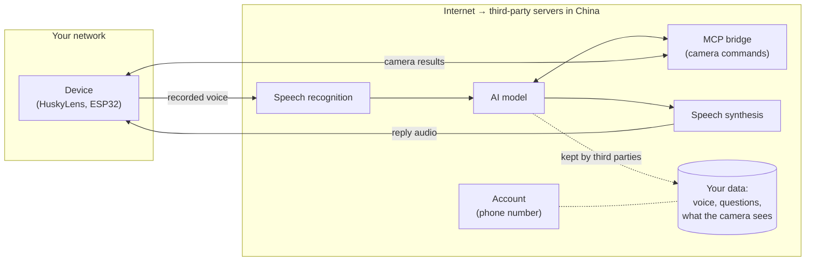
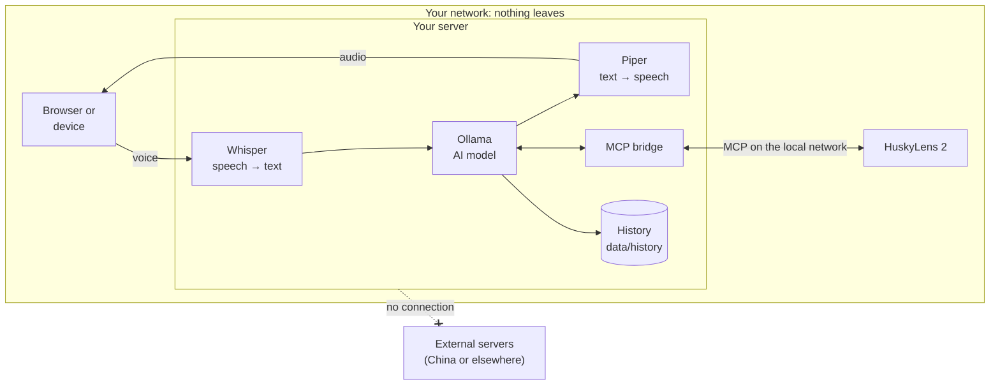

# Privacy: your data stays on your server

🇮🇹 [Italiano](PRIVACY.md) · 🇬🇧 English

**The point is simple: no data is sent to external servers.** Not to the xiaozhi.me servers in China, not to any
other Internet service. Voice, questions, answers, camera results and history are processed and stored **only on
your server**, the computer where you install Husky locale.

## Why it matters

With the `xiaozhi.me` cloud service, everything you say, and everything the camera sees, goes through servers in
China run by third parties. You have no control over how that data is stored, used or shared.



## How Husky locale works

Everything the cloud used to do is now done by your server, **MCP included**: the HuskyLens talks directly to your
server over the local network instead of going through the cloud in China.



## Where each piece of data ends up

| Data | Processed by | Stored in | Sent outside? |
|---|---|---|---|
| Your voice | Whisper, on your server | nowhere: the audio is transcribed and discarded | **No** |
| Questions and answers | Ollama, on your server | **history on your disk**, **encrypted**, deleted after 30 days | **No** |
| Camera commands and results (MCP) | MCP bridge on your server ↔ HuskyLens on the local network | in the history, as part of the answer | **No** |
| Photos for visual analysis (optional) | local vision model | nowhere | **No** |
| Local accounts (username, password, 2FA) | on your server | `data/users.json`: scrypt password hashes, encrypted 2FA secrets | **No** |
| Authorised devices | on your server | `data/devices.json` | **No** |
| Phone number, e-mail, personal data | not required | — | — |

### Conversation history

Conversations are saved on your server's disk, so you can read them again at
**`http://SERVER-IP:8000/cronologia`**: one file per day in `data/history/YYYY-MM-DD.jsonl`.

- They stay **only** there: they are never synced or uploaded anywhere, and the `data/` folder is excluded from
  Git, so it never ends up on GitHub.
- You can delete a day from the history page, or delete the folder.
- In `data/config.yaml`:
  ```yaml
  history:
    enabled: true     # false = save nothing
    keep_days: 30     # automatically delete older conversations (checked hourly); 0 = keep forever
  security:
    encrypt_data: true    # history and 2FA secrets encrypted (AES-256-GCM)
  ```
- **Encryption**: history files and 2FA secrets are encrypted, so whoever copies the folder without the key
  (`data/encryption.key`) cannot read them. The key lives on the same computer, though: against theft of the whole disk
  use disk encryption (BitLocker on Windows, LUKS on Linux), or move the key to another medium with `security.key_file`.
- If you set a token (`server.tokens`), it is also required to view the history.

## When the program uses the Internet

**Only during installation**, and only to download programs and models: none of your data is sent.

| What | From |
|---|---|
| Python packages | pypi.org |
| Ollama (program) | github.com/ollama |
| Language model | Ollama registry (ollama.com) |
| Whisper (speech recognition) | huggingface.co |
| Piper voice | huggingface.co |

Afterwards, while in use, the assistant needs **no connections to the Internet**:
- the server switches to offline mode on its own (`HF_HUB_OFFLINE=1`) when the models are already downloaded;
- Ollama only listens on `127.0.0.1`, so only the server itself can reach it;
- **the server checks this by itself**: if `llm.base_url` or an MCP address pointed to the Internet (e.g. an online AI
  service), it refuses to start and explains why. Allowing it requires writing `privacy.allow_external: true`. The Admin
  page lists the addresses and whether they are local;
- the server's only outgoing connections go to Ollama (local) and to the `mcp_servers` addresses you write in
  `data/config.yaml` (the HuskyLens on your local network).

**The only exception, under your control: updates.** The Admin page asks GitHub whether a new version was
released (when the page opens, or with the button) and downloads it only if you press "Update". That request sends
**no data**: no conversations, no users, no information about the server. To skip even the check on page open, set
`update.check_on_admin_open: false` in `data/config.yaml`.

The automated test suite checks this too: after all tests it verifies that the server opened no connection to
the Internet.

## How to verify it yourself

1. **The simplest test**: after installation, unplug the network cable or turn off Wi-Fi and use the assistant.
   If it answers, it is not using the Internet.
2. **Check active connections**:
   - Windows: `powershell -ExecutionPolicy Bypass -File verifica_privacy.ps1`
     (lists the connections of the server and Ollama and flags in red any going to the Internet);
   - Linux: `ss -tnp | grep -E 'python|ollama'` (only `127.0.0.1` or your local network addresses should appear).
3. **Read the code**: it is all in `xiaozhi_locale/`, a few hundred lines.

## Where the components come from

They are all programs and files running on your server: none of them "phones home".

| Component | Author | License |
|---|---|---|
| This project's code | Husky locale authors | GPL-3.0 |
| faster-whisper / Whisper | SYSTRAN / OpenAI | MIT |
| Piper (speech synthesis) | Open Home Foundation | GPL-3.0 |
| Ollama | Ollama | MIT |
| Qwen3 4B (default model) | Alibaba Qwen | Apache-2.0 |
| xiaozhi protocol | xiaozhi-esp32 open source project | MIT |

The Qwen3 model is developed in China, but it is just a file running on your server, with no connections.
If you prefer another origin, you can use for example `llama3.1:8b` (Meta) or `mistral-nemo` (Mistral, France)
in `data/config.yaml`.

## Local network security

- The server answers on port 8000 of your local network: **do not expose that port to the Internet** on your router.
- Using the assistant, the history and the admin pages requires an **account** (username and password, plus
  **2FA** if you want). After 5 wrong passwords the account is locked for 15 minutes; there are anti-spam limits per IP
  and per user. Details in the [README](README.en.md#6-accounts-2fa-and-anti-bot-protection).
- xiaozhi devices can connect only after the admin approves them (6-digit code).
- If the server must be reachable from the Internet, use a reverse proxy with HTTPS (Caddy, nginx).
