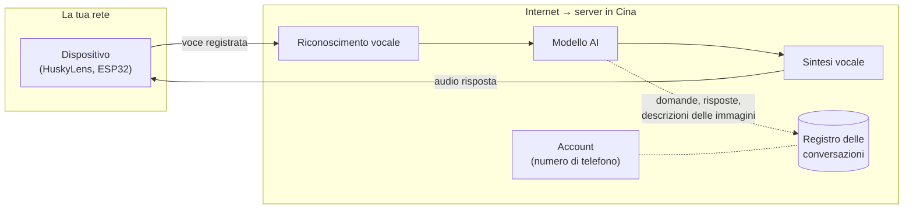
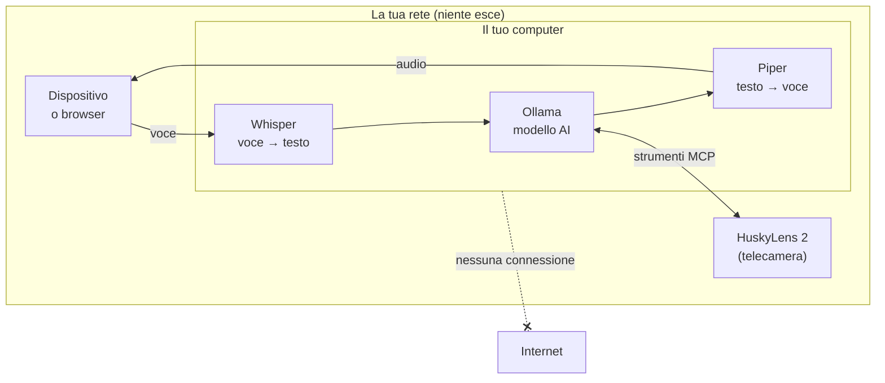

# Privacy: dove vanno i tuoi dati

**In breve: da nessuna parte.** Dopo l'installazione, Husky locale non contatta nessun server su Internet:
né in Cina, né negli Stati Uniti, né altrove. Voce, testo, risposte e immagini restano sul computer che fa
da server e sulla tua rete locale.

## Confronto con il servizio cloud originale

Con il servizio cloud `xiaozhi.me` ogni frase fa il giro del mondo:

Con Husky locale tutto avviene dentro la tua rete:

## Cosa succede ai dati, passo per passo

| Dato | Dove viene elaborato | Viene salvato? |
|---|---|---|
| La tua voce | Whisper, sul computer server | **No**: resta in memoria (RAM) solo il tempo di trascriverla |
| Il testo delle domande | Ollama, sul computer server | **No**: resta in RAM per la memoria della conversazione e viene cancellato alla disconnessione |
| Le risposte | Ollama + Piper, sul computer server | **No** |
| Le immagini della telecamera | HuskyLens stessa (e, se attivato, un modello visivo locale) | **No**: l'eventuale foto vive in RAM solo durante la richiesta |
| Account, numero di telefono, e-mail | non richiesti | — |

Il server **non scrive su disco** né audio né testi né immagini. L'unica cosa che può comparire è la
trascrizione stampata nel terminale, utile per il debug, che non viene salvata. Si disattiva con
`server.log_transcripts: false` in `config.yaml`.

## Quando il programma usa Internet

**Solo durante l'installazione**, per scaricare:

| Cosa | Da dove |
|---|---|
| Pacchetti Python | pypi.org |
| Ollama (programma) | github.com/ollama |
| Modello linguistico | registry di Ollama (ollama.com) |
| Whisper (riconoscimento vocale) | huggingface.co |
| Voce italiana Piper | huggingface.co |

Poi niente. Il server attiva da solo la modalità offline (`HF_HUB_OFFLINE=1`) quando trova i modelli già
scaricati, e Ollama ascolta solo su `127.0.0.1`, quindi non è raggiungibile nemmeno dagli altri PC della rete.

## Come verificarlo tu stesso

1. **La prova più semplice**: stacca il cavo di rete o il Wi-Fi dopo l'installazione e usa l'assistente.
   Se risponde, non sta usando Internet.
2. **Controllare le connessioni attive**:
   - Windows: `powershell -ExecutionPolicy Bypass -File verifica_privacy.ps1`
     (elenca le connessioni del server e di Ollama e segnala in rosso quelle verso Internet)
   - Linux: `ss -tnp | grep -E 'python|ollama'` (devono comparire solo indirizzi `127.0.0.1` o della tua rete)
3. **Leggere il codice**: è tutto in `xiaozhi_locale/`. Le uniche connessioni in uscita sono verso
   `llm.base_url` (Ollama, in locale) e verso gli indirizzi `mcp_servers` (la HuskyLens in rete locale)
   che scrivi tu in `config.yaml`.

## Da dove vengono i componenti

Nessun componente "telefona a casa": sono tutti file o programmi che girano sul tuo computer.

| Componente | Autore | Licenza |
|---|---|---|
| Codice di questo progetto | autori di Husky locale | GPL-3.0 |
| faster-whisper / Whisper | SYSTRAN / OpenAI | MIT |
| Piper (sintesi vocale) | Open Home Foundation | GPL-3.0 |
| Ollama | Ollama | MIT |
| Qwen3 4B (modello predefinito) | Alibaba Qwen | Apache-2.0 |
| Protocollo xiaozhi | progetto open source xiaozhi-esp32 | MIT |

Il modello Qwen3 è sviluppato in Cina, ma funziona come un file chiuso sul tuo computer, senza connessioni.
Se preferisci modelli di altra origine, in `config.yaml` puoi usare per esempio `llama3.1:8b` (Meta)
o `mistral-nemo` (Mistral, Francia).

## Sicurezza in rete locale

- Il server risponde sulla porta 8000 della rete locale: **non aprire quella porta su Internet** (router).
- Per limitare chi può collegarsi imposta un token in `config.yaml`:
  `server.tokens: ["una-parola-segreta"]`. Chi non lo conosce viene rifiutato (HTTP 401).
