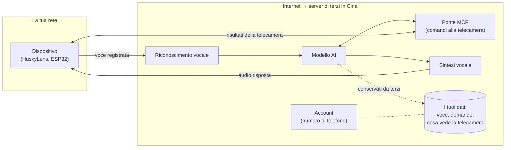
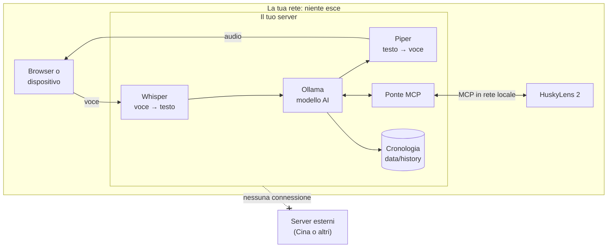

# Privacy: i tuoi dati restano sul tuo server

🇮🇹 Italiano · 🇬🇧 [English](PRIVACY.en.md)

**Il punto è uno solo: nessun dato viene inviato a server esterni.** Né ai server cinesi di xiaozhi.me, né a
nessun altro servizio su Internet. Voce, domande, risposte, risultati della telecamera e cronologia vengono
elaborati e conservati **solo sul tuo server**, cioè il computer su cui installi Husky locale.

## Perché serve

Con il servizio cloud `xiaozhi.me` ogni cosa che dici, e quello che vede la telecamera, passa da server in Cina
gestiti da terzi. Non hai alcun controllo su come quei dati vengano conservati, usati o ceduti.



## Come funziona Husky locale

Tutto quello che prima faceva il cloud ora lo fa il tuo server, **MCP compreso**: la HuskyLens parla
direttamente con il tuo server sulla rete locale, invece di passare dal cloud cinese.



## Dove finisce ogni dato

| Dato | Dove viene elaborato | Dove viene conservato | Inviato fuori? |
|---|---|---|---|
| La tua voce | Whisper, sul tuo server | da nessuna parte: l'audio viene trascritto e scartato | **No** |
| Domande e risposte | Ollama, sul tuo server | **cronologia sul tuo disco** (`data/history`), se attiva | **No** |
| Comandi e risultati della telecamera (MCP) | ponte MCP sul tuo server ↔ HuskyLens in rete locale | nella cronologia, come parte della risposta | **No** |
| Foto per l'analisi visiva (opzionale) | modello visivo locale | da nessuna parte | **No** |
| Account, telefono, e-mail | non richiesti | — | — |

### Cronologia delle conversazioni

Le conversazioni vengono salvate sul disco del tuo server, così puoi rileggerle dalla pagina
**`http://IP-DEL-SERVER:8000/cronologia`**: un file per giorno in `data/history/AAAA-MM-GG.jsonl`.

- Restano **solo** lì: non vengono sincronizzate né caricate da nessuna parte, e la cartella `data/` è esclusa
  da Git, quindi non finisce mai su GitHub.
- Puoi cancellare un giorno dalla pagina della cronologia, oppure cancellare la cartella.
- In `config.yaml`:
  ```yaml
  history:
    enabled: true     # false = non salvare niente
    keep_days: 0      # es. 30 = cancella da sola le conversazioni più vecchie di 30 giorni
  ```
- Se imposti un token (`server.tokens`), serve anche per vedere la cronologia.

## Quando il programma usa Internet

**Solo durante l'installazione**, e solo per scaricare programmi e modelli: non invia nessun tuo dato.

| Cosa | Da dove |
|---|---|
| Pacchetti Python | pypi.org |
| Ollama (programma) | github.com/ollama |
| Modello linguistico | registry di Ollama (ollama.com) |
| Whisper (riconoscimento vocale) | huggingface.co |
| Voce italiana Piper | huggingface.co |

Dopo, durante l'uso, **nessuna connessione verso Internet**:
- il server attiva da solo la modalità offline (`HF_HUB_OFFLINE=1`) quando trova i modelli già scaricati;
- Ollama ascolta solo su `127.0.0.1`, quindi è raggiungibile solo dal server stesso;
- le uniche connessioni in uscita del server vanno verso Ollama (locale) e verso gli indirizzi `mcp_servers`
  che scrivi tu in `config.yaml` (la HuskyLens in rete locale).

Lo controlla anche la suite di test automatica: alla fine verifica che il server non abbia aperto nessuna
connessione verso Internet.

## Come verificarlo tu stesso

1. **La prova più semplice**: dopo l'installazione stacca il cavo di rete o il Wi-Fi e usa l'assistente.
   Se risponde, non sta usando Internet.
2. **Controllare le connessioni attive**:
   - Windows: `powershell -ExecutionPolicy Bypass -File verifica_privacy.ps1`
     (elenca le connessioni del server e di Ollama e segnala in rosso quelle verso Internet);
   - Linux: `ss -tnp | grep -E 'python|ollama'` (devono comparire solo `127.0.0.1` o indirizzi della tua rete).
3. **Leggere il codice**: è tutto in `xiaozhi_locale/`, poche centinaia di righe.

## Da dove vengono i componenti

Sono tutti programmi e file che girano sul tuo server: nessuno "telefona a casa".

| Componente | Autore | Licenza |
|---|---|---|
| Codice di questo progetto | autori di Husky locale | GPL-3.0 |
| faster-whisper / Whisper | SYSTRAN / OpenAI | MIT |
| Piper (sintesi vocale) | Open Home Foundation | GPL-3.0 |
| Ollama | Ollama | MIT |
| Qwen3 4B (modello predefinito) | Alibaba Qwen | Apache-2.0 |
| Protocollo xiaozhi | progetto open source xiaozhi-esp32 | MIT |

Il modello Qwen3 è sviluppato in Cina, ma è solo un file che gira sul tuo server, senza connessioni.
Se preferisci un'altra origine, in `config.yaml` puoi usare per esempio `llama3.1:8b` (Meta)
o `mistral-nemo` (Mistral, Francia).

## Sicurezza in rete locale

- Il server risponde sulla porta 8000 della rete locale: **non aprire quella porta su Internet** dal router.
- Per limitare chi può collegarsi, e chi può leggere la cronologia, imposta un token in `config.yaml`:
  `server.tokens: ["una-parola-segreta"]`. Chi non lo conosce viene rifiutato con HTTP 401.
