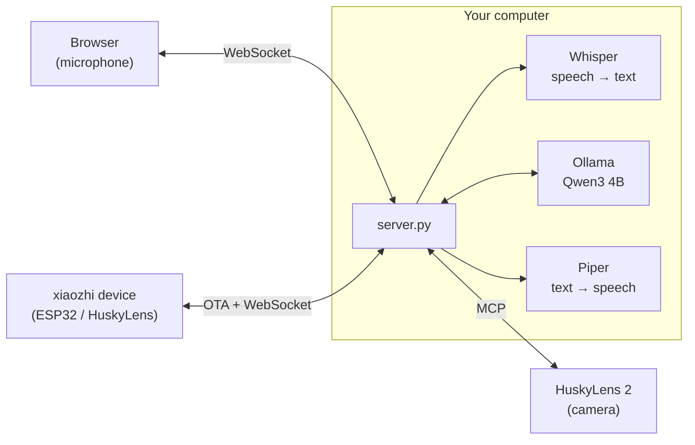

# Husky locale: a privacy-first xiaozhi server

🇮🇹 [Italiano](README.md) · 🇬🇧 English

A **self-hosted**, open source server compatible with [xiaozhi](https://github.com/78/xiaozhi-esp32), to use instead
of the `xiaozhi.me` cloud, with HuskyLens 2 support via MCP.
Voice, transcripts, answers and camera results **never leave your network**: everything runs on your own
computer, Linux or Windows, with or without a GPU.

| | xiaozhi.me (cloud, China) | Husky locale |
|---|---|---|
| Account | phone number + SMS | none |
| Speech → text | remote servers | **faster-whisper** (large-v3-turbo on GPU, small on CPU) |
| Brain (LLM) | cloud models | **Qwen3 4B** via Ollama, on your computer |
| Text → speech | remote servers | **Piper**, on your computer |
| Where your data ends up | third-party servers in China | **only on your server** (history on your disk, if enabled) |
| Camera commands (MCP) | routed through the cloud | from your server straight to the HuskyLens |
| Internet connections while in use | always | **none** |

📄 **[Privacy: where your data goes](PRIVACY.en.md)** · 🧩 **[How the app is built (diagrams)](docs/ARCHITECTURE.md)**

> The assistant speaks Italian by default (Whisper `language: it`, Italian Piper voice, Italian system prompt).
> To use another language, change `asr.language`, `tts.voice` and `assistant.system_prompt` in `config.yaml`
> (see [Other languages](#other-languages)).

## Architecture



The server implements the official xiaozhi-esp32 protocol: OTA, WebSocket with binary framing v1/v2/v3,
Opus at 16 kHz in and 24 kHz out with 60 ms frames, and MCP wrapped in `type: "mcp"` messages
(with `nextCursor` pagination). Details in [docs/ARCHITECTURE.md](docs/ARCHITECTURE.md).

## 1. Automatic installation (once)

Works on **Linux** (Ubuntu/Debian and similar, x86_64 or ARM64) and **Windows 10/11**, with or without an NVIDIA card.
The script installs everything **inside the project folder**: Python environment, portable Ollama (unless it is
already installed), Piper voice, Whisper and the language model. You need about 8 GB of free space and an
Internet connection for this step only.

**Linux**

```bash
git clone https://github.com/BitJacker/xiaozhi-local-server.git && cd xiaozhi-local-server
./install.sh              # or: ./install.sh --service   (start automatically with systemd)
```

On Debian/Ubuntu it installs any missing packages by itself (`python3-venv`, `curl`, `zstd`): root or `sudo` required.

**Windows** (PowerShell, no administrator rights needed)

```powershell
powershell -ExecutionPolicy Bypass -File install.ps1           # add -Service to start automatically at logon
```

Requires [Python 3.10+](https://www.python.org/downloads/) (tick "Add to PATH").

| What | With NVIDIA GPU | Without GPU |
|---|---|---|
| Whisper | `large-v3-turbo` (~1 s per sentence) | `small` on CPU (~2-4 s per sentence) |
| LLM (Ollama) | on the GPU | on the CPU (slower, but works) |

The default language model is `qwen3:4b-instruct-2507-q4_K_M` (2.5 GB): good at Italian and English, supports
tool calling and keeps its safety filters. Change it in `config.yaml` → `llm.model` (other tool-capable options:
`llama3.2:3b`, `llama3.1:8b`, `mistral-nemo`); Ollama downloads it automatically on first start.
Avoid "abliterated" / "uncensored" models: their safety filters have been removed.

Prefer **LM Studio**? Set `base_url: http://localhost:1234/v1` and the LM Studio model name in `config.yaml`.

## 2. Starting

| System | Command |
|---|---|
| Linux | `./start.sh` (or the service: `sudo systemctl status husky-locale`, logs with `journalctl -u husky-locale -f`) |
| Windows | double-click **`avvia.bat`** (also opens the browser) |

After installation the server works **completely offline**: the models are already on the machine and Ollama
only listens on `127.0.0.1`. To check it on Windows: `powershell -ExecutionPolicy Bypass -File verifica_privacy.ps1`;
on Linux: `ss -tnp | grep -E 'python|ollama'`.

The server prints its addresses:

```
  Client web:   http://PC-IP:8000/
  URL OTA:      http://PC-IP:8000/xiaozhi/ota/
  WebSocket:    ws://PC-IP:8000/xiaozhi/v1/
```

## 3. Connecting a HuskyLens 2 (recommended)

1. On the HuskyLens 2 (firmware ≥ 1.1.6, Wi-Fi module fitted, same network as the PC): Settings → **MCP** → enable.
   An address like `http://HUSKYLENS-IP:3000/sse` appears.
2. In `config.yaml`:
   ```yaml
   mcp_servers:
     - name: huskylens
       url: http://HUSKYLENS-IP:3000/sse
   ```
3. **Turn off "Xiaozhi AI"** in the HuskyLens menu, so it stops connecting to xiaozhi.me.
4. Start the server: the log shows `MCP 'huskylens' connesso: N tool`. If the HuskyLens is switched off or
   restarted, the server reconnects automatically.
5. Open `http://localhost:8000/` in Chrome on the server PC, then hold **"Tieni premuto per parlare"** (push to talk)
   or enable **"Conversazione continua"** (hands-free). Try "what do you see?", "switch to face recognition",
   "learn this face and call it Marco".

The PC is the microphone and speaker; the HuskyLens is the "eyes". Camera commands and results travel only between
your server and the HuskyLens on your local network: no cloud in between.

**About the built-in "Xiaozhi AI" on HuskyLens 2**: DFRobot's official guide shows no option to change the server
address, which is fixed to xiaozhi.me. That is why the method above is recommended. If a future firmware allows
setting the OTA address, just use the one from the next section.

## 4. Connecting xiaozhi devices (ESP32)

Any device running the [xiaozhi-esp32](https://github.com/78/xiaozhi-esp32) firmware can use this server instead of
xiaozhi.me:

- **Official firmware**: on the device's Wi-Fi setup page (hotspot `Xiaozhi-xxxx`) → advanced options →
  **OTA address** = `http://PC-IP:8000/xiaozhi/ota/`.
- **Self-built firmware**: `idf.py menuconfig` → `CONFIG_OTA_URL` = the same address.

The server answers the OTA request without activation or firmware updates and points the device to its own WebSocket.
The device's MCP tools (volume, brightness, camera...) are discovered automatically. If you set `llm.vision_model`
(a local vision model) in `config.yaml`, camera photos are analysed at `/xiaozhi/vision/explain`, locally.

## 5. Microphone from other PCs on the network

Browsers only allow the microphone on `localhost` or over HTTPS. From another PC:
- the text box always works;
- for the microphone, open `chrome://flags/#unsafely-treat-insecure-origin-as-secure` in Chrome, add
  `http://PC-IP:8000` and restart Chrome (only on a trusted local network).

Microphone filters, configurable in the URL:

| Parameter | Default | Effect |
|---|---|---|
| `ec` | `1` | echo cancellation |
| `ns` | `0` | Chrome noise suppression (add `?ns=1` in very noisy rooms) |
| `agc` | `1` | automatic gain control |

If end-of-sentence detection triggers too early or too late, tune `vad.energy_threshold` and `vad.silence_ms`
in `config.yaml`.

## 6. Privacy, history and security

- **No data is sent to external servers**: not to the xiaozhi.me servers in China, not to anyone else. Voice,
  questions, answers and camera commands (MCP) stay on your server and your network. Details and how to verify
  it in [PRIVACY.en.md](PRIVACY.en.md).
- **History**: conversations are saved on your server's disk (`data/history`) and can be read at
  `http://IP:8000/cronologia`, where you can also delete a day. Turn it off with `history.enabled: false`;
  `history.keep_days` deletes old conversations automatically.
- The only Internet connections happen during installation, to download programs and models.
- With `server.tokens: ["a-secret-word"]` a token is required to connect and to read the history
  (web client: `http://IP:8000/?token=a-secret-word`). Wrong tokens are rejected with HTTP 401.

## Other languages

Everything runs locally, so switching language only means changing three settings in `config.yaml`:

```yaml
assistant:
  system_prompt: |
    You are Husky, a friendly voice assistant. Always answer in English, in short sentences...
asr:
  language: en
tts:
  voice: models/piper/en_US-lessac-medium.onnx
```

Download the voice once with `python -m piper.download_voices --download-dir models/piper en_US-lessac-medium`
(list of voices: [rhasspy/piper-voices](https://huggingface.co/rhasspy/piper-voices)). The web interface labels are in Italian.

## 7. Tests

With Ollama running (`./start.sh` or `avvia.bat`, or Ollama alone), after `pip install -r requirements-dev.txt`:

```bash
.venv\Scripts\python tests\run_all.py
```

It starts a simulated HuskyLens and a test server (port 8079, token `test123`), then runs:

**`tests/test_suite.py`** (28 checks)
- OTA POST/GET, `activate`
- wrong or missing token rejected
- `hello`, MCP connection to the HuskyLens
- voice → device tool with protocol v1, v2 and v3 (tools across 2 pages)
- push-to-talk and hands-free modes
- conversation memory within a session
- history saved to disk, protected by the token and against invalid paths
- visual question → HuskyLens tool
- interruption (`abort`)
- wake word with background noise only → no answer
- PCM web client
- vision endpoint
- latency
- 3 devices in parallel

**`tests/browser_mic_test.py`**
- real Chrome with a microphone simulated from an audio file: push-to-talk, hands-free and text
- reply audio played back
- no JavaScript errors

**Network check**: at the end it verifies that the server opened **no connections to the Internet**.

Other tests:
- `tests/raw_sse_mcp.py`: hand-written MCP server (protocol 2024-11-05), to check compatibility with
  implementations other than the SDK.
- `tests/bench_parallel.py`: timings with 1, 3 and 4 devices at once.
- `tests/fake_device.py` + `tests/mock_llm.py`: test without a language model.

### Measured results

**Windows 11, GTX 1060 6 GB** (Whisper large-v3-turbo on GPU, Ollama with Qwen3 4B fully on GPU)

| Measure | Value |
|---|---|
| End of sentence → first reply audio | ~2.5 s |
| Transcribing one sentence | ~0.9 s |
| 1 device, full question | ~5 s |
| 3-4 devices at once | 15-18 s (shared GPU) |
| Video memory used | ~4.1 GB of 6 (LLM context 8192 tokens, q8_0 cache) |

**Ubuntu 24.04 without GPU** (clean install with `install.sh`, Whisper small on CPU): works, with answers in
about 5-10 s. Slower, but usable.

Both installers were tested **from scratch** on clean machines: `install.ps1` on Windows and `install.sh` on
Ubuntu 24.04 (including the automatic download of Ollama and the model, and offline operation).

## Known limitations

- Not yet tested with a physical HuskyLens 2: tests use two simulators (one built on the official MCP SDK, one
  hand-written with protocol 2024-11-05). The server discovers the real tools automatically anyway.
- The `systemd` service (`install.sh --service`) is generated by the script but has not been tested on a server
  with systemd running.
- With more than 3-4 simultaneous devices, answers slow down (single GPU).
- In hands-free mode you cannot interrupt by voice while it is speaking (the microphone is ignored meanwhile, so
  it does not hear itself): use the button.
- The synthetic test voice (Piper) is sometimes mis-transcribed: this does not affect real voices.

## Files

| File | Content |
|---|---|
| `install.sh` / `install.ps1` | automatic installation, Linux / Windows |
| `start.sh` / `start.ps1` / `avvia.bat` | start (Ollama + server) |
| `scripts/download_models.py` | download of the speech models |
| `server.py` | server entry point |
| `config.yaml` | configuration |
| `xiaozhi_locale/app.py` | HTTP routes: OTA, WebSocket, vision, web client, history |
| `xiaozhi_locale/session.py` | xiaozhi protocol for each connection |
| `xiaozhi_locale/audio.py` | Opus encoding/decoding (PyAV) and end-of-sentence detection |
| `xiaozhi_locale/engines.py` | Whisper (speech recognition) and Piper (speech synthesis) |
| `xiaozhi_locale/llm.py` | local LLM with tool calling |
| `xiaozhi_locale/tools.py` | device MCP and external MCP (HuskyLens) |
| `xiaozhi_locale/history.py` | history saved on the server's disk |
| `web/index.html` | web client with microphone |
| `web/cronologia.html` | history page |
| `PRIVACY.md` / `PRIVACY.en.md` | where data goes and how to verify it |
| `docs/ARCHITETTURA.md` / `docs/ARCHITECTURE.md` | diagrams: components, request flow, installation, tests |

## License

[GPL-3.0](LICENSE): the project uses Piper (GPL-3.0) for speech synthesis. Models downloaded during installation
have their own licenses (Qwen3: Apache-2.0, Whisper: MIT, Piper voices: see each voice's model card).

Independent project, not affiliated with xiaozhi, DFRobot (HuskyLens) or Ollama.
