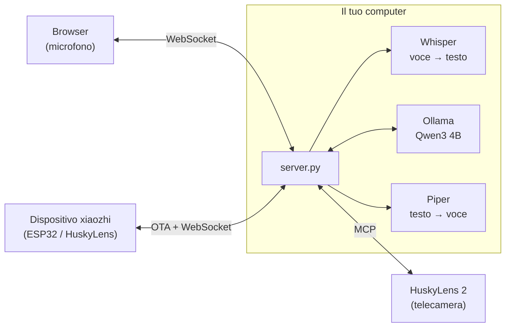
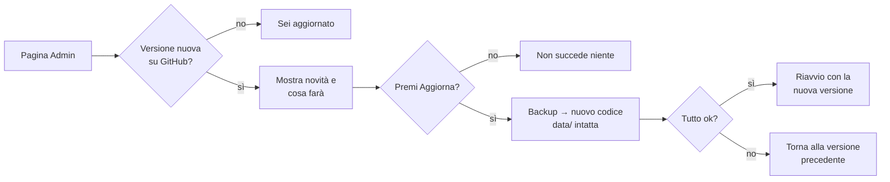

# Husky locale: server xiaozhi privacy-first

🇮🇹 Italiano · 🇬🇧 [English](README.en.md)

Server **locale** e open source compatibile con [xiaozhi](https://github.com/78/xiaozhi-esp32), da usare al posto
del cloud `xiaozhi.me`, con supporto a HuskyLens 2 via MCP.
Voce, trascrizioni, risposte e immagini **non escono dalla tua rete**: tutto gira su un tuo computer,
Linux o Windows, con o senza GPU.

| | xiaozhi.me (cloud, Cina) | Husky locale |
|---|---|---|
| Account | numero di telefono + SMS | nessuno |
| Voce → testo | server remoti | **faster-whisper** (large-v3-turbo su GPU, small su CPU) |
| Cervello (LLM) | modelli cloud | **Qwen3 4B** con Ollama, sul tuo computer |
| Testo → voce | server remoti | **Piper** (voce italiana), sul tuo computer |
| Dove finiscono i dati | server di terzi in Cina | **solo sul tuo server** (cronologia sul tuo disco, se attiva) |
| Comandi alla telecamera (MCP) | passano dal cloud | dal tuo server direttamente alla HuskyLens |
| Connessioni a Internet durante l'uso | sempre | **nessuna** |
| Accesso | account sul cloud | **utenti locali con password e 2FA**, protezione anti-bot |
| Aggiornamenti | decisi dal cloud | **pulsante "Aggiorna"** nella pagina Admin, i tuoi dati restano |

📄 **[Privacy](docs/PRIVACY.md)** · 🧩 **[Come è fatta l'app](docs/ARCHITETTURA.md)** · 🔄 **[Novità delle versioni](CHANGELOG.md)** · 💬 **[Chiedere una modifica](#9-chiedere-modifiche-e-aggiornare)** · ✉️ **[giacomo.dev@icloud.com](mailto:giacomo.dev@icloud.com)**

## Architettura



Il server implementa il protocollo ufficiale xiaozhi-esp32: OTA, WebSocket con framing binario v1/v2/v3,
Opus a 16 kHz in ingresso e 24 kHz in uscita con frame da 60 ms, e MCP incapsulato nei messaggi `type: "mcp"`
(con paginazione `nextCursor`). I dettagli sono in [docs/ARCHITETTURA.md](docs/ARCHITETTURA.md).

## 1. Installazione automatica (una volta)

Funziona su **Linux** (Ubuntu/Debian e simili, x86_64 o ARM64) e su **Windows 10/11**, con o senza scheda NVIDIA.
Lo script installa tutto **dentro la cartella del progetto**: ambiente Python, Ollama portatile (se non è già
installato), voce italiana, Whisper e il modello linguistico. Servono circa 8 GB liberi e una connessione
a Internet solo per questo passaggio.

**Linux**

```bash
git clone https://github.com/BitJacker/xiaozhi-local-server.git && cd xiaozhi-local-server
./install.sh              # oppure: ./install.sh --service   (avvio automatico con systemd)
```

Su Debian/Ubuntu installa da solo i pacchetti mancanti (`python3-venv`, `curl`, `zstd`): serve root o `sudo`.

**Raspberry Pi e computer senza GPU con poca RAM**: `install.sh` sceglie da solo un **profilo leggero**
(Whisper `base`, modello `qwen2.5:3b` con 8 GB di RAM o `qwen2.5:1.5b` con 4 GB) e lo scrive in `data/config.yaml`.
Si può forzare con `./install.sh --light` (o `--full` per il profilo normale). Il profilo leggero è stato provato
su Linux senza GPU; **su un Raspberry Pi vero i tempi non sono ancora stati misurati**: aspettati risposte più lente
che su un PC (decine di secondi con il Pi 4, meno con il Pi 5).

**Windows** (PowerShell, nessun permesso di amministratore)

```powershell
powershell -ExecutionPolicy Bypass -File install.ps1           # oppure aggiungi -Service per l'avvio all'accesso
```

Serve [Python 3.10+](https://www.python.org/downloads/) (spunta "Add to PATH").

| Cosa | Con GPU NVIDIA | Senza GPU |
|---|---|---|
| Whisper | `large-v3-turbo` (~1 s per frase) | `small` su CPU (~2-4 s per frase) |
| LLM (Ollama) | sulla GPU | sulla CPU (più lento ma funziona) |

Il modello linguistico predefinito è `qwen3:4b-instruct-2507-q4_K_M` (2,5 GB): buono in italiano, sa usare gli
strumenti e ha i filtri di sicurezza attivi. Si cambia in `data/config.yaml` → `llm.model` (alternative con supporto
ai tool: `llama3.2:3b`, `llama3.1:8b`, `mistral-nemo`); al primo avvio Ollama lo scarica da solo.
Evita i modelli "abliterated" / "uncensored": hanno i filtri rimossi.

Preferisci **LM Studio**? In `data/config.yaml` metti `base_url: http://localhost:1234/v1` e il nome del modello di LM Studio.

## 2. Avvio

| Sistema | Comando |
|---|---|
| Linux | `./start.sh` (oppure il servizio: `sudo systemctl status husky-locale`, log con `journalctl -u husky-locale -f`) |
| Windows | doppio clic su **`avvia.bat`** (apre anche il browser) |

Dopo l'installazione il server lavora **completamente offline**: i modelli sono già sulla macchina e
Ollama ascolta solo su `127.0.0.1`. Per verificarlo su Windows: `powershell -ExecutionPolicy Bypass -File scripts\verifica_privacy.ps1`;
su Linux: `ss -tnp | grep -E 'python|ollama'`.

Il server stampa i suoi indirizzi:

```
  Husky locale v1.2.1   (dati in .../data)
  Client web:   http://IP-DEL-PC:8000/
  URL OTA:      http://IP-DEL-PC:8000/xiaozhi/ota/
  WebSocket:    ws://IP-DEL-PC:8000/xiaozhi/v1/

  PRIMO AVVIO: apri http://IP-DEL-PC:8000/login
  e crea l'amministratore con questo codice:  12345678
```

**Al primo avvio** apri la pagina indicata e crea l'amministratore usando il codice mostrato nel terminale.
Il codice cambia a ogni avvio e si vede solo sul server, così nessun altro può "prendersi" il server appena
installato. Subito dopo ti viene proposto di attivare la verifica in due passaggi (2FA).

**Le tue impostazioni** vanno in `data/config.yaml`, non in `config.yaml`: scrivi solo le voci che vuoi
cambiare, con la stessa struttura. `config.yaml` contiene i valori predefiniti e viene sostituito dagli aggiornamenti.

## 3. Collegare HuskyLens 2 (metodo consigliato)

1. Su HuskyLens 2 (firmware ≥ 1.1.6, modulo Wi-Fi montato, stessa rete del PC): Impostazioni → **MCP** → attiva.
   Compare un indirizzo tipo `http://IP-DI-HUSKYLENS:3000/sse`.
2. In `data/config.yaml`:
   ```yaml
   mcp_servers:
     - name: huskylens
       url: http://IP-DI-HUSKYLENS:3000/sse
   ```
3. **Disattiva "Xiaozhi AI"** nel menu di HuskyLens, così smette di collegarsi a xiaozhi.me.
4. Avvia il server: nel log compare `MCP 'huskylens' connesso: N tool`. Se HuskyLens si spegne o si
   riavvia, il server si ricollega da solo.
5. Apri `http://localhost:8000/` in Chrome sul PC del server. Poi tieni premuto **"Tieni premuto per parlare"**
   oppure attiva **"Conversazione continua"**. Prova "cosa vedi?", "passa al riconoscimento facciale",
   "impara questa faccia e chiamala Marco".

**Permessi**: gli utenti normali possono solo *leggere* dalla telecamera (risultati, elenchi, foto); far imparare
o dimenticare oggetti, cambiare modalità o parametri resta ad admin e dispositivi. La tabella completa è nella pagina
**Admin**; si cambia con `tool_permissions` in `data/config.yaml`.

Se uno strumento restituisce un'**immagine** (es. una foto), viene descritta dal modello visivo locale se c'è
(`llm.vision_model`, per esempio `qwen2.5vl:3b` con Ollama); altrimenti l'assistente lo dice chiaramente.

Il PC fa da microfono e altoparlante, HuskyLens fa da "occhi". I comandi alla telecamera e i risultati passano
solo tra il tuo server e la HuskyLens, in rete locale: nessun cloud in mezzo.

**Nota sul "Xiaozhi AI" integrato in HuskyLens 2**: la guida ufficiale DFRobot non mostra un'opzione per
cambiare l'indirizzo del server, che è fisso su xiaozhi.me. Per questo il metodo consigliato è quello sopra.
Se un firmware futuro permetterà di impostare l'indirizzo OTA, basterà inserire quello del punto 4.

## 4. Collegare dispositivi xiaozhi (ESP32)

Qualunque dispositivo con firmware [xiaozhi-esp32](https://github.com/78/xiaozhi-esp32) può usare questo server
al posto di xiaozhi.me:

- **Firmware ufficiale**: nella pagina di configurazione Wi-Fi del dispositivo (hotspot `Xiaozhi-xxxx`)
  → opzioni avanzate → **indirizzo OTA** = `http://IP-DEL-PC:8000/xiaozhi/ota/`.
- **Firmware compilato da te**: `idf.py menuconfig` → `CONFIG_OTA_URL` = lo stesso indirizzo.

Al primo collegamento il dispositivo mostra sul suo schermo un **codice a 6 cifre**: inseriscilo in **Admin → Dispositivi** per autorizzarlo (vedi la sezione 6). Il server non forza aggiornamenti del firmware.
Gli strumenti MCP del dispositivo (volume, luminosità, camera...) vengono letti automaticamente.
Se in `data/config.yaml` imposti `llm.vision_model` (un modello locale con visione), le foto della camera
vengono analizzate su `/xiaozhi/vision/explain`, sempre in locale.

## 5. HTTPS e microfono da altri PC o dal telefono

Il server crea da solo un certificato e risponde anche su **`https://IP-DEL-PC:8443`**: da un altro PC o dal telefono
apri quell'indirizzo (chi apre `http://IP-DEL-PC:8000` viene mandato lì in automatico). La prima volta il browser
avvisa che il certificato non è di un'autorità pubblica: è normale, perché l'ha creato il tuo server. Accettalo una volta:
da quel momento password, cookie e voce viaggiano **cifrati** e il microfono funziona anche dagli altri dispositivi.

- Sul server stesso puoi usare anche `http://localhost:8000`.
- I dispositivi xiaozhi (ESP32) restano in HTTP sulla porta 8000, perché il loro firmware non accetta certificati
  autofirmati: per questo i loro dati andrebbero tenuti su una rete locale fidata.
- Hai un certificato vero (es. da un dominio)? Imposta `server.tls_cert` e `server.tls_key`. HTTPS si spegne con
  `server.https_port: 0`.

Filtri del microfono, regolabili dall'indirizzo:

| Parametro | Predefinito | Effetto |
|---|---|---|
| `ec` | `1` | cancellazione dell'eco |
| `ns` | `0` | soppressione del rumore di Chrome (aggiungi `?ns=1` se l'ambiente è molto rumoroso) |
| `agc` | `1` | guadagno automatico |

Se il riconoscimento della fine frase scatta troppo presto o troppo tardi, regola `vad.energy_threshold`
e `vad.silence_ms` in `data/config.yaml`.

## 6. Account, 2FA e protezione anti-bot

Tutte le pagine (assistente, cronologia, account, admin) richiedono l'accesso.

| Funzione | Come funziona |
|---|---|
| **Utenti** | L'admin li crea dalla pagina **Admin** (username e password iniziale), con ruolo *utente* o *admin*. |
| **Password** | Salvate cifrate (scrypt con sale casuale), mai in chiaro. Lunghezza minima configurabile. |
| **2FA** | Ogni utente la attiva da **Account** con un'app (Google Authenticator, Microsoft Authenticator, Aegis, 2FAS…): si inquadra un QR code e poi all'accesso serve anche il codice a 6 cifre. Un codice non vale due volte. Con `auth.require_2fa: true` diventa obbligatoria per tutti. |
| **Blocco tentativi** | Dopo 5 password sbagliate l'account viene bloccato per 15 minuti (anche per lo stesso indirizzo IP, con un margine più ampio). |
| **Anti-spam** | Limite di richieste per IP, di domande al minuto per utente e di connessioni contemporanee per IP. |
| **Sessioni** | Cookie protetto (HttpOnly, SameSite=Strict) che scade dopo 7 giorni. Cambiare la password chiude tutte le sessioni. |
| **Cronologia** | Ogni utente vede solo le sue conversazioni; l'admin le vede tutte e può cancellarle. |
| **Protezioni web** | Content-Security-Policy, protezione CSRF e anti-clickjacking. |

Tutto è regolabile in `data/config.yaml`, nelle sezioni `auth:` e `limits:`.

**Dispositivi xiaozhi (ESP32)**: un dispositivo nuovo mostra sul suo schermo un **codice a 6 cifre** (come faceva
xiaozhi.me). L'admin lo inserisce nella pagina **Admin → Dispositivi** e il dispositivo viene autorizzato; finché
non è approvato non può usare l'assistente. Da lì si può anche revocare un dispositivo.
L'autorizzazione vale per la coppia **MAC + Client-Id**: il Client-Id è un codice casuale che il dispositivo genera
e non mostra mai. Conoscere il MAC di un dispositivo approvato, che è facile da scoprire, non basta per
impersonarlo: chi ci prova riceve solo un nuovo codice da approvare.

> Se il server deve essere raggiungibile **da Internet** (non solo dalla rete locale), mettilo dietro un reverse
> proxy con un certificato vero (Caddy, nginx) e tieni gli ESP32 sulla rete locale.

## 7. Privacy, cronologia e sicurezza

- **Nessun dato viene inviato a server esterni**: né ai server cinesi di xiaozhi.me né ad altri. Voce, domande,
  risposte e comandi alla telecamera (MCP) restano sul tuo server e sulla tua rete. Dettagli e verifiche in
  [PRIVACY.md](docs/PRIVACY.md).
- **Cronologia**: le conversazioni vengono salvate sul disco del tuo server (`data/history`) e si rileggono da
  `/cronologia`, dove si può anche cancellare un giorno. Per impostazione vengono **cancellate dopo 30 giorni**
  (`history.keep_days`, controllo ogni ora anche a server sempre acceso); si disattiva con `history.enabled: false`.
- **Cifratura**: cronologia e segreti 2FA sono salvati **cifrati** (AES-256-GCM, `security.encrypt_data`). La chiave è
  in `data/encryption.key`: per proteggerti anche dal furto del disco usa la cifratura del disco (BitLocker / LUKS)
  o tieni la chiave altrove (`security.key_file`).
- **Controllo degli indirizzi**: se il modello linguistico o un server MCP fossero configurati su un indirizzo di
  Internet, il server **si rifiuta di partire** e spiega perché, a meno di `privacy.allow_external: true`.
  La pagina Admin mostra a chi si collega il server.
- Le uniche connessioni a Internet avvengono durante l'installazione e quando controlli gli aggiornamenti.
- `server.tokens` (opzionale) aggiunge token fissi per script o dispositivi configurati a mano, oltre agli account.
- **Gli aggiornamenti** contattano GitHub solo dalla pagina Admin (all'apertura, per vedere se c'è una versione
  nuova, oppure col pulsante): non inviano nessun dato. Si disattiva con `update.check_on_admin_open: false`.

## 8. Aggiornamenti

**Niente si aggiorna da solo.** Quando apri la pagina **Admin** controlla se su GitHub è uscita una versione nuova.
Se c'è, compare un riquadro con **le novità** e **cosa farà l'aggiornamento**, e il pulsante **"Aggiorna"**.
Premendolo:

1. salva un backup del programma attuale (`runtime/backups/`);
2. scarica la nuova versione e sostituisce **solo il codice**;
3. **non tocca i tuoi dati**: utenti, password e 2FA, cronologia, dispositivi, impostazioni (`data/`), modelli e Ollama;
4. aggiorna i pacchetti Python se servono;
5. **prova la nuova versione prima di riavviare** (se non si carica, rimette subito quella precedente);
6. riavvia il server (circa 1 minuto). Se dopo il riavvio la nuova versione **non riesce a partire per due volte**,
   al terzo avvio il server **torna da solo alla versione precedente** e la pagina Admin lo segnala.

Da terminale: `./update.sh` (Linux) o `powershell -ExecutionPolicy Bypass -File update.ps1` (Windows), che mostrano le
novità e chiedono conferma. Se il server non è partito da `start.sh` / `avvia.bat` / servizio, riavvialo a mano.



## 9. Chiedere modifiche e aggiornare

1. Chi usa il programma apre una **segnalazione** nella pagina
   [Issues](https://github.com/BitJacker/xiaozhi-local-server/issues/new/choose) del progetto, scegliendo
   *Richiesta di funzione* o *Segnalazione di problema*. Si può anche semplicemente dirlo a chi mantiene il progetto.
   Idee, cose da aggiungere o da migliorare si possono anche mandare per email a **giacomo.dev@icloud.com**.
2. Chi mantiene il progetto la implementa, la verifica con i test e pubblica una **nuova versione** (release) su GitHub,
   con le novità scritte nel [CHANGELOG](CHANGELOG.md).
3. Sul server basta aprire **Admin** e premere **"Aggiorna"**: i dati restano tutti.

## 10. Test

Con Ollama acceso (`./start.sh` o `avvia.bat`, oppure solo Ollama), dopo `pip install -r requirements-dev.txt`:

```bash
.venv\Scripts\python tests\run_all.py
```

Senza Ollama: `run_all.py --mock` usa un modello finto e salta i test che controllano le risposte e la voce.

Avvia un HuskyLens simulato e un server di prova (porta 8079, token `test123`), poi esegue:

**`tests/test_suite.py`** (28 controlli, account disattivati)
- OTA POST/GET, `activate`
- token errato o assente rifiutato
- `hello`, collegamento MCP a HuskyLens
- voce → tool del dispositivo con protocollo v1, v2 e v3 (tool su 2 pagine)
- modalità manuale e automatica
- memoria della conversazione nella sessione
- cronologia salvata su disco, protetta dal token e da percorsi non validi
- domanda visiva → tool HuskyLens
- interruzione (`abort`)
- parola di attivazione con solo rumore → nessuna risposta
- client web PCM
- endpoint visione
- latenza
- 3 dispositivi in parallelo

**`tests/browser_mic_test.py`**
- Chrome vero con microfono simulato da un file audio: tieni-premuto, conversazione continua e testo
- audio di risposta riprodotto
- nessun errore JavaScript

**Controllo di rete**: verifica che il server non abbia aperto **nessuna connessione verso Internet**.

**`tests/test_units.py`** (21 controlli, senza server)
- cronologia che scade anche a server sempre acceso; cronologia cifrata e illeggibile senza chiave
- permessi degli strumenti: l'utente legge ma non fa imparare, dimenticare o cambiare parametri; argomenti inventati dal modello scartati
- immagini restituite dagli strumenti descritte dal modello visivo
- indirizzi esterni riconosciuti; con un LLM su Internet il server non parte

**`tests/test_auth.py`** (55 controlli, server con account attivi, primo avvio da zero)
- primo admin solo col codice del terminale, non ripetibile
- pagine e API protette, CSRF, intestazioni di sicurezza, cookie protetti
- permessi utente/admin, blocco dopo 5 password sbagliate (solo per quell'account)
- 2FA: QR, attivazione, codice errato, **codice riusato rifiutato**
- WebSocket senza login rifiutato, cronologia separata per utente, limite di domande al minuto
- dispositivi: codice di attivazione, approvazione, revoca; **tentativo di impersonazione** (stesso MAC,
  altro Client-Id, token rubato) respinto; foto per la visione accettata col token del dispositivo
- 2FA e cronologia salvate cifrate sul disco; HTTPS attivo e redirect da HTTP per gli altri PC
- cambio password e logout invalidano le sessioni

**`tests/test_update.py`** (23 controlli): una finta installazione v1.0.0 con utenti, dispositivi, impostazioni,
30 giorni di cronologia, modelli e `config.yaml` modificato a mano si aggiorna a una finta v1.2.0. Verifica che
**tutti i dati siano identici byte per byte** e che le modifiche a mano vengano salvate. Poi prova i casi peggiori:
- una release difettosa viene rifiutata;
- una release che si installa ma **va in crash all'avvio** viene scoperta prima del riavvio;
- una versione che **non riesce mai a partire** viene sostituita da sola con la precedente al terzo avvio.

**`tests/test_upgrade_real.py`** (9 controlli): prende la **vera v1.1.0 pubblicata** (tag Git), la riempie di dati
con il suo codice (admin con 2FA, dispositivo approvato, cronologia) e la aggiorna **con il suo aggiornatore**:
verifica che login, 2FA, dispositivo e cronologia funzionino nella nuova versione.

**`tests/soak_test.py`** (affidabilità, lancio separato: `python tests/soak_test.py 15`): per N minuti fa domande
continue, spegne e riaccende la HuskyLens simulata, fa cadere connessioni a metà risposta e misura la memoria.
Risultato su 15 minuti: 38 domande su 38 riuscite (tempo medio 4,7 s, massimo 9,7 s); telecamera spenta e riaccesa 9 volte, sempre ricollegata da sola in 2-11 s e "cosa vedi" corretto 9/9; 10 connessioni chiuse di colpo a metà risposta senza problemi; memoria stabile intorno a 690 MB dopo i primi minuti di caricamento.

Altri test:
- `tests/raw_sse_mcp.py`: server MCP scritto a mano (protocollo 2024-11-05), per verificare la compatibilità
  con implementazioni diverse dall'SDK.
- `tests/bench_parallel.py`: tempi con 1, 3 e 4 dispositivi insieme.
- `tests/fake_device.py` + `tests/mock_llm.py`: prova senza modello linguistico.

### Risultati misurati

**Windows 11, GTX 1060 6 GB** (Whisper large-v3-turbo su GPU, Ollama con Qwen3 4B tutto su GPU)

| Misura | Valore |
|---|---|
| Fine della frase → primo audio di risposta | ~2,5 s |
| Trascrizione di una frase | ~0,9 s |
| 1 dispositivo, domanda completa | ~5 s |
| 3-4 dispositivi insieme | 15-18 s (la GPU è condivisa) |
| Memoria video usata | ~4,1 GB su 6 (contesto LLM 8192 token, cache q8_0) |

**Ubuntu 24.04 senza GPU** (installazione da zero con `install.sh`, Whisper small su CPU): funziona, con
risposte in circa 5-10 s. Più lento ma utilizzabile.

Entrambe le installazioni sono state provate **da zero** su macchine pulite: `install.ps1` su Windows e `install.sh`
su Ubuntu 24.04 (incluso il download automatico di Ollama e del modello, e il funzionamento offline).

## Limiti noti

- Non è stato ancora provato con un HuskyLens 2 fisico: i test usano due simulatori (uno con l'SDK MCP ufficiale,
  uno scritto a mano con il protocollo 2024-11-05). Il server legge comunque i tool reali in automatico. Collaudo
  consigliato: conversazione, "cosa vedi?", cambio modello, apprendimento, telecamera spenta e riaccesa.
- Prestazioni su Raspberry Pi non ancora misurate (vedi profilo leggero).
- Il riavvio automatico dopo un aggiornamento funziona con `start.sh`, `avvia.bat` e il servizio; avviando a mano `python server.py` va riavviato a mano.
- Il servizio `systemd` (`install.sh --service`) è generato dallo script ma non è stato provato su un server
  con systemd attivo.
- Con più di 3-4 dispositivi contemporanei le risposte rallentano (una sola GPU).
- In "conversazione continua" non si può interrompere a voce mentre risponde (il microfono è ignorato mentre parla,
  per non sentire la propria voce): si interrompe col pulsante.
- La voce di test sintetica (Piper) a volte viene trascritta male ("ragno", "zampe"): non riguarda le voci reali.

## File

```
xiaozhi-local-server/
├── install.sh / install.ps1   installazione automatica (Linux / Windows)
├── start.sh / start.ps1       avvio (Ollama + server); avvia.bat = doppio clic su Windows
├── update.sh / update.ps1     aggiornamento da terminale
├── server.py                  il server
├── config.yaml                impostazioni predefinite (le tue vanno in data/config.yaml)
├── requirements*.txt          pacchetti Python (base, GPU, solo per i test)
├── VERSION, CHANGELOG.md      versione e novità
├── xiaozhi_locale/            codice del server
├── web/                       pagine: assistente, cronologia, login, account, admin
├── scripts/                   download dei modelli, controllo delle connessioni di rete
├── docs/                      privacy, sicurezza, architettura (con diagrammi)
├── tests/                     test automatici e simulatori
└── data/                      I TUOI DATI: creata al primo avvio, mai toccata dagli aggiornamenti
```

| Dove | Cosa c'è |
|---|---|
| `xiaozhi_locale/app.py` | rotte HTTP: OTA, WebSocket, visione, API di account e admin, sicurezza |
| `xiaozhi_locale/session.py` | protocollo xiaozhi per ogni connessione (voce, testo, strumenti) |
| `xiaozhi_locale/audio.py`, `engines.py` | Opus, fine frase, Whisper (voce → testo), Piper (testo → voce) |
| `xiaozhi_locale/llm.py`, `tools.py` | modello linguistico locale e strumenti MCP (dispositivo, HuskyLens) |
| `xiaozhi_locale/auth.py` | utenti, password, 2FA, sessioni, dispositivi, limiti anti-spam |
| `xiaozhi_locale/history.py`, `cryptobox.py` | cronologia sul disco, cifrata |
| `xiaozhi_locale/tls.py`, `privacy.py` | HTTPS automatico, controllo degli indirizzi esterni |
| `xiaozhi_locale/updater.py`, `config.py` | aggiornamenti che conservano i dati, impostazioni |
| `scripts/download_models.py` | download dei modelli vocali |
| `scripts/verifica_privacy.ps1` | controlla che il server non sia collegato a Internet (Windows) |
| `docs/PRIVACY.md` / `docs/PRIVACY.en.md` | dove vanno i dati e come verificarlo |
| `docs/SECURITY.md` | come segnalare un problema di sicurezza |
| `docs/ARCHITETTURA.md` / `docs/ARCHITECTURE.md` | diagrammi: componenti, flusso di una domanda, installazione, test |

## Licenza

[GPL-3.0](LICENSE): il progetto usa Piper (GPL-3.0) per la sintesi vocale. I modelli scaricati durante
l'installazione hanno le loro licenze (Qwen3: Apache-2.0, Whisper: MIT, voci Piper: vedi la scheda di ogni voce).

Progetto indipendente, non affiliato a xiaozhi, DFRobot (HuskyLens) o Ollama.
