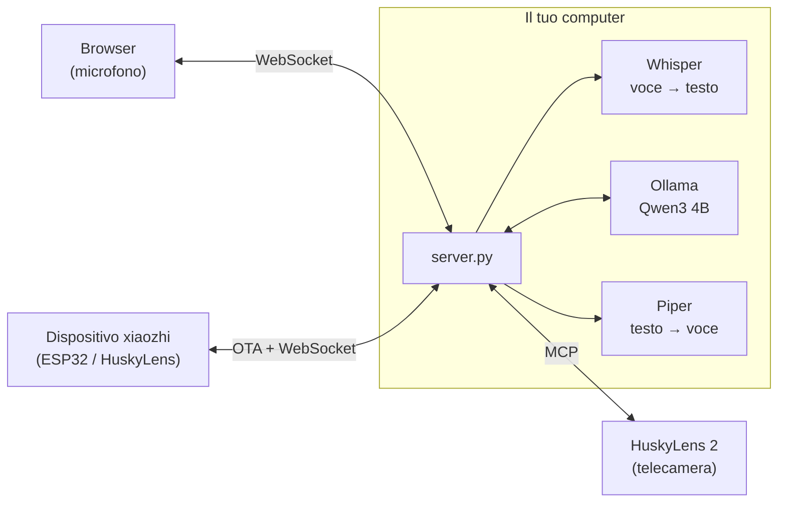
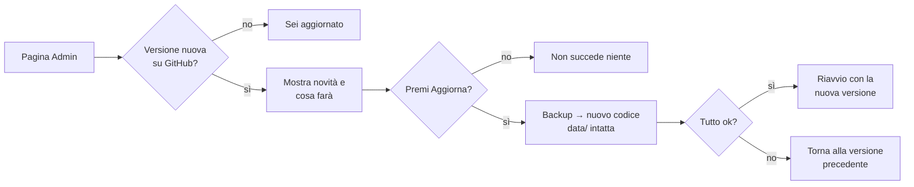

# Husky locale: server xiaozhi privacy-first

🇮🇹 Italiano · 🇬🇧 [English](docs/README.en.md)

Server **locale** e open source compatibile con [xiaozhi](https://github.com/78/xiaozhi-esp32), da usare al posto
del cloud `xiaozhi.me`, con supporto a HuskyLens 2 via MCP.
Voce, trascrizioni, risposte e immagini **non escono dalla tua rete**: tutto gira su un tuo computer,
Linux o Windows, con o senza GPU.

| | xiaozhi.me (cloud, Cina) | Husky locale |
|---|---|---|
| Account | numero di telefono + SMS | nessuno |
| Voce → testo | server remoti | **faster-whisper** (large-v3-turbo su GPU, small su CPU) |
| Cervello (LLM) | modelli cloud | **Qwen3 4B** con Ollama, sul tuo computer |
| Testo → voce | server remoti | **Piper** (voce italiana), sul tuo computer |
| Dove finiscono i dati | server di terzi in Cina | **solo sul tuo server** (cronologia sul tuo disco, se attiva) |
| Comandi alla telecamera (MCP) | passano dal cloud | dal tuo server direttamente alla HuskyLens |
| Connessioni a Internet durante l'uso | sempre | **nessuna** |
| Accesso | account sul cloud | **utenti locali con password e 2FA**, protezione anti-bot |
| Aggiornamenti | decisi dal cloud | **pulsante "Aggiorna"** nella pagina Admin, i tuoi dati restano |

📄 **[Privacy](docs/PRIVACY.md)** · 🧩 **[Come è fatta l'app](docs/ARCHITETTURA.md)** · 🔄 **[Novità delle versioni](CHANGELOG.md)** · 💬 **[Chiedere una modifica](#9-chiedere-modifiche-e-aggiornare)** · ✉️ **[giacomo.dev@icloud.com](mailto:giacomo.dev@icloud.com)**

## Architettura



Il server implementa il protocollo ufficiale xiaozhi-esp32: OTA, WebSocket con framing binario v1/v2/v3,
Opus a 16 kHz in ingresso e 24 kHz in uscita con frame da 60 ms, e MCP incapsulato nei messaggi `type: "mcp"`
(con paginazione `nextCursor`). I dettagli sono in [docs/ARCHITETTURA.md](docs/ARCHITETTURA.md).

## 1. Installazione automatica (una volta)

Funziona su **Linux** (Ubuntu/Debian e simili, x86_64 o ARM64) e su **Windows 10/11**, con o senza scheda NVIDIA.
Lo script installa tutto **dentro la cartella del progetto**: ambiente Python, Ollama portatile (se non è già
installato), voce italiana, Whisper e il modello linguistico. Servono circa 8 GB liberi e una connessione
a Internet solo per questo passaggio.

**Linux**

```bash
git clone https://github.com/BitJacker/xiaozhi-local-server.git && cd xiaozhi-local-server
./install.sh              # oppure: ./install.sh --service   (avvio automatico con systemd)
```

Su Debian/Ubuntu installa da solo i pacchetti mancanti (`python3-venv`, `curl`, `zstd`): serve root o `sudo`.

**Raspberry Pi e computer senza GPU con poca RAM**: `install.sh` sceglie da solo un **profilo leggero**
(Whisper `base`, modello `qwen2.5:3b` con 8 GB di RAM o `qwen2.5:1.5b` con 4 GB) e lo scrive in `data/config.yaml`.
Si può forzare con `./install.sh --light` (o `--full` per il profilo normale). Il profilo leggero è stato provato
su Linux senza GPU; **su un Raspberry Pi vero i tempi non sono ancora stati misurati**: aspettati risposte più lente
che su un PC (decine di secondi con il Pi 4, meno con il Pi 5).

**Windows** (PowerShell, nessun permesso di amministratore)

```powershell
powershell -ExecutionPolicy Bypass -File install.ps1           # oppure aggiungi -Service per l'avvio all'accesso
```

Serve [Python 3.10+](https://www.python.org/downloads/) (spunta "Add to PATH").

| Cosa | Con GPU NVIDIA | Senza GPU |
|---|---|---|
| Whisper | `large-v3-turbo` (~1 s per frase) | `small` su CPU (~2-4 s per frase) |
| LLM (Ollama) | sulla GPU | sulla CPU (più lento ma funziona) |

Il modello linguistico predefinito è `qwen3:4b-instruct-2507-q4_K_M` (2,5 GB): buono in italiano, sa usare gli
strumenti e ha i filtri di sicurezza attivi. Si cambia in `data/config.yaml` → `llm.model` (alternative con supporto
ai tool: `llama3.2:3b`, `llama3.1:8b`, `mistral-nemo`); al primo avvio Ollama lo scarica da solo.
Evita i modelli "abliterated" / "uncensored": hanno i filtri rimossi.

Preferisci **LM Studio**? In `data/config.yaml` metti `base_url: http://localhost:1234/v1` e il nome del modello di LM Studio.

## 2. Avvio

| Sistema | Comando |
|---|---|
| Linux | `./start.sh` (oppure il servizio: `sudo systemctl status husky-locale`, log con `journalctl -u husky-locale -f`) |
| Windows | doppio clic su **`avvia.bat`** (apre anche il browser) |

Dopo l'installazione il server lavora **completamente offline**: i modelli sono già sulla macchina e
Ollama ascolta solo su `127.0.0.1`. Per verificarlo su Windows: `powershell -ExecutionPolicy Bypass -File scripts\verifica_privacy.ps1`;
su Linux: `ss -tnp | grep -E 'python|ollama'`.

Il server stampa i suoi indirizzi:

```
  Husky locale v1.7.0   (dati in .../data)
  Client web:   http://IP-DEL-PC:8000/
  URL OTA:      http://IP-DEL-PC:8000/xiaozhi/ota/
  WebSocket:    ws://IP-DEL-PC:8000/xiaozhi/v1/

  PRIMO ACCESSO: apri http://localhost:8000/login
  utente: admin   password: Passw0rd!
  Al primo accesso ti verrà chiesto di cambiarla.
```

**Primo accesso**: utente **`admin`**, password **`Passw0rd!`**. Questa password è pubblica (è scritta qui), quindi
al primo accesso il server ti fa **cambiarla subito**: finché non lo fai non si può usare nient'altro, né dal browser
né dai dispositivi. Poi puoi attivare la verifica in due passaggi (2FA) dalla pagina **Account**.
Se preferisci che l'amministratore si crei solo con un codice mostrato nel terminale del server, metti
`auth.default_admin: false` in `data/config.yaml` prima del primo avvio.

**Sito in italiano e in inglese, chiaro o scuro**: in alto a destra in ogni pagina ci sono i pulsanti **IT / EN** e
**A / ☀ / ☾** (automatico, chiaro, scuro); il browser se li ricorda.

**Le tue impostazioni** vanno in `data/config.yaml`, non in `config.yaml`: scrivi solo le voci che vuoi
cambiare, con la stessa struttura. `config.yaml` contiene i valori predefiniti e viene sostituito dagli aggiornamenti.

## 3. Collegare HuskyLens 2 (metodo consigliato)

1. Su HuskyLens 2 (firmware ≥ 1.1.6, modulo Wi-Fi montato, stessa rete del PC): Impostazioni → **MCP** → attiva.
   Compare un indirizzo tipo `http://IP-DI-HUSKYLENS:3000/sse`.
2. In `data/config.yaml`:
   ```yaml
   mcp_servers:
     - name: huskylens
       url: http://IP-DI-HUSKYLENS:3000/sse
   ```
3. **Disattiva "Xiaozhi AI"** nel menu di HuskyLens, così smette di collegarsi a xiaozhi.me.
4. Avvia il server: nel log compare `MCP 'huskylens' connesso: N tool`. Se HuskyLens si spegne o si
   riavvia, il server si ricollega da solo.
5. Apri `http://localhost:8000/` in Chrome sul PC del server. Poi tieni premuto **"Tieni premuto per parlare"**
   oppure attiva **"Conversazione continua"**. Prova "cosa vedi?", "passa al riconoscimento facciale",
   "impara questa faccia e chiamala Marco".

**Permessi**: gli utenti normali possono solo *leggere* dalla telecamera (risultati, elenchi, foto); far imparare
o dimenticare oggetti, cambiare modalità o parametri resta ad admin e dispositivi. La tabella completa è nella pagina
**Admin**; si cambia con `tool_permissions` in `data/config.yaml`.

Se uno strumento restituisce un'**immagine** (es. una foto), viene descritta dal modello visivo locale se c'è
(`llm.vision_model`, per esempio `qwen2.5vl:3b` con Ollama); altrimenti l'assistente lo dice chiaramente.

Il PC fa da microfono e altoparlante, HuskyLens fa da "occhi". I comandi alla telecamera e i risultati passano
solo tra il tuo server e la HuskyLens, in rete locale: nessun cloud in mezzo.

**Nota sul "Xiaozhi AI" integrato in HuskyLens 2**: la guida ufficiale DFRobot non mostra un'opzione per
cambiare l'indirizzo del server, che è fisso su xiaozhi.me. Per questo il metodo consigliato è quello sopra.
Se un firmware futuro permetterà di impostare l'indirizzo OTA, basterà inserire quello del punto 4.

## 4. Collegare dispositivi xiaozhi (ESP32)

Qualunque dispositivo con firmware [xiaozhi-esp32](https://github.com/78/xiaozhi-esp32) può usare questo server
al posto di xiaozhi.me:

- **Firmware ufficiale**: nella pagina di configurazione Wi-Fi del dispositivo (hotspot `Xiaozhi-xxxx`)
  → opzioni avanzate → **indirizzo OTA** = `http://IP-DEL-PC:8000/xiaozhi/ota/`.
- **Firmware compilato da te**: `idf.py menuconfig` → `CONFIG_OTA_URL` = lo stesso indirizzo.

Al primo collegamento il dispositivo mostra sul suo schermo un **codice a 6 cifre**: inseriscilo in **Admin → Dispositivi** per autorizzarlo (vedi la sezione 6). Il server non forza aggiornamenti del firmware.
Gli strumenti MCP del dispositivo (volume, luminosità, camera...) vengono letti automaticamente.
Se in `data/config.yaml` imposti `llm.vision_model` (un modello locale con visione), le foto della camera
vengono analizzate su `/xiaozhi/vision/explain`, sempre in locale.

## 5. HTTPS e microfono da altri PC o dal telefono

Il server crea da solo un certificato e risponde anche su **`https://IP-DEL-PC:8443`**: da un altro PC o dal telefono
apri quell'indirizzo (chi apre `http://IP-DEL-PC:8000` viene mandato lì in automatico). La prima volta il browser
avvisa che il certificato non è di un'autorità pubblica: è normale, perché l'ha creato il tuo server. Accettalo una volta:
da quel momento password, cookie e voce viaggiano **cifrati** e il microfono funziona anche dagli altri dispositivi.

- Sul server stesso puoi usare anche `http://localhost:8000`.
- I dispositivi xiaozhi (ESP32) restano in HTTP sulla porta 8000, perché il loro firmware non accetta certificati
  autofirmati: per questo i loro dati andrebbero tenuti su una rete locale fidata.
- Hai un certificato vero (es. da un dominio)? Imposta `server.tls_cert` e `server.tls_key`. HTTPS si spegne con
  `server.https_port: 0`.

Filtri del microfono, regolabili dall'indirizzo:

| Parametro | Predefinito | Effetto |
|---|---|---|
| `ec` | `1` | cancellazione dell'eco |
| `ns` | `0` | soppressione del rumore di Chrome (aggiungi `?ns=1` se l'ambiente è molto rumoroso) |
| `agc` | `1` | guadagno automatico |

Se il riconoscimento della fine frase scatta troppo presto o troppo tardi, regola `vad.energy_threshold`
e `vad.silence_ms` in `data/config.yaml`.

## 6. Account, 2FA e protezione anti-bot

Tutte le pagine (assistente, cronologia, account, admin) richiedono l'accesso.

| Funzione | Come funziona |
|---|---|
| **Utenti** | L'admin li crea dalla pagina **Admin** (username e password iniziale), con ruolo *utente* o *admin*. |
| **Password** | Salvate cifrate (scrypt con sale casuale), mai in chiaro. Lunghezza minima configurabile. |
| **2FA** | Ogni utente la attiva da **Account** con un'app (Google Authenticator, Microsoft Authenticator, Aegis, 2FAS…): si inquadra un QR code e poi all'accesso serve anche il codice a 6 cifre. Un codice non vale due volte. Con `auth.require_2fa: true` diventa obbligatoria per tutti. |
| **Blocco tentativi** | Dopo 5 password sbagliate l'account viene bloccato per 15 minuti (anche per lo stesso indirizzo IP, con un margine più ampio). |
| **Anti-spam** | Limite di richieste per IP, di domande al minuto per utente e di connessioni contemporanee per IP. |
| **Sessioni** | Cookie protetto (HttpOnly, SameSite=Strict) che scade dopo 7 giorni. Cambiare la password chiude tutte le sessioni. |
| **Cronologia** | Ogni utente vede solo le sue conversazioni; l'admin le vede tutte e può cancellarle. |
| **Protezioni web** | Content-Security-Policy, protezione CSRF e anti-clickjacking. |
| **Revoca immediata** | Eliminare un utente, cambiargli password o ruolo, o revocare un dispositivo chiude subito le sue connessioni aperte. |
| **Registro di sicurezza** | La pagina **Admin** mostra accessi, tentativi falliti, account bloccati, modifiche a utenti e dispositivi, aggiornamenti e strumenti che cambiano qualcosa (es. "impara questo volto"). Mai il contenuto delle conversazioni. Il registro è cifrato sul disco. |

Tutto è regolabile in `data/config.yaml`, nelle sezioni `auth:` e `limits:`.

**Dispositivi xiaozhi (ESP32)**: un dispositivo nuovo mostra sul suo schermo un **codice a 6 cifre** (come faceva
xiaozhi.me). L'admin lo inserisce nella pagina **Admin → Dispositivi** e il dispositivo viene autorizzato; finché
non è approvato non può usare l'assistente. Da lì si può anche revocare un dispositivo.
L'autorizzazione vale per la coppia **MAC + Client-Id**: il Client-Id è un codice casuale che il dispositivo genera
e non mostra mai. Conoscere il MAC di un dispositivo approvato, che è facile da scoprire, non basta per
impersonarlo: chi ci prova riceve solo un nuovo codice da approvare.

> Se il server deve essere raggiungibile **da Internet** (non solo dalla rete locale), mettilo dietro un reverse
> proxy con un certificato vero (Caddy, nginx) e tieni gli ESP32 sulla rete locale.

**Firewall (consigliato)**: apri solo le porte del server e solo verso la tua rete locale.

```bash
# Linux (UFW): sostituisci 192.168.1.0/24 con la tua rete
sudo ufw allow from 192.168.1.0/24 to any port 8000,8443 proto tcp
# solo se usi MQTT: broker (TCP 1883) e voce dei dispositivi xiaozhi MQTT+UDP (UDP 8884)
sudo ufw allow from 192.168.1.0/24 to any port 1883 proto tcp
sudo ufw allow from 192.168.1.0/24 to any port 8884 proto udp
# solo se cerchi i dispositivi ESPHome in rete (Admin → ESPHome): mDNS
sudo ufw allow from 192.168.1.0/24 to any port 5353 proto udp
sudo ufw enable
```

```powershell
# Windows (PowerShell come amministratore)
New-NetFirewallRule -DisplayName "Husky locale" -Direction Inbound -Protocol TCP -LocalPort 8000,8443 -RemoteAddress LocalSubnet -Action Allow
```

Ollama ascolta solo su `127.0.0.1` e non va aperto. Su Linux il servizio creato da `install.sh --service` gira con
protezioni di systemd: non può ottenere privilegi né modificare il sistema, e i file che crea sono leggibili solo
dal suo utente (installalo con un utente normale, non root).

## 7. Privacy, cronologia e sicurezza

- **Nessun dato viene inviato a server esterni**: né ai server cinesi di xiaozhi.me né ad altri. Voce, domande,
  risposte e comandi alla telecamera (MCP) restano sul tuo server e sulla tua rete. Dettagli e verifiche in
  [PRIVACY.md](docs/PRIVACY.md).
- **Cronologia**: le conversazioni vengono salvate sul disco del tuo server (`data/history`) e si rileggono da
  `/cronologia`, dove si può anche cancellare un giorno. Per impostazione vengono **cancellate dopo 30 giorni**
  (`history.keep_days`, controllo ogni ora anche a server sempre acceso); si disattiva con `history.enabled: false`.
- **Cifratura**: cronologia e segreti 2FA sono salvati **cifrati** (AES-256-GCM, `security.encrypt_data`). La chiave è
  in `data/encryption.key`: per proteggerti anche dal furto del disco usa la cifratura del disco (BitLocker / LUKS)
  o tieni la chiave altrove (`security.key_file`).
- **Controllo degli indirizzi**: se il modello linguistico o un server MCP fossero configurati su un indirizzo di
  Internet, il server **si rifiuta di partire** e spiega perché, a meno di `privacy.allow_external: true`.
  La pagina Admin mostra a chi si collega il server.
- Le uniche connessioni a Internet avvengono durante l'installazione e quando controlli gli aggiornamenti.
- `server.tokens` (opzionale) aggiunge token fissi per script o dispositivi configurati a mano, oltre agli account.
- **Strumenti più sicuri**: prima di chiamare uno strumento (telecamera, dispositivo) il server controlla gli
  argomenti con il suo schema (obbligatori, tipi, valori ammessi, limiti): un valore sbagliato non arriva mai al
  dispositivo e il modello riceve l'errore per correggersi. Insieme ai permessi per ruolo, questo limita cosa
  può fare chi prova a "convincere" il modello con frasi studiate (*prompt injection*).
- **Gli aggiornamenti** contattano GitHub solo dalla pagina Admin (all'apertura, per vedere se c'è una versione
  nuova, oppure col pulsante): non inviano nessun dato. Si disattiva con `update.check_on_admin_open: false`.

## MQTT, sensori, LoRaWAN ed ESPHome

Dalla pagina **Admin → MQTT e sensori** si accende il **broker MQTT integrato** (porta 1883, spento di serie).
Non serve installare Mosquitto.

| Cosa | Come |
|---|---|
| **Sensori e attuatori** (ESP8266, ESP32, Arduino con Wi-Fi) | Crei un **account** (nome, password, argomenti in cui può scrivere e leggere) e lo scrivi nel dispositivo. Poi in **Strumenti** aggiungi "Leggi un sensore" o "Comanda un dispositivo" con l'argomento giusto: "che temperatura c'è in aula 1?", "accendi la luce". |
| **ESPHome** | Nel file YAML del dispositivo aggiungi il blocco `mqtt:` (sotto). Sensori, interruttori, luci, pulsanti, numeri e selettori **compaiono da soli** e diventano strumenti di Husky: leggere per tutti, comandare solo amministratori e dispositivi (`mqtt.esphome_command_roles`). |
| **LoRaWAN** | I sensori LoRaWAN passano da un network server: in **Broker esterni** colleghi The Things Network o ChirpStack (indirizzo, porta 8883 con TLS, utente e chiave API, argomenti `v3/ID-APP@ttn/devices/+/up`), poi aggiungi lo strumento già pronto "Sensore LoRaWAN" indicando il campo da leggere (es. `uplink_message.decoded_payload.temperature`). |
| **Dispositivi xiaozhi via MQTT+UDP** | Con l'interruttore "Dispositivi xiaozhi via MQTT+UDP" i dispositivi approvati ricevono dall'OTA i dati per collegarsi in MQTT: comandi via MQTT, **voce cifrata AES-128 via UDP** (porta 8884). Così possono ricevere gli **avvisi vocali anche quando sono a riposo**. |

```yaml
# ESPHome: aggiungi questo al file YAML del dispositivo
mqtt:
  broker: 192.168.1.50        # indirizzo del server Husky
  username: laboratorio       # account creato in Admin → MQTT e sensori
  password: !secret mqtt_password
```

Sicurezza: nessuno entra nel broker senza account (o senza essere un dispositivo xiaozhi approvato); ogni account
scrive e legge solo nei suoi argomenti; limiti di connessioni e di messaggi al secondo; eliminare un account o
revocare un dispositivo lo scollega subito. Il broker non usa TLS (rete locale): per la voce xiaozhi c'è la cifratura
AES, per i sensori usa account diversi per ogni gruppo di dispositivi. I broker esterni su Internet compaiono nella
tabella Privacy.

## Avvisi ai dispositivi

**Admin → Avvisi**: un messaggio a tutti i dispositivi o a uno solo ("fine dell'attività tra cinque minuti"), subito o
**a un orario** nei giorni scelti (es. ricreazione alle 10:55 dal lunedì al venerdì). I dispositivi xiaozhi collegati
via MQTT lo **sentono anche a riposo** (notifica vocale con sottotitolo, audio creato dalla voce locale e scaricato da
questo server); le conversazioni aperte e la pagina dell'assistente lo ricevono subito. I dispositivi via WebSocket a
riposo non hanno una connessione aperta: per loro l'avviso arriva solo durante una conversazione. Le schede vocali
ESPHome con la funzione "announce" lo riproducono anche a riposo.

## Altri server MCP e punti di accesso MCP

Oltre alla HuskyLens, **Admin → Server MCP** collega **qualsiasi server MCP**. Ognuno parte spento e ha i suoi
**ruoli** (chi può usare i suoi strumenti).

| Tipo | Come |
|---|---|
| **In rete locale** | indirizzo `http://IP:porta/...`: se finisce con `/sse` usa SSE (come la HuskyLens), altrimenti Streamable HTTP. Un indirizzo fuori dalla rete locale si salva solo spuntando "usa Internet" e compare nella tabella Privacy. |
| **Programma su questo computer** (stdio) | es. `npx` con argomenti `-y`, `@modelcontextprotocol/server-filesystem`, `C:\Lezioni` (uno per riga, niente shell). Prima va acceso l'interruttore "Permetti programmi MCP": girano con i permessi del server. |
| **Punto di accesso MCP** | come su xiaozhi.me: Husky crea un indirizzo `ws://SERVER:8000/xiaozhi/mcp/?token=...`; un programma su un altro PC (es. `mcp_pipe.py` del progetto xiaozhi, con `MCP_ENDPOINT=` quell'indirizzo) si collega e porta i suoi strumenti, finché resta acceso. Utile per gli strumenti scritti dagli studenti. |

Anche in `data/config.yaml` si possono scrivere server stdio: `mcp_servers: [{name: files, command: npx, args: [...]}]`.

## ESPHome con l'API nativa (anche schede vocali)

**Admin → ESPHome** collega i dispositivi ESPHome con lo **stesso collegamento di Home Assistant** (API nativa,
cifrata), **senza MQTT**. Accendi "Cerca dispositivi ESPHome in rete" (mDNS, solo rete locale), premi **Approva…**
su quello trovato e scrivi la **chiave di cifratura** (`api: encryption: key:` del file YAML). Oppure aggiungilo a
mano con IP o `nome.local`.

- Sensori, interruttori, luci (anche luminosità), pulsanti, numeri e selettori diventano **strumenti di Husky**:
  leggere per tutti, comandare per i ruoli in `esphome.command_roles` (di serie admin e dispositivi).
- **Schede vocali** (ESP32-S3-BOX, M5Stack Atom Echo, Home Assistant Voice PE, qualsiasi YAML con `voice_assistant:`):
  con "Usa la scheda come assistente vocale" Husky prende il posto di Home Assistant. La scheda sente la parola di
  attivazione e manda la voce; Husky trascrive, risponde con i suoi strumenti e restituisce la voce **in streaming**
  sull'altoparlante (`speaker`) oppure come file WAV per i `media_player`. Se dopo la parola di attivazione nessuno
  parla, chiude dopo 5 secondi (`esphome.no_speech_seconds`).
- Le schede con la funzione "announce" ricevono anche gli **Avvisi**.

```yaml
# ESPHome: blocco api con la chiave da scrivere anche nella pagina Admin
api:
  encryption:
    key: "la-chiave-di-44-caratteri="
```

## Installare il firmware dal browser

**Admin → Installa firmware**: carichi una volta il file `.bin` **completo** (ESPHome: Installa → Scarica →
"Factory format"; xiaozhi-esp32: il `merged-binary.bin` della tua scheda dai rilasci su GitHub), scegli il chip, poi
colleghi l'ESP32 con il cavo USB **al computer da cui stai usando la pagina** e premi **Installa**. Serve Chrome o
Edge, in HTTPS (o su localhost). Il programma di installazione (ESP Web Tools) è incluso nel server: nessun file
viene scaricato da Internet.

## Per la classe: documenti, lezioni, memoria e personaggi

| Funzione | Come |
|---|---|
| **Documenti del prof** (Admin → Documenti) | Carichi appunti, regolamenti e materiali (PDF, Word .docx, .txt, .md, .html) e scegli chi può usarli. Quando una domanda riguarda quegli argomenti, Husky trova i pezzi pertinenti e risponde usando quelli ("cosa si fa se si rompe una provetta?"). Ricerca sul server, senza modelli in più; testo salvato cifrato. I PDF fatti di sole immagini vanno prima convertiti in testo. |
| **Modalità lezione** | Dalla pagina dell'assistente (pulsante **Modalità lezione**) o a voce ("inizia la modalità lezione"): Husky trascrive senza rispondere. Si ferma con il pulsante o dicendo **"fine della lezione"**; poi prepara il riassunto (argomento, punti chiave, compiti e scadenze). Tutto nella pagina **Lezioni**, scaricabile in .txt, cifrato. Di serie la avviano admin e dispositivi (`lessons.roles`). |
| **Memoria per utente** | Husky ricorda le cose importanti che gli dici di te (nome, cosa studi, preferenze) anche nelle conversazioni successive. Ognuno le vede e le cancella in **Account**. Di serie per admin e utenti, non per i dispositivi condivisi (`memory.roles`). |
| **Personaggi** (Admin → Personaggi) | Più assistenti con istruzioni, voce, velocità, lingua e strumenti propri, es. un tutor di inglese. Si scelgono per dispositivo, dal menu della pagina dell'assistente o a voce ("passa al tutor di inglese"). Altre voci Piper vanno scaricate nella cartella `models/piper`. |

## Strumenti, risposte immediate e promemoria

Dalla pagina **Admin** si dà a Husky la possibilità di fare altre cose. **Tutto è spento** finché non lo accendi.

| Funzione | Cosa fa |
|---|---|
| **Strumenti personalizzati** | Tre tipi, ognuno da accendere a parte: **comandi** sul server (un programma con argomenti fissi, mai una shell), **siti web** (indirizzo fisso, il modello sceglie solo i valori nei punti segnati) e **sensori MQTT**. Per ogni strumento scegli chi può usarlo (admin, utenti, dispositivi) e puoi provarlo col pulsante *Prova*. |
| **Strumenti già pronti** | Meteo, qualità dell'aria, allerte meteo della regione, titoli delle notizie, Wikipedia, spazio su disco, temperatura del processore, "il dispositivo è acceso?", lettura di un sensore e comando di un dispositivo MQTT. Si aggiungono con un clic e si modificano (es. le coordinate della tua città). |
| **Promemoria e note** | "Ricordami di portare il libro", "cosa devo ricordare?": salvati cifrati sul server, separati per utente. Si spengono con `assistant.notes: false`. |
| **Risposte immediate** | Domande frequenti con una risposta fissa scritta dal prof (orari, regole, date delle verifiche): Husky risponde subito, senza il modello. Le domande solo un po' diverse ("finisce" invece di "inizia") non vengono confuse: in quel caso risponde il modello. |
| **Gruppi di strumenti** | Quando gli strumenti sono più di 12 (`assistant.tool_groups_threshold`), il modello vede solo i gruppi (telecamera, dispositivo, sensori, web, comandi, promemoria) e apre quelli che gli servono: con tanti strumenti tutti insieme i modelli piccoli sbagliano. Decide il modello, non il server. |

Sicurezza degli strumenti: i valori scelti dal modello devono rispettare tipo, valori ammessi e limiti (per i
comandi niente caratteri come `; | & $`); le chiavi API dei siti sono salvate cifrate e non tornano mai al browser;
ogni modifica e ogni uso finiscono nel registro di sicurezza; i siti attivati compaiono nella tabella Privacy.

## 8. Aggiornamenti

**Niente si aggiorna da solo.** Quando apri la pagina **Admin** controlla se su GitHub è uscita una versione nuova.
Se c'è, compare un riquadro con **le novità** e **cosa farà l'aggiornamento**, e il pulsante **"Aggiorna"**.
Premendolo:

1. salva un backup del programma attuale (`runtime/backups/`);
2. scarica la nuova versione e sostituisce **solo il codice**;
3. **non tocca i tuoi dati**: utenti, password e 2FA, cronologia, dispositivi, impostazioni (`data/`), modelli e Ollama;
4. aggiorna i pacchetti Python se servono;
5. **prova la nuova versione prima di riavviare** (se non si carica, rimette subito quella precedente);
6. riavvia il server (circa 1 minuto). Se dopo il riavvio la nuova versione **non riesce a partire per due volte**,
   al terzo avvio il server **torna da solo alla versione precedente** e la pagina Admin lo segnala.

Da terminale: `./update.sh` (Linux) o `powershell -ExecutionPolicy Bypass -File update.ps1` (Windows), che mostrano le
novità e chiedono conferma. Se il server non è partito da `start.sh` / `avvia.bat` / servizio, riavvialo a mano.



## 9. Chiedere modifiche e aggiornare

1. Chi usa il programma apre una **segnalazione** nella pagina
   [Issues](https://github.com/BitJacker/xiaozhi-local-server/issues/new/choose) del progetto, scegliendo
   *Richiesta di funzione* o *Segnalazione di problema*. Si può anche semplicemente dirlo a chi mantiene il progetto.
   Idee, cose da aggiungere o da migliorare si possono anche mandare per email a **giacomo.dev@icloud.com**.
2. Chi mantiene il progetto la implementa, la verifica con i test e pubblica una **nuova versione** (release) su GitHub,
   con le novità scritte nel [CHANGELOG](CHANGELOG.md).
3. Sul server basta aprire **Admin** e premere **"Aggiorna"**: i dati restano tutti.

## 10. Test

Con Ollama acceso (`./start.sh` o `avvia.bat`, oppure solo Ollama), dopo `pip install -r requirements/dev.txt`:

```bash
.venv\Scripts\python tests\run_all.py
```

Senza Ollama: `run_all.py --mock` usa un modello finto e salta i test che controllano le risposte e la voce.

Avvia un HuskyLens simulato e un server di prova (porta 8079, token `test123`), poi esegue:

**`tests/test_suite.py`** (28 controlli, account disattivati)
- OTA POST/GET, `activate`
- token errato o assente rifiutato
- `hello`, collegamento MCP a HuskyLens
- voce → tool del dispositivo con protocollo v1, v2 e v3 (tool su 2 pagine)
- modalità manuale e automatica
- memoria della conversazione nella sessione
- cronologia salvata su disco, protetta dal token e da percorsi non validi
- domanda visiva → tool HuskyLens
- interruzione (`abort`)
- parola di attivazione con solo rumore → nessuna risposta
- client web PCM
- endpoint visione
- latenza
- 3 dispositivi in parallelo

**`tests/browser_mic_test.py`**
- Chrome vero con microfono simulato da un file audio: tieni-premuto, conversazione continua e testo
- audio di risposta riprodotto
- nessun errore JavaScript

**Controllo di rete**: verifica che il server non abbia aperto **nessuna connessione verso Internet**.

**`tests/test_units.py`** (67 controlli, senza server)
- cronologia che scade anche a server sempre acceso; cronologia cifrata e illeggibile senza chiave
- permessi degli strumenti: l'utente legge ma non fa imparare, dimenticare o cambiare parametri; argomenti inventati dal modello scartati
- immagini restituite dagli strumenti descritte dal modello visivo
- indirizzi esterni riconosciuti; con un LLM su Internet il server non parte

**`tests/test_auth.py`** (64 controlli, server con account attivi, primo avvio da zero)
- primo admin solo col codice del terminale, non ripetibile
- pagine e API protette, CSRF, intestazioni di sicurezza, cookie protetti
- permessi utente/admin, blocco dopo 5 password sbagliate (solo per quell'account)
- 2FA: QR, attivazione, codice errato, **codice riusato rifiutato**
- WebSocket senza login rifiutato, cronologia separata per utente, limite di domande al minuto
- dispositivi: codice di attivazione, approvazione, revoca; **tentativo di impersonazione** (stesso MAC,
  altro Client-Id, token rubato) respinto; foto per la visione accettata col token del dispositivo
- 2FA e cronologia salvate cifrate sul disco; HTTPS attivo e redirect da HTTP per gli altri PC
- cambio password e logout invalidano le sessioni

**`tests/test_mqtt.py`** (26 controlli, senza server): broker MQTT provato con paho-mqtt (account, permessi, messaggi "retained"), strumenti dei sensori, riconoscimento ESPHome con i messaggi di un dispositivo vero, broker esterno come per LoRaWAN, revoca.

**`tests/test_xiaozhi_mqtt.py`** (17 controlli): un dispositivo simulato fa quello che fa il firmware xiaozhi: OTA, collegamento MQTT con il suo token, voce cifrata AES via UDP (domanda capita, risposta ricevuta e decifrata), avviso vocale scaricato come Ogg Opus, pacchetti falsi ignorati, revoca immediata.

**`tests/test_mcp.py`** (19 controlli): server MCP aggiunti dalla pagina Admin in Streamable HTTP e come programma locale (stdio, solo dopo averlo permesso), indirizzi su Internet solo con conferma e nella Privacy, ruoli (uno studente non vede gli strumenti degli admin), punto di accesso MCP con un programma collegato come fa `mcp_pipe.py` (token sbagliato rifiutato, eliminazione = scollegato), strumenti usati nella conversazione.

**`tests/test_esphome.py`** (25 controlli): due schede ESPHome finte che parlano l'API nativa vera: ricerca in rete (mDNS), approvazione, sensori e comandi come strumenti, **scheda vocale** con voce in streaming e con file WAV (domanda capita, eventi nell'ordine giusto), silenzio dopo la parola di attivazione, annunci, chiave sbagliata, eliminazione; firmware: file non valido rifiutato, manifest per ESP Web Tools, solo admin.

**`tests/test_scuola.py`** (30 controlli col modello vero, 28 con `--mock`): documenti (testo e PDF, formati non validi, ricerca, ruoli, cifratura, risposta presa dal documento), memoria (salvata, ricordata nella conversazione dopo, separata per utente, cifrata, cancellabile), personaggi (voce non valida rifiutata, scelta dalla pagina, cambio a voce, risposta nella lingua del personaggio, assegnazione a un dispositivo), modalità lezione (permessi, trascrizione senza risposte, "fine della lezione", riassunto, pagina Lezioni e .txt, salvataggio anche se la connessione cade).

**`tests/test_update.py`** (23 controlli): una finta installazione v1.0.0 con utenti, dispositivi, impostazioni,
30 giorni di cronologia, modelli e `config.yaml` modificato a mano si aggiorna a una finta v1.2.0. Verifica che
**tutti i dati siano identici byte per byte** e che le modifiche a mano vengano salvate. Poi prova i casi peggiori:
- una release difettosa viene rifiutata;
- una release che si installa ma **va in crash all'avvio** viene scoperta prima del riavvio;
- una versione che **non riesce mai a partire** viene sostituita da sola con la precedente al terzo avvio.

**`tests/test_upgrade_real.py`** (9 controlli): prende la **vera v1.1.0 pubblicata** (tag Git), la riempie di dati
con il suo codice (admin con 2FA, dispositivo approvato, cronologia) e la aggiorna **con il suo aggiornatore**:
verifica che login, 2FA, dispositivo e cronologia funzionino nella nuova versione.

**`tests/soak_test.py`** (affidabilità, lancio separato: `python tests/soak_test.py 15`): per N minuti fa domande
continue, spegne e riaccende la HuskyLens simulata, fa cadere connessioni a metà risposta e misura la memoria.
Risultato su 15 minuti: 38 domande su 38 riuscite (tempo medio 4,7 s, massimo 9,7 s); telecamera spenta e riaccesa 9 volte, sempre ricollegata da sola in 2-11 s e "cosa vedi" corretto 9/9; 10 connessioni chiuse di colpo a metà risposta senza problemi; memoria stabile intorno a 690 MB dopo i primi minuti di caricamento.

Altri test:
- `tests/raw_sse_mcp.py`: server MCP scritto a mano (protocollo 2024-11-05), per verificare la compatibilità
  con implementazioni diverse dall'SDK.
- `tests/bench_parallel.py`: tempi con 1, 3 e 4 dispositivi insieme.
- `tests/fake_device.py` + `tests/mock_llm.py`: prova senza modello linguistico.

### Risultati misurati

**Windows 11, GTX 1060 6 GB** (Whisper large-v3-turbo su GPU, Ollama con Qwen3 4B tutto su GPU)

| Misura | Valore |
|---|---|
| Fine della frase → primo audio di risposta | ~2,5 s |
| Trascrizione di una frase | ~0,9 s |
| 1 dispositivo, domanda completa | ~5 s |
| 3-4 dispositivi insieme | 15-18 s (la GPU è condivisa) |
| Memoria video usata | ~4,1 GB su 6 (contesto LLM 8192 token, cache q8_0) |

**Ubuntu 24.04 senza GPU** (installazione da zero con `install.sh`, Whisper small su CPU): funziona, con
risposte in circa 5-10 s. Più lento ma utilizzabile.

Entrambe le installazioni sono state provate **da zero** su macchine pulite: `install.ps1` su Windows e `install.sh`
su Ubuntu 24.04 (incluso il download automatico di Ollama e del modello, e il funzionamento offline).

## Limiti noti

- Non è stato ancora provato con un HuskyLens 2 fisico: i test usano due simulatori (uno con l'SDK MCP ufficiale,
  uno scritto a mano con il protocollo 2024-11-05). Il server legge comunque i tool reali in automatico. Collaudo
  consigliato: conversazione, "cosa vedi?", cambio modello, apprendimento, telecamera spenta e riaccesa.
- Prestazioni su Raspberry Pi non ancora misurate (vedi profilo leggero).
- Il riavvio automatico dopo un aggiornamento funziona con `start.sh`, `avvia.bat` e il servizio; avviando a mano `python server.py` va riavviato a mano.
- Il servizio `systemd` (`install.sh --service`) è generato dallo script ma non è stato provato su un server
  con systemd attivo.
- Con più di 3-4 dispositivi contemporanei le risposte rallentano (una sola GPU).
- In "conversazione continua" non si può interrompere a voce mentre risponde (il microfono è ignorato mentre parla,
  per non sentire la propria voce): si interrompe col pulsante.
- La voce di test sintetica (Piper) a volte viene trascritta male ("ragno", "zampe"): non riguarda le voci reali.

## File

```
xiaozhi-local-server/
├── install.sh / install.ps1   installazione automatica (Linux / Windows)
├── start.sh / start.ps1       avvio (Ollama + server); avvia.bat = doppio clic su Windows
├── update.sh / update.ps1     aggiornamento da terminale
├── server.py                  il server
├── config.yaml                impostazioni predefinite (le tue vanno in data/config.yaml)
├── requirements.txt           pacchetti Python (requirements/: GPU e test)
├── VERSION, CHANGELOG.md      versione e novità
├── xiaozhi_locale/            codice del server
├── web/                       pagine: assistente, cronologia, login, account, admin
├── scripts/                   download dei modelli, controllo delle connessioni di rete
├── docs/                      privacy, sicurezza, architettura (con diagrammi)
├── tests/                     test automatici e simulatori
└── data/                      I TUOI DATI: creata al primo avvio, mai toccata dagli aggiornamenti
```

| Dove | Cosa c'è |
|---|---|
| `xiaozhi_locale/app.py` | rotte HTTP: OTA, WebSocket, visione, API di account e admin, sicurezza |
| `xiaozhi_locale/session.py` | protocollo xiaozhi per ogni connessione (voce, testo, strumenti) |
| `xiaozhi_locale/audio.py`, `engines.py` | Opus, fine frase, Whisper (voce → testo), Piper (testo → voce) |
| `xiaozhi_locale/llm.py`, `tools.py` | modello linguistico locale e strumenti MCP (dispositivo, HuskyLens) |
| `xiaozhi_locale/auth.py` | utenti, password, 2FA, sessioni, dispositivi, limiti anti-spam |
| `xiaozhi_locale/history.py`, `cryptobox.py`, `events.py` | cronologia e registro di sicurezza sul disco, cifrati |
| `xiaozhi_locale/tls.py`, `privacy.py` | HTTPS automatico, controllo degli indirizzi esterni |
| `xiaozhi_locale/custom_tools.py`, `notes.py`, `faq.py` | strumenti personalizzati, promemoria, risposte immediate |
| `xiaozhi_locale/mqtt_*.py`, `xiaozhi_mqtt.py` | broker MQTT, client per broker esterni, sensori ed ESPHome, protocollo xiaozhi MQTT+UDP |
| `xiaozhi_locale/alerts.py` | avvisi ai dispositivi, anche programmati |
| `xiaozhi_locale/knowledge.py`, `lessons.py`, `memory.py`, `personas.py` | documenti del prof, modalità lezione, memoria per utente, personaggi |
| `xiaozhi_locale/mcp_hub.py` | server MCP aggiunti dalla pagina Admin, punti di accesso MCP |
| `xiaozhi_locale/esphome_native.py` | ESPHome con l'API nativa: scoperta, strumenti, schede vocali, annunci |
| `xiaozhi_locale/firmware.py`, `web/static/vendor/esp-web-tools/` | firmware da installare dal browser |
| `scripts/tools/` | programmi degli strumenti già pronti (disco, temperatura, ping) |
| `xiaozhi_locale/updater.py`, `config.py` | aggiornamenti che conservano i dati, impostazioni |
| `scripts/download_models.py` | download dei modelli vocali |
| `scripts/verifica_privacy.ps1` | controlla che il server non sia collegato a Internet (Windows) |
| `docs/PRIVACY.md` / `docs/PRIVACY.en.md` | dove vanno i dati e come verificarlo |
| `docs/SECURITY.md` | come segnalare un problema di sicurezza |
| `docs/ARCHITETTURA.md` / `docs/ARCHITECTURE.md` | diagrammi: componenti, flusso di una domanda, installazione, test |

## Licenza

[GPL-3.0](LICENSE): il progetto usa Piper (GPL-3.0) per la sintesi vocale. I modelli scaricati durante
l'installazione hanno le loro licenze (Qwen3: Apache-2.0, Whisper: MIT, voci Piper: vedi la scheda di ogni voce).

Incluso nel server: ESP Web Tools (Apache-2.0, `web/static/vendor/esp-web-tools/`) e il carattere Atkinson Hyperlegible (OFL). Librerie Python principali: aioesphomeapi (MIT), zeroconf (LGPL-2.1), mcp (MIT), pypdf (BSD).

Progetto indipendente, non affiliato a xiaozhi, DFRobot (HuskyLens), ESPHome / Home Assistant o Ollama.
