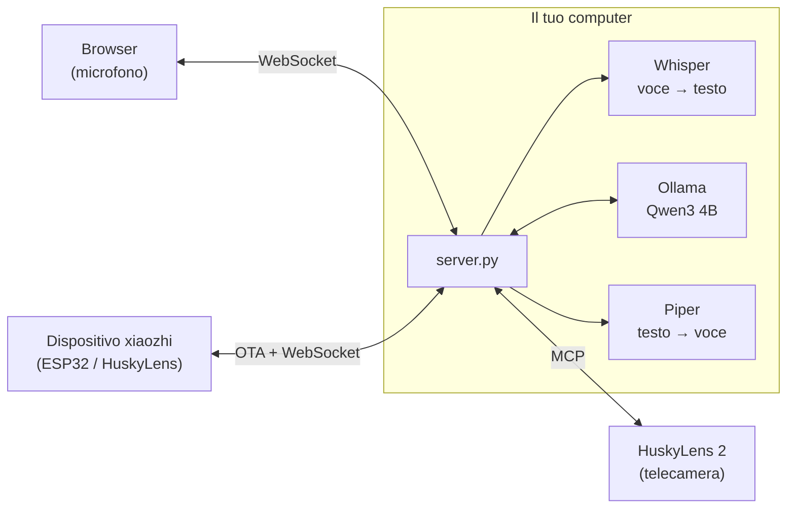

# Husky locale: server xiaozhi privacy-first

🇮🇹 Italiano · 🇬🇧 [English](README.en.md)

Server **locale** e open source compatibile con [xiaozhi](https://github.com/78/xiaozhi-esp32), da usare al posto
del cloud `xiaozhi.me`, con supporto a HuskyLens 2 via MCP.
Voce, trascrizioni, risposte e immagini **non escono dalla tua rete**: tutto gira su un tuo computer,
Linux o Windows, con o senza GPU.

| | xiaozhi.me (cloud, Cina) | Husky locale |
|---|---|---|
| Account | numero di telefono + SMS | nessuno |
| Voce → testo | server remoti | **faster-whisper** (large-v3-turbo su GPU, small su CPU) |
| Cervello (LLM) | modelli cloud | **Qwen3 4B** con Ollama, sul tuo computer |
| Testo → voce | server remoti | **Piper** (voce italiana), sul tuo computer |
| Dove finiscono i dati | server di terzi in Cina | **solo sul tuo server** (cronologia sul tuo disco, se attiva) |
| Comandi alla telecamera (MCP) | passano dal cloud | dal tuo server direttamente alla HuskyLens |
| Connessioni a Internet durante l'uso | sempre | **nessuna** |

📄 **[Privacy: dove vanno i tuoi dati](PRIVACY.md)** · 🧩 **[Come è fatta l'app (diagrammi)](docs/ARCHITETTURA.md)**

## Architettura



Il server implementa il protocollo ufficiale xiaozhi-esp32: OTA, WebSocket con framing binario v1/v2/v3,
Opus a 16 kHz in ingresso e 24 kHz in uscita con frame da 60 ms, e MCP incapsulato nei messaggi `type: "mcp"`
(con paginazione `nextCursor`). I dettagli sono in [docs/ARCHITETTURA.md](docs/ARCHITETTURA.md).

## 1. Installazione automatica (una volta)

Funziona su **Linux** (Ubuntu/Debian e simili, x86_64 o ARM64) e su **Windows 10/11**, con o senza scheda NVIDIA.
Lo script installa tutto **dentro la cartella del progetto**: ambiente Python, Ollama portatile (se non è già
installato), voce italiana, Whisper e il modello linguistico. Servono circa 8 GB liberi e una connessione
a Internet solo per questo passaggio.

**Linux**

```bash
git clone https://github.com/BitJacker/xiaozhi-local-server.git && cd xiaozhi-local-server
./install.sh              # oppure: ./install.sh --service   (avvio automatico con systemd)
```

Su Debian/Ubuntu installa da solo i pacchetti mancanti (`python3-venv`, `curl`, `zstd`): serve root o `sudo`.

**Windows** (PowerShell, nessun permesso di amministratore)

```powershell
powershell -ExecutionPolicy Bypass -File install.ps1           # oppure aggiungi -Service per l'avvio all'accesso
```

Serve [Python 3.10+](https://www.python.org/downloads/) (spunta "Add to PATH").

| Cosa | Con GPU NVIDIA | Senza GPU |
|---|---|---|
| Whisper | `large-v3-turbo` (~1 s per frase) | `small` su CPU (~2-4 s per frase) |
| LLM (Ollama) | sulla GPU | sulla CPU (più lento ma funziona) |

Il modello linguistico predefinito è `qwen3:4b-instruct-2507-q4_K_M` (2,5 GB): buono in italiano, sa usare gli
strumenti e ha i filtri di sicurezza attivi. Si cambia in `config.yaml` → `llm.model` (alternative con supporto
ai tool: `llama3.2:3b`, `llama3.1:8b`, `mistral-nemo`); al primo avvio Ollama lo scarica da solo.
Evita i modelli "abliterated" / "uncensored": hanno i filtri rimossi.

Preferisci **LM Studio**? In `config.yaml` metti `base_url: http://localhost:1234/v1` e il nome del modello di LM Studio.

## 2. Avvio

| Sistema | Comando |
|---|---|
| Linux | `./start.sh` (oppure il servizio: `sudo systemctl status husky-locale`, log con `journalctl -u husky-locale -f`) |
| Windows | doppio clic su **`avvia.bat`** (apre anche il browser) |

Dopo l'installazione il server lavora **completamente offline**: i modelli sono già sulla macchina e
Ollama ascolta solo su `127.0.0.1`. Per verificarlo su Windows: `powershell -ExecutionPolicy Bypass -File verifica_privacy.ps1`;
su Linux: `ss -tnp | grep -E 'python|ollama'`.

Il server stampa i suoi indirizzi:

```
  Client web:   http://IP-DEL-PC:8000/
  URL OTA:      http://IP-DEL-PC:8000/xiaozhi/ota/
  WebSocket:    ws://IP-DEL-PC:8000/xiaozhi/v1/
```

## 3. Collegare HuskyLens 2 (metodo consigliato)

1. Su HuskyLens 2 (firmware ≥ 1.1.6, modulo Wi-Fi montato, stessa rete del PC): Impostazioni → **MCP** → attiva.
   Compare un indirizzo tipo `http://IP-DI-HUSKYLENS:3000/sse`.
2. In `config.yaml`:
   ```yaml
   mcp_servers:
     - name: huskylens
       url: http://IP-DI-HUSKYLENS:3000/sse
   ```
3. **Disattiva "Xiaozhi AI"** nel menu di HuskyLens, così smette di collegarsi a xiaozhi.me.
4. Avvia il server: nel log compare `MCP 'huskylens' connesso: N tool`. Se HuskyLens si spegne o si
   riavvia, il server si ricollega da solo.
5. Apri `http://localhost:8000/` in Chrome sul PC del server. Poi tieni premuto **"Tieni premuto per parlare"**
   oppure attiva **"Conversazione continua"**. Prova "cosa vedi?", "passa al riconoscimento facciale",
   "impara questa faccia e chiamala Marco".

Il PC fa da microfono e altoparlante, HuskyLens fa da "occhi". I comandi alla telecamera e i risultati passano
solo tra il tuo server e la HuskyLens, in rete locale: nessun cloud in mezzo.

**Nota sul "Xiaozhi AI" integrato in HuskyLens 2**: la guida ufficiale DFRobot non mostra un'opzione per
cambiare l'indirizzo del server, che è fisso su xiaozhi.me. Per questo il metodo consigliato è quello sopra.
Se un firmware futuro permetterà di impostare l'indirizzo OTA, basterà inserire quello del punto 4.

## 4. Collegare dispositivi xiaozhi (ESP32)

Qualunque dispositivo con firmware [xiaozhi-esp32](https://github.com/78/xiaozhi-esp32) può usare questo server
al posto di xiaozhi.me:

- **Firmware ufficiale**: nella pagina di configurazione Wi-Fi del dispositivo (hotspot `Xiaozhi-xxxx`)
  → opzioni avanzate → **indirizzo OTA** = `http://IP-DEL-PC:8000/xiaozhi/ota/`.
- **Firmware compilato da te**: `idf.py menuconfig` → `CONFIG_OTA_URL` = lo stesso indirizzo.

Il server risponde all'OTA senza attivazione né aggiornamenti firmware e indica il proprio WebSocket.
Gli strumenti MCP del dispositivo (volume, luminosità, camera...) vengono letti automaticamente.
Se in `config.yaml` imposti `llm.vision_model` (un modello locale con visione), le foto della camera
vengono analizzate su `/xiaozhi/vision/explain`, sempre in locale.

## 5. Microfono da altri PC della rete

I browser permettono il microfono solo su `localhost` o in HTTPS. Da un altro PC:
- la casella di testo funziona sempre;
- per il microfono, in Chrome apri `chrome://flags/#unsafely-treat-insecure-origin-as-secure`, aggiungi
  `http://IP-DEL-PC:8000` e riavvia Chrome (solo su una rete locale fidata).

Filtri del microfono, regolabili dall'indirizzo:

| Parametro | Predefinito | Effetto |
|---|---|---|
| `ec` | `1` | cancellazione dell'eco |
| `ns` | `0` | soppressione del rumore di Chrome (aggiungi `?ns=1` se l'ambiente è molto rumoroso) |
| `agc` | `1` | guadagno automatico |

Se il riconoscimento della fine frase scatta troppo presto o troppo tardi, regola `vad.energy_threshold`
e `vad.silence_ms` in `config.yaml`.

## 6. Privacy, cronologia e sicurezza

- **Nessun dato viene inviato a server esterni**: né ai server cinesi di xiaozhi.me né ad altri. Voce, domande,
  risposte e comandi alla telecamera (MCP) restano sul tuo server e sulla tua rete. Dettagli e verifiche in
  [PRIVACY.md](PRIVACY.md).
- **Cronologia**: le conversazioni vengono salvate sul disco del tuo server (`data/history`) e si rileggono da
  `http://IP:8000/cronologia`, dove si può anche cancellare un giorno. Si disattiva con `history.enabled: false`,
  e con `history.keep_days` le conversazioni vecchie si cancellano da sole.
- Le uniche connessioni a Internet avvengono durante l'installazione, per scaricare programmi e modelli.
- Con `server.tokens: ["una-parola-segreta"]` serve un token per collegarsi e per leggere la cronologia
  (client web: `http://IP:8000/?token=una-parola-segreta`). Token errati vengono rifiutati con HTTP 401.

## 7. Test

Con Ollama acceso (`./start.sh` o `avvia.bat`, oppure solo Ollama), dopo `pip install -r requirements-dev.txt`:

```bash
.venv\Scripts\python tests\run_all.py
```

Avvia un HuskyLens simulato e un server di prova (porta 8079, token `test123`), poi esegue:

**`tests/test_suite.py`** (28 controlli)
- OTA POST/GET, `activate`
- token errato o assente rifiutato
- `hello`, collegamento MCP a HuskyLens
- voce → tool del dispositivo con protocollo v1, v2 e v3 (tool su 2 pagine)
- modalità manuale e automatica
- memoria della conversazione nella sessione
- cronologia salvata su disco, protetta dal token e da percorsi non validi
- domanda visiva → tool HuskyLens
- interruzione (`abort`)
- parola di attivazione con solo rumore → nessuna risposta
- client web PCM
- endpoint visione
- latenza
- 3 dispositivi in parallelo

**`tests/browser_mic_test.py`**
- Chrome vero con microfono simulato da un file audio: tieni-premuto, conversazione continua e testo
- audio di risposta riprodotto
- nessun errore JavaScript

**Controllo di rete**: alla fine verifica che il server non abbia aperto **nessuna connessione verso Internet**.

Altri test:
- `tests/raw_sse_mcp.py`: server MCP scritto a mano (protocollo 2024-11-05), per verificare la compatibilità
  con implementazioni diverse dall'SDK.
- `tests/bench_parallel.py`: tempi con 1, 3 e 4 dispositivi insieme.
- `tests/fake_device.py` + `tests/mock_llm.py`: prova senza modello linguistico.

### Risultati misurati

**Windows 11, GTX 1060 6 GB** (Whisper large-v3-turbo su GPU, Ollama con Qwen3 4B tutto su GPU)

| Misura | Valore |
|---|---|
| Fine della frase → primo audio di risposta | ~2,5 s |
| Trascrizione di una frase | ~0,9 s |
| 1 dispositivo, domanda completa | ~5 s |
| 3-4 dispositivi insieme | 15-18 s (la GPU è condivisa) |
| Memoria video usata | ~4,1 GB su 6 (contesto LLM 8192 token, cache q8_0) |

**Ubuntu 24.04 senza GPU** (installazione da zero con `install.sh`, Whisper small su CPU): funziona, con
risposte in circa 5-10 s. Più lento ma utilizzabile.

Entrambe le installazioni sono state provate **da zero** su macchine pulite: `install.ps1` su Windows e `install.sh`
su Ubuntu 24.04 (incluso il download automatico di Ollama e del modello, e il funzionamento offline).

## Limiti noti

- Non è stato ancora provato con un HuskyLens 2 fisico: i test usano due simulatori (uno con l'SDK MCP ufficiale,
  uno scritto a mano con il protocollo 2024-11-05). Il server legge comunque i tool reali in automatico.
- Il servizio `systemd` (`install.sh --service`) è generato dallo script ma non è stato provato su un server
  con systemd attivo.
- Con più di 3-4 dispositivi contemporanei le risposte rallentano (una sola GPU).
- In "conversazione continua" non si può interrompere a voce mentre risponde (il microfono è ignorato mentre parla,
  per non sentire la propria voce): si interrompe col pulsante.
- La voce di test sintetica (Piper) a volte viene trascritta male ("ragno", "zampe"): non riguarda le voci reali.

## File

| File | Contenuto |
|---|---|
| `install.sh` / `install.ps1` | installazione automatica Linux / Windows |
| `start.sh` / `start.ps1` / `avvia.bat` | avvio (Ollama + server) |
| `scripts/download_models.py` | download dei modelli vocali |
| `server.py` | avvio del server |
| `config.yaml` | configurazione |
| `xiaozhi_locale/app.py` | rotte HTTP: OTA, WebSocket, visione, client web |
| `xiaozhi_locale/session.py` | protocollo xiaozhi per ogni connessione |
| `xiaozhi_locale/audio.py` | codifica/decodifica Opus (PyAV) e rilevamento di fine frase |
| `xiaozhi_locale/engines.py` | Whisper (riconoscimento vocale) e Piper (sintesi vocale) |
| `xiaozhi_locale/llm.py` | LLM locale con chiamata ai tool |
| `xiaozhi_locale/tools.py` | MCP del dispositivo e MCP esterni (HuskyLens) |
| `web/index.html` | client web con microfono |
| `web/cronologia.html` | pagina della cronologia |
| `xiaozhi_locale/history.py` | cronologia salvata sul disco del server |
| `PRIVACY.md` / `PRIVACY.en.md` | dove vanno i dati e come verificarlo |
| `docs/ARCHITETTURA.md` / `docs/ARCHITECTURE.md` | diagrammi: componenti, flusso di una domanda, installazione, test |

## Licenza

[GPL-3.0](LICENSE): il progetto usa Piper (GPL-3.0) per la sintesi vocale. I modelli scaricati durante
l'installazione hanno le loro licenze (Qwen3: Apache-2.0, Whisper: MIT, voci Piper: vedi la scheda di ogni voce).

Progetto indipendente, non affiliato a xiaozhi, DFRobot (HuskyLens) o Ollama.
