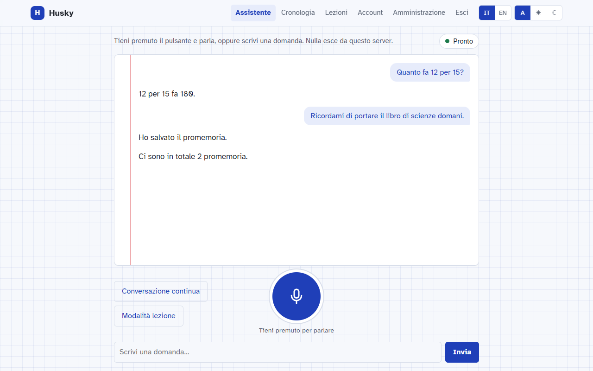
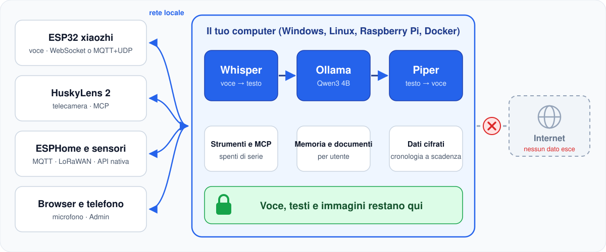
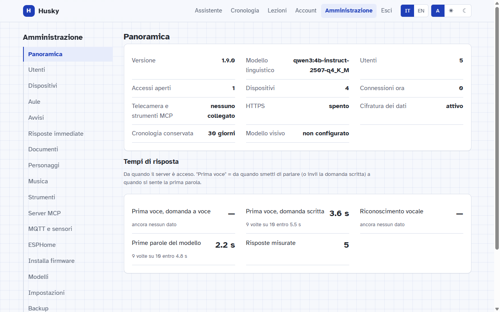
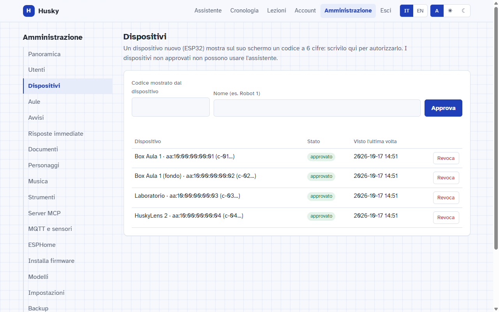
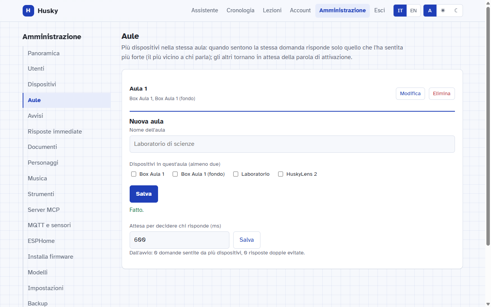
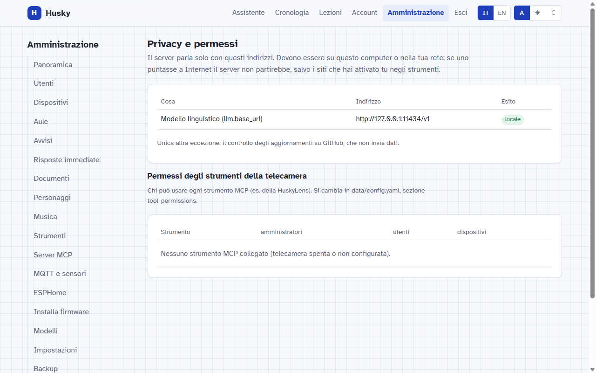
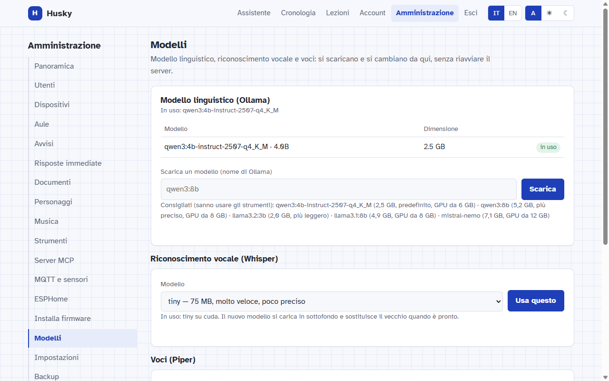
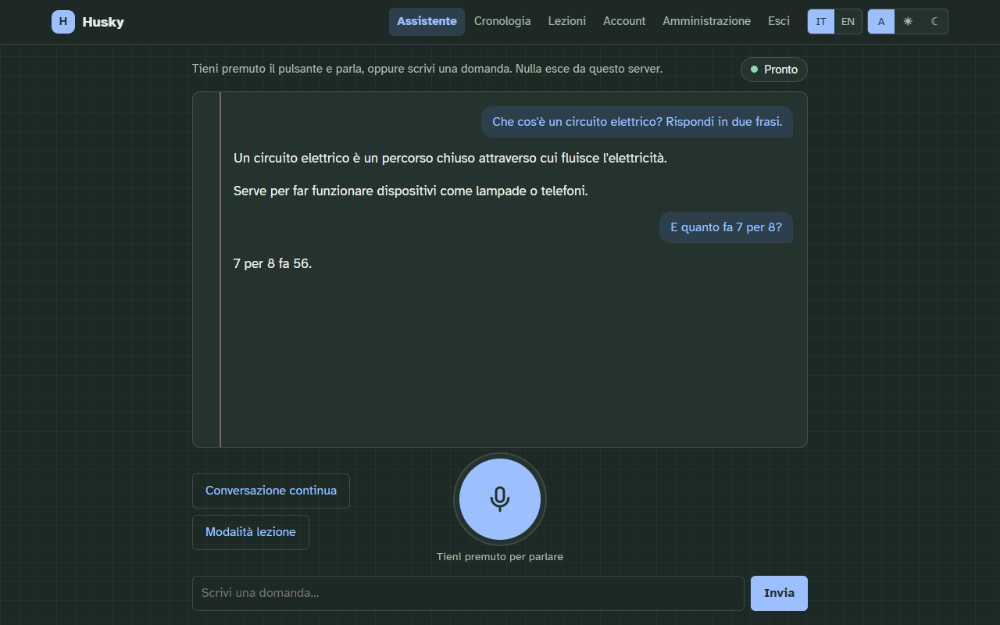

<p align="center">
  
</p>

<p align="center">
  <a href="https://github.com/BitJacker/xiaozhi-local-server/releases/latest"></a>
  <a href="https://github.com/BitJacker/xiaozhi-local-server/actions/workflows/verifica.yml"></a>
  <a href="LICENSE"></a>
  
  
</p>

<p align="center">
  🇮🇹 Italiano · 🇬🇧 <a href="docs/README.en.md">English</a>
  &nbsp;|&nbsp; 📖 <a href="docs/GUIDA.md">Guida completa</a>
  &nbsp;|&nbsp; 🔒 <a href="docs/PRIVACY.md">Privacy</a>
  &nbsp;|&nbsp; 🧩 <a href="docs/ARCHITETTURA.md">Architettura</a>
  &nbsp;|&nbsp; 🗺️ <a href="docs/ROADMAP.md">Roadmap</a>
  &nbsp;|&nbsp; 🔄 <a href="CHANGELOG.md">Novità</a>
</p>

**Husky locale** sostituisce il cloud `xiaozhi.me` per i dispositivi vocali [xiaozhi (ESP32)](https://github.com/78/xiaozhi-esp32)
e la telecamera **HuskyLens 2**. Capisce la voce, risponde, usa strumenti e sensori: **tutto sul tuo computer**.

<p align="center">
  
</p>

## Come funziona

<p align="center">
  
</p>

## Cosa sa fare

| | | |
|:---:|:---:|:---:|
| 🎙️ **Voce in locale**<br><sub>Whisper, Ollama, Piper: la risposta parte dalla prima frase</sub> | 📷 **HuskyLens 2**<br><sub>"cosa vedi?", impara volti e oggetti (MCP)</sub> | 🔌 **ESP32, ESPHome, MQTT, LoRaWAN**<br><sub>sensori e luci comandati a voce</sub> |
| 🧰 **Strumenti e server MCP**<br><sub>creati dall'Admin, spenti di serie</sub> | 📚 **Per la classe**<br><sub>documenti del prof, lezioni trascritte, memoria, personaggi</sub> | 🏫 **Più dispositivi per aula**<br><sub>risponde solo il più vicino</sub> |
| 🗣️ **Impronta vocale**<br><sub>riconosce chi parla, solo con consenso</sub> | 🎵 **Musica e audio**<br><sub>dalla cartella del server</sub> | 🔐 **Account, 2FA, dati cifrati**<br><sub>cronologia a 30/60/90 giorni o senza limite</sub> |
| 📊 **Prometheus e Grafana**<br><sub>tempi e carico, solo numeri</sub> | 💾 **Backup cifrato**<br><sub>ogni giorno, ripristino con un comando</sub> | ⬆️ **Aggiornamenti con un pulsante**<br><sub>se qualcosa va storto torna indietro da solo</sub> |

## La pagina Admin

<table>
  <tr>
    <td width="50%"><br><sub><b>Panoramica</b>: stato del server e tempi di risposta</sub></td>
    <td width="50%"><br><sub><b>Dispositivi</b>: si approvano con un codice di 6 cifre</sub></td>
  </tr>
  <tr>
    <td><br><sub><b>Aule</b>: nella stessa stanza risponde un solo dispositivo</sub></td>
    <td><br><sub><b>Privacy</b>: ogni indirizzo che il server contatta</sub></td>
  </tr>
  <tr>
    <td><br><sub><b>Modelli</b>: scarica e cambia senza riavviare</sub></td>
    <td><br><sub><b>Tema chiaro e scuro</b>, italiano e inglese</sub></td>
  </tr>
</table>

## Avvio in 3 passi

**1. Installa** (una volta, scarica i modelli: circa 8 GB)

```bash
git clone https://github.com/BitJacker/xiaozhi-local-server.git && cd xiaozhi-local-server
./install.sh                                         # Linux e Raspberry Pi
```

```powershell
powershell -ExecutionPolicy Bypass -File install.ps1   # Windows
```

<details>
<summary>🐳 Con Docker o Kubernetes</summary>

```bash
docker compose up -d                                   # con GPU NVIDIA: aggiungi -f docker-compose.gpu.yml
kubectl apply -k k8s/
```

Dettagli nella [guida](docs/GUIDA.md#gestione-impostazioni-metriche-backup-docker-e-kubernetes).
</details>

**2. Avvia**: `./start.sh` oppure `avvia.bat`, poi apri **http://localhost:8000**
(primo accesso `admin` / `Passw0rd!`: la password va cambiata subito).

**3. Collega i dispositivi**: sull'ESP32 imposta l'indirizzo OTA `http://IP-DEL-PC:8000/xiaozhi/ota/` e approva il
codice che compare sullo schermo nella pagina **Admin → Dispositivi**.

## Perché locale

| | ☁️ xiaozhi.me | 🏠 Husky locale |
|---|:---:|:---:|
| Dove va la tua voce | server di terzi | **il tuo computer** |
| Account richiesto | telefono + SMS | **nessuno** (utenti locali) |
| Funziona senza Internet | ❌ | ✅ |
| Scegli tu i modelli | ❌ | ✅ |
| Codice aperto e verificabile | ❌ | ✅ GPL-3.0 |

<details>
<summary>📈 Quanti dispositivi regge</summary>

Misurato con il modello vero (Qwen3 4B, GTX 1060 6 GB), studenti che fanno domande **tutti nello stesso momento**:

| Persone insieme | 1 | 5 | 10 | 20 | 30 |
|---|:---:|:---:|:---:|:---:|:---:|
| Risposta (mediana) | 1,8 s | 6,1 s | 11,5 s | 21 s | 27 s |
| Hanno ricevuto risposta | ✅ | ✅ | ✅ | ✅ | ✅ |

Prova da solo con `tests/load_test.py`. Dettagli nella [guida](docs/GUIDA.md#risultati-misurati).
</details>

## Documentazione

📖 [Guida completa](docs/GUIDA.md): installazione, dispositivi, HTTPS, account, MQTT, ESPHome, strumenti, test

🔒 [Privacy](docs/PRIVACY.md) · 🛡️ [Sicurezza](docs/SECURITY.md) · 🧩 [Architettura](docs/ARCHITETTURA.md) · 🗺️ [Roadmap](docs/ROADMAP.md) · 🔄 [Novità](CHANGELOG.md)

💬 Idee, problemi, richieste: [apri una issue](https://github.com/BitJacker/xiaozhi-local-server/issues) oppure
✉️ [giacomo.dev@icloud.com](mailto:giacomo.dev@icloud.com)

<sub>Licenza [GPL-3.0](LICENSE). Non affiliato con xiaozhi.me né con DFRobot.</sub>
