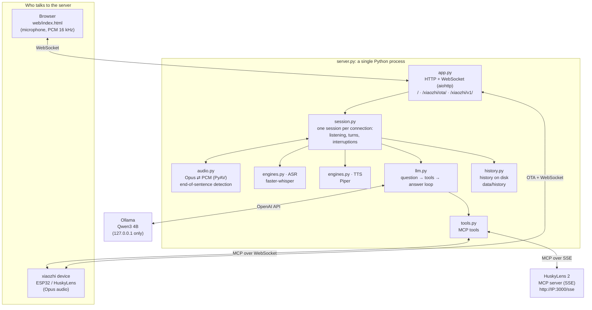
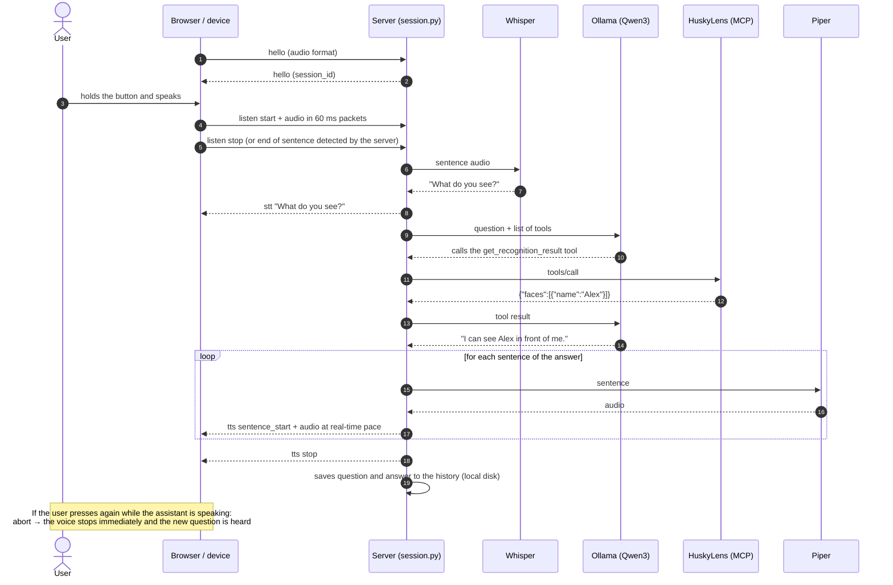
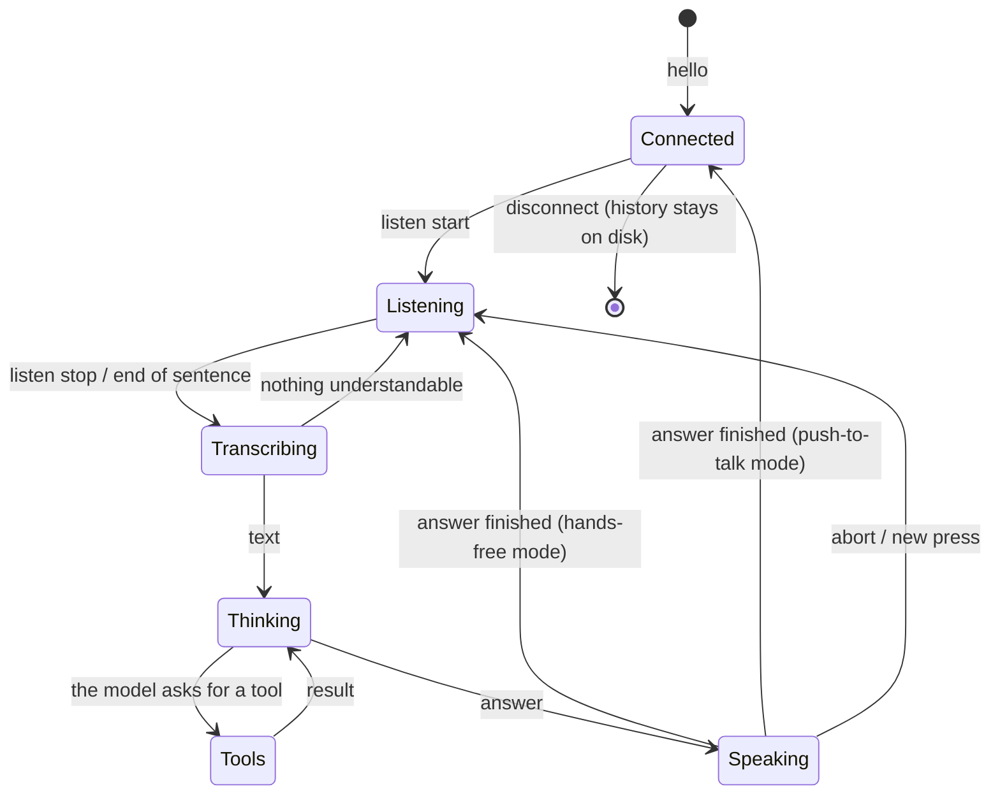
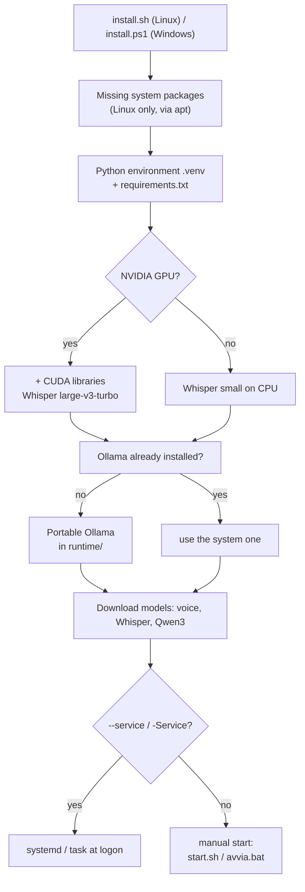

# How the app is built

🇮🇹 [Italiano](ARCHITETTURA.md) · 🇬🇧 English

This page explains how Husky locale is built: its components, what happens when you speak, how the code is
organised and how it was verified.

## 1. Components



| Module | What it does |
|---|---|
| `app.py` | Runs the web server: client page, OTA for devices, WebSocket, vision endpoint, history API, `/health`. Checks the token. |
| `session.py` | Implements the xiaozhi protocol for one connection: `hello`, `listen`, `abort`, `mcp`. Collects audio, decides when a sentence has ended, runs the turn and streams the voice back. |
| `audio.py` | Opus decoding and encoding (60 ms frames, 16 kHz in and 24 kHz out), resampling and end-of-sentence detection. |
| `engines.py` | Whisper (on the GPU if available, otherwise on the CPU) and Piper. Strips emoji and markdown before reading text aloud. |
| `llm.py` | Talks to the language model, runs the tools the model asks for, and repeats until there is an answer. With Ollama it downloads and preloads the model. |
| `tools.py` | Gathers MCP tools: the device's own (over WebSocket) and the HuskyLens 2 ones (over SSE, with automatic reconnection). |
| `history.py` | Saves questions and answers on the server's disk, one file per day, and serves them to the `/cronologia` page. |

## 2. What happens when you speak



## 3. Session states



## 4. Installation and startup



At startup (`start.sh` / `start.ps1`) Ollama is started, if it is not already running, on `127.0.0.1` only, with an
8192-token context. Then `server.py` starts and works offline, because the models are already on disk.

## 5. How it was verified

```mermaid
flowchart LR
    subgraph unit["Components"]
        T1["Opus: encode / decode"]
        T2["Whisper GPU vs CPU"]
        T3["MCP: official SDK +<br/>hand-written server (2024-11-05)"]
    end
    subgraph e2e["tests/test_suite.py: 28 checks"]
        E1["OTA, token, hello"]
        E2["voice → tool<br/>protocol v1 / v2 / v3"]
        E3["push-to-talk, hands-free,<br/>interruption, memory"]
        E4["HuskyLens, vision,<br/>latency, 3 devices"]
        E5["history on disk,<br/>token-protected"]
    end
    subgraph browser["tests/browser_mic_test.py"]
        B1["real Chrome with<br/>simulated microphone"]
    end
    subgraph net["Network check"]
        N1["no connections<br/>to the Internet"]
    end
    subgraph install["Clean installation"]
        I1["Windows 11 + GPU"]
        I2["Ubuntu 24.04 without GPU"]
    end
    unit --> e2e --> browser --> net --> install
```



All tests run with one command: `python tests/run_all.py` (Ollama must be running).

## 6. File layout

```
xiaozhi-local-server/
├── server.py                 entry point (switches to offline mode if the models are present)
├── config.yaml               configuration
├── install.sh / install.ps1  automatic installation, Linux / Windows
├── start.sh / start.ps1      start (Ollama + server); avvia.bat = double-click on Windows
├── verifica_privacy.ps1      network connection check
├── xiaozhi_locale/           server code
├── web/index.html            web client
├── web/cronologia.html       history page
├── data/history/             history (created on use, stays on the server only, excluded from Git)
├── PRIVACY.md / .en.md       privacy and how to verify it
├── scripts/download_models.py
├── tests/                    automated tests and simulators (HuskyLens, device, LLM)
└── docs/                     this page (ARCHITECTURE.md) and the Italian version (ARCHITETTURA.md)
```
