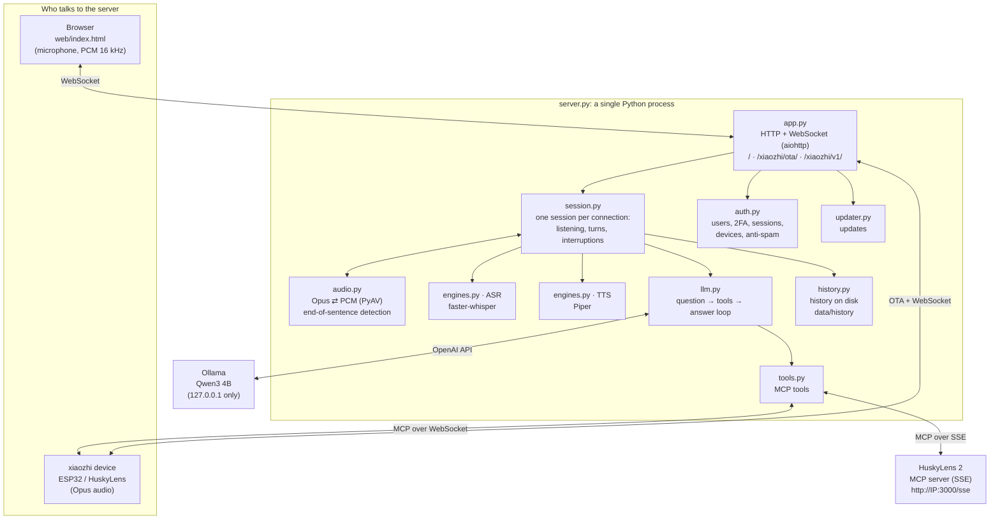
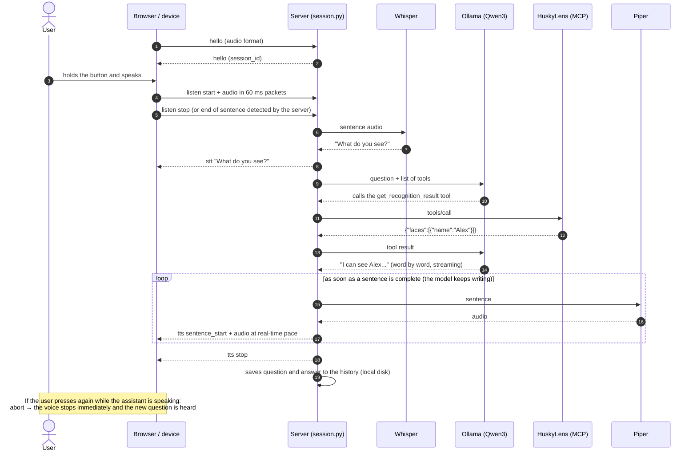
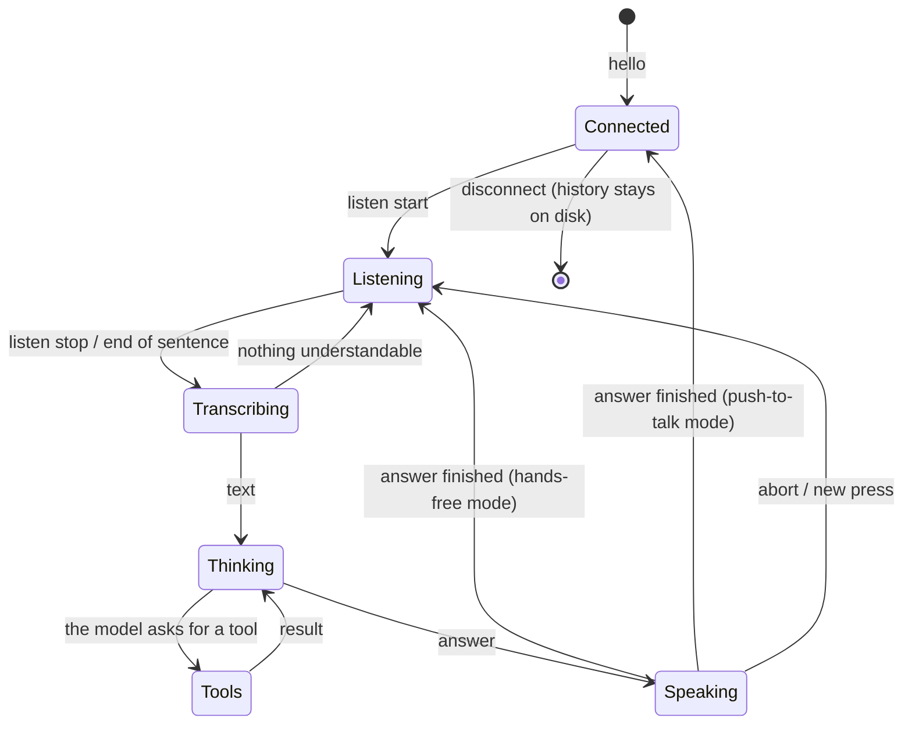
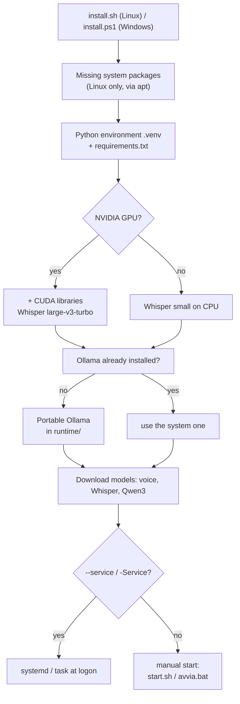
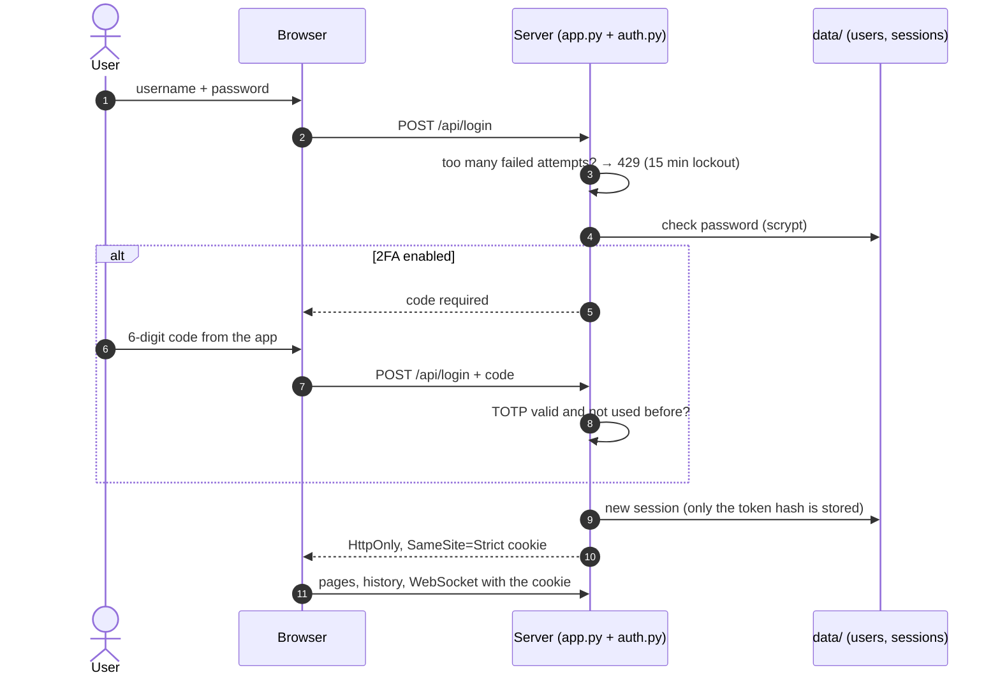
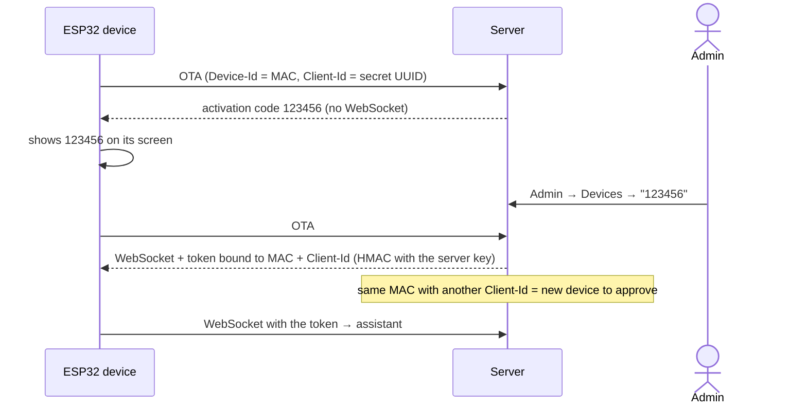

# How the app is built

🇮🇹 [Italiano](ARCHITETTURA.md) · 🇬🇧 English

This page explains how Husky locale is built: its components, what happens when you speak, how the code is
organised and how it was verified.

## 1. Components



| Module | What it does |
|---|---|
| `app.py` | Runs the web server: client page, OTA for devices, WebSocket, vision endpoint, history API, `/health`. Checks the token. |
| `session.py` | Implements the xiaozhi protocol for one connection: `hello`, `listen`, `abort`, `mcp`. Collects audio, decides when a sentence has ended, runs the turn and streams the voice back. |
| `audio.py` | Opus decoding and encoding (60 ms frames, 16 kHz in and 24 kHz out), resampling and end-of-sentence detection. |
| `engines.py` | Whisper (on the GPU if available, otherwise on the CPU) and Piper. Strips emoji and markdown before reading text aloud. |
| `llm.py` | Talks to the language model, runs the tools the model asks for, and repeats until there is an answer. With Ollama it downloads and preloads the model. |
| `tools.py` | Gathers MCP tools: the device's own (over WebSocket) and the HuskyLens 2 ones (over SSE, with automatic reconnection). |
| `history.py` | Saves questions and answers on the server's disk, one file per day, with the user who asked, and serves them to the `/cronologia` page. |
| `auth.py` | Users and passwords (scrypt), TOTP 2FA, sessions, device approval by code, anti-spam limits. |
| `config.py` | Merges `config.yaml` (defaults) and `data/config.yaml` (your settings); migrates the `data/` format. |
| `updater.py` | Checks GitHub releases and installs the new version keeping `data/`; tests it before restarting, confirms it afterwards and rolls back by itself if it does not start. |
| `privacy.py` | Checks that the language model and MCP servers are on this computer or the local network; otherwise the server does not start. |
| `cryptobox.py` | AES-256-GCM encryption of history and 2FA secrets. |
| `custom_tools.py` | Custom tools (commands, web, MQTT) created from the Admin page, off by default. |
| `notes.py`, `faq.py` | Per-user reminders (encrypted) and instant answers to frequent questions. |
| `mqtt_proto.py`, `mqtt_broker.py`, `mqtt_client.py` | MQTT 3.1.1 protocol, built-in broker (accounts, per-topic permissions, limits), client for external brokers. |
| `mqtt_hub.py` | Switching on from the Admin page, accounts, external brokers (LoRaWAN), last values, ESPHome discovery and auto-created tools. |
| `xiaozhi_mqtt.py` | xiaozhi MQTT+UDP protocol: commands over MQTT, AES-128-CTR encrypted voice over UDP, same Session as WebSocket. |
| `alerts.py` | Alerts to devices (Ogg Opus voice notification for MQTT devices), also scheduled. |
| `events.py` | Encrypted security log (logins, failed attempts, users, devices, updates, tools). |
| `tls.py` | HTTPS with an automatically generated self-signed certificate (or one you provide). |

**Streaming answers**: the model writes the answer word by word; as soon as a sentence is complete it is turned
into speech and sent, while the model keeps writing the next ones. The first word is heard after the first
sentence, not after the whole answer. The system prompt only contains the date (the time comes from the built-in
`ora_attuale` tool), so the start of the conversation stays identical and Ollama reuses the work already done.
Timings (speech recognition, first words from the model, first audio) are shown on the Admin page.

## 2. What happens when you speak



## 3. Session states



## 4. Installation and startup



At startup (`start.sh` / `start.ps1`) Ollama is started, if it is not already running, on `127.0.0.1` only, with an
8192-token context. Then `server.py` starts and works offline, because the models are already on disk.

## 5. How it was verified

```mermaid
flowchart LR
    subgraph unit["Components"]
        T1["Opus: encode / decode"]
        T2["Whisper GPU vs CPU"]
        T3["MCP: official SDK +<br/>hand-written server (2024-11-05)"]
        T4["test_units.py: 16<br/>history, encryption,<br/>permissions, privacy"]
    end
    subgraph e2e["test_suite.py: 28 checks"]
        E1["OTA, token, hello"]
        E2["voice → tool<br/>protocol v1 / v2 / v3"]
        E3["push-to-talk, hands-free,<br/>interruption, memory"]
        E4["HuskyLens, vision,<br/>latency, 3 devices"]
        E5["history on disk,<br/>token-protected"]
    end
    subgraph browser["tests/browser_mic_test.py"]
        B1["real Chrome with<br/>simulated microphone"]
    end
    subgraph sec["test_auth.py: 64 checks"]
        S1["login, lockout, 2FA,<br/>permissions, CSRF"]
        S2["devices, impersonation,<br/>HTTPS, encrypted data"]
    end
    subgraph upd["test_update.py: 23 checks"]
        U1["identical data<br/>after update"]
        U2["broken release, crash<br/>at startup → rollback"]
    end
    subgraph net["Network check"]
        N1["no connections<br/>to the Internet"]
    end
    subgraph install["Clean installation"]
        I1["Windows 11 + GPU"]
        I2["Ubuntu 24.04 without GPU"]
    end
    unit --> e2e --> browser --> net --> sec --> upd --> install
```



All tests run with one command: `python tests/run_all.py` (Ollama must be running; with `--mock` it also works without).

## 6. Security: login and devices





## 7. Updates

Code and data are kept apart: `config.yaml` and the program are replaced by updates; `data/` (personal settings,
users, devices, sessions, history), `models/` and `runtime/` never are. An update only starts from the Admin page
button (or `update.sh` / `update.ps1`); the flow diagram is in the [README](README.en.md#8-updates).

| Step | Detail |
|---|---|
| Check | `GET api.github.com/repos/<repo>/releases/latest` → version and release notes (`CHANGELOG`) |
| Hand edits | if `config.yaml` was edited (compared with `data/.manifest.json`), a copy is saved in `data/` |
| Backup | zip of the current code in `runtime/backups/` |
| Install | from Git (`git checkout <tag>`) or from the release zip; files are replaced with `os.replace` |
| Packages | `pip install -r requirements.txt` (and `requirements/gpu.txt` if the GPU libraries were installed) |
| Test | `server.py --selftest` on the new version: if it does not load, immediate restore |
| Failure | automatic restore from the backup (code and packages) |
| Restart | the server exits with code 42: `start.sh` / `start.ps1` / systemd restart it |
| Confirmation | `data/.update_pending.json`: removed when the new version stays up for 20 seconds |
| Automatic rollback | if the new version fails to start twice, the third start restores the backup and reports it in Admin |
| Migrations | on restart `config.py` upgrades the `data/` format if needed (`data/schema.json`) |

## 8. File layout

```
xiaozhi-local-server/
├── install.sh / install.ps1   automatic installation (Linux / Windows)
├── start.sh / start.ps1       start (Ollama + server); avvia.bat = double click on Windows
├── update.sh / update.ps1     update from the terminal
├── server.py                  the server
├── config.yaml                default settings (yours go in data/config.yaml)
├── requirements.txt           Python packages (requirements/: GPU and tests)
├── VERSION, CHANGELOG.md      version and release notes
├── xiaozhi_locale/            server code
├── web/                       pages: assistant, history, login, account, admin
├── scripts/                   model download, network connection check
├── docs/                      privacy, security, architecture (with diagrams)
├── tests/                     automated tests and simulators
└── data/                      YOUR DATA: created on first start, never touched by updates
```
