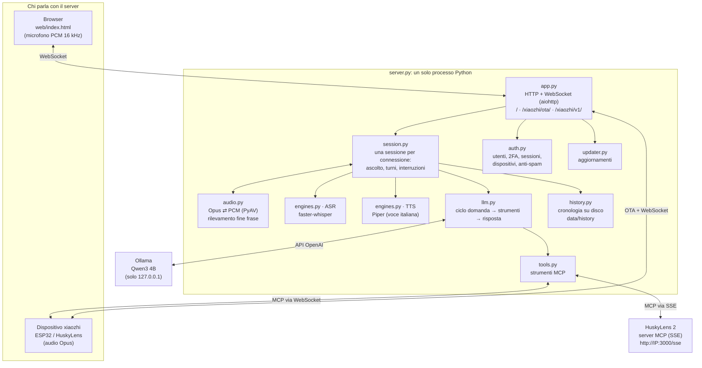
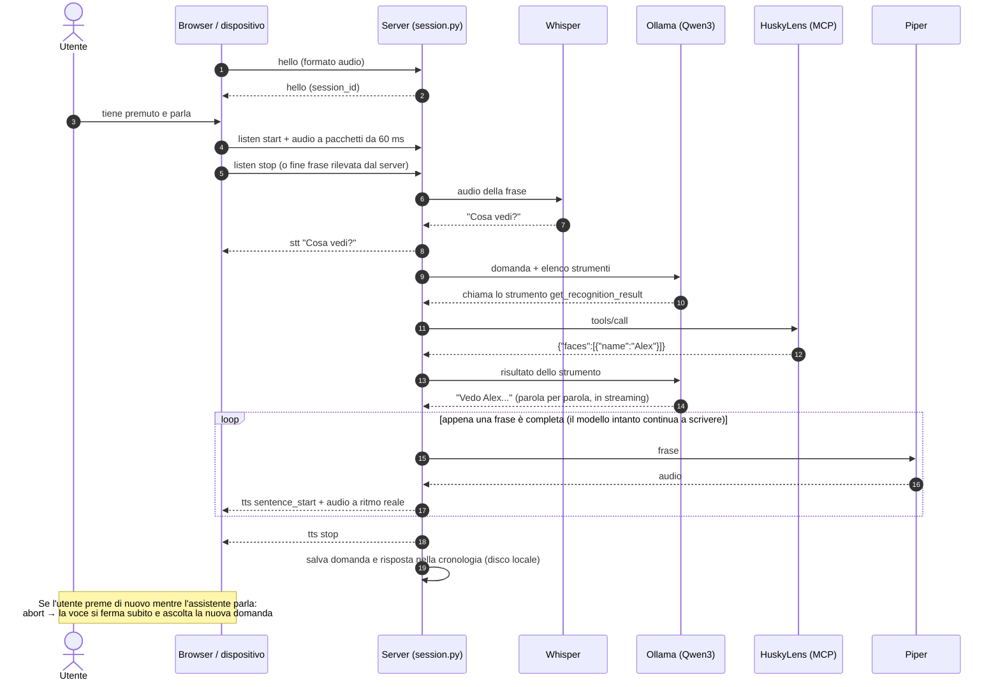
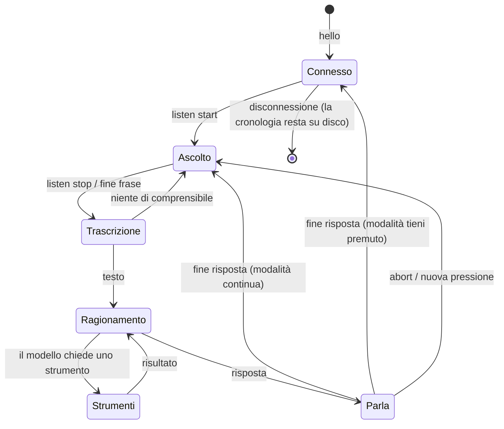
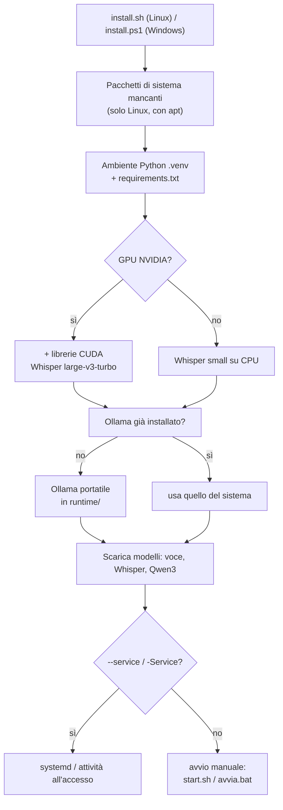
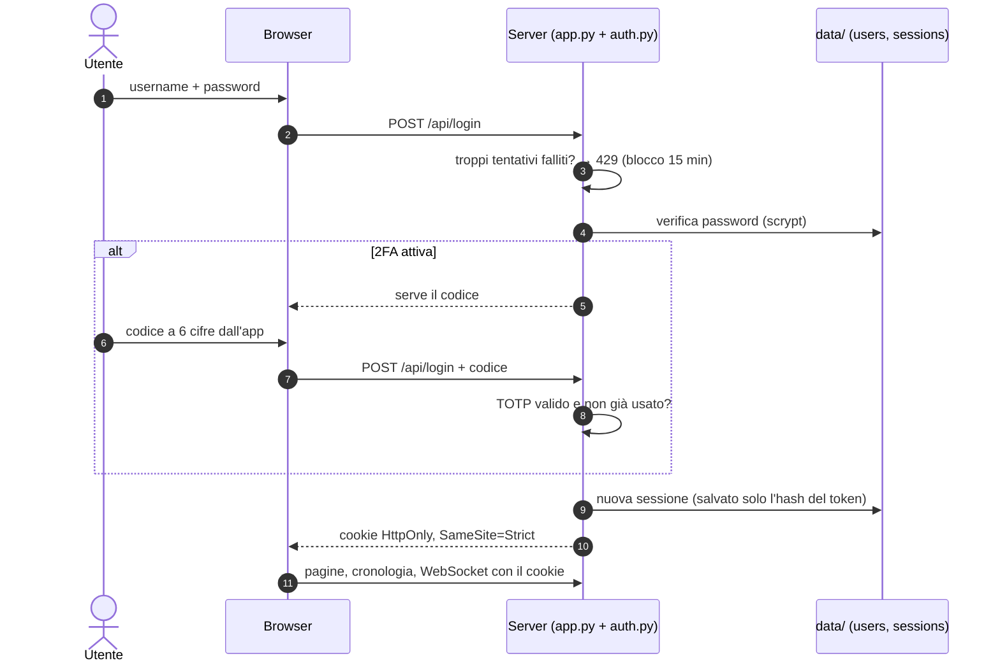
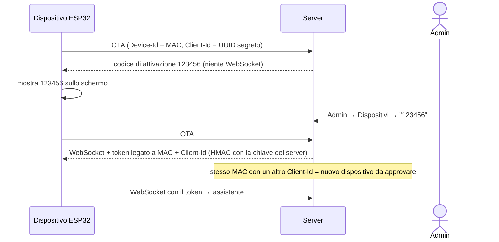

# Come è fatta l'app

🇮🇹 Italiano · 🇬🇧 [English](ARCHITECTURE.md)

Questa pagina spiega com'è costruito Husky locale: i componenti, cosa succede quando parli,
come è organizzato il codice e come è stato verificato.

## 1. Componenti



| Modulo | Cosa fa |
|---|---|
| `app.py` | Avvia il server web: pagina del client, OTA per i dispositivi, WebSocket, endpoint della visione, `/health`. Controlla il token. |
| `session.py` | Implementa il protocollo xiaozhi per una connessione: `hello`, `listen`, `abort`, `mcp`. Raccoglie l'audio, decide quando la frase è finita, esegue il turno e invia la voce. |
| `audio.py` | Decodifica e codifica Opus (frame da 60 ms, 16 kHz in ingresso e 24 kHz in uscita), ricampionamento e rilevamento della fine della frase. |
| `engines.py` | Whisper (sulla GPU se c'è, altrimenti sulla CPU) e Piper. Pulisce il testo da emoji e markdown prima di leggerlo. |
| `llm.py` | Parla con il modello linguistico, esegue gli strumenti che il modello chiede e ripete finché c'è una risposta. Con Ollama scarica e precarica il modello. |
| `tools.py` | Raccoglie gli strumenti MCP: quelli del dispositivo (via WebSocket) e quelli di HuskyLens 2 (via SSE, con riconnessione automatica). |
| `history.py` | Salva domande e risposte sul disco del server, un file per giorno, con l'utente che le ha fatte, e le fornisce alla pagina `/cronologia`. |
| `auth.py` | Utenti e password (scrypt), 2FA TOTP, sessioni, approvazione dei dispositivi con codice, limiti anti-spam. |
| `config.py` | Unisce `config.yaml` (predefiniti) e `data/config.yaml` (le tue impostazioni); migra il formato di `data/`. |
| `updater.py` | Controlla le release su GitHub e installa la nuova versione conservando `data/`; la prova prima del riavvio, la conferma dopo e torna indietro da sola se non parte. |
| `privacy.py` | Verifica che modello linguistico e server MCP siano su questo computer o in rete locale; altrimenti il server non parte. |
| `cryptobox.py` | Cifratura AES-256-GCM di cronologia e segreti 2FA. |
| `tls.py` | HTTPS con certificato autofirmato creato in automatico (o fornito dall'utente). |
| `custom_tools.py` | Strumenti personalizzati (comandi, web, MQTT) creati dalla pagina Admin, spenti di serie. |
| `notes.py`, `faq.py` | Promemoria per utente (cifrati) e risposte immediate a domande frequenti. |
| `mqtt_proto.py`, `mqtt_broker.py`, `mqtt_client.py` | Protocollo MQTT 3.1.1, broker integrato (account, permessi per argomento, limiti), client per broker esterni. |
| `mqtt_hub.py` | Accensione dalla pagina Admin, account, broker esterni (LoRaWAN), ultimi valori, riconoscimento ESPHome e strumenti creati da soli. |
| `xiaozhi_mqtt.py` | Protocollo xiaozhi MQTT+UDP: comandi via MQTT, voce cifrata AES-128-CTR via UDP, stessa Session del WebSocket. |
| `knowledge.py` | Documenti del prof: testo da PDF/Word/HTML, pezzi, ricerca BM25 per l'italiano, strumento cerca_documenti e contesto automatico per le domande pertinenti. Cifrati. |
| `lessons.py` | Modalità lezione: trascrizione, "fine della lezione", riassunto a parti per le lezioni lunghe, archivio cifrato. |
| `memory.py` | Ricordi per utente: strumento del modello ed estrazione in sottofondo dalle frasi personali; nel prompt come informazioni certe. |
| `personas.py` | Personaggi (istruzioni, voce, lingua, strumenti), per dispositivo, dalla pagina o a voce. |
| `mcp_hub.py` | Server MCP aggiunti dalla pagina Admin (SSE, Streamable HTTP, programmi stdio) con i loro ruoli; punti di accesso MCP (WebSocket compatibile con xiaozhi.me). |
| `esphome_native.py` | ESPHome con l'API nativa (aioesphomeapi): scoperta mDNS, strumenti, schede vocali (stessa Session in PCM, voce in streaming o WAV), annunci. |
| `firmware.py` | Firmware caricati dall'admin e manifest per ESP Web Tools (installazione dal browser via Web Serial). |
| `alerts.py` | Avvisi ai dispositivi (notifica vocale Ogg Opus per i dispositivi MQTT), anche programmati. |
| `events.py` | Registro di sicurezza cifrato (accessi, tentativi falliti, utenti, dispositivi, aggiornamenti, strumenti). |

**Risposte in streaming**: il modello scrive la risposta parola per parola; appena una frase è completa viene
trasformata in voce e inviata, mentre il modello continua con le successive. La prima parola si sente quindi dopo
la prima frase, non dopo l'intera risposta. Nel prompt di sistema c'è solo la data (l'ora la fornisce lo strumento
interno `ora_attuale`): così l'inizio della conversazione resta identico e Ollama riusa i calcoli già fatti a ogni turno.
I tempi (riconoscimento, prime parole del modello, prima voce) sono visibili nella pagina Admin.

## 2. Cosa succede quando parli



## 3. Stati di una sessione



## 4. Installazione e avvio



All'avvio (`start.sh` / `start.ps1`) viene acceso Ollama, se non è già attivo, solo su `127.0.0.1`, con il
contesto da 8192 token. Poi parte `server.py`, che lavora offline perché i modelli sono già sul disco.

## 5. Come è stato verificato

```mermaid
flowchart LR
    subgraph unit["Componenti"]
        T1["Opus: codifica / decodifica"]
        T2["Whisper GPU vs CPU"]
        T3["MCP: SDK ufficiale +<br/>server scritto a mano (2024-11-05)"]
        T4["test_units.py: 16<br/>cronologia, cifratura,<br/>permessi, privacy"]
    end
    subgraph e2e["test_suite.py: 28 controlli"]
        E1["OTA, token, hello"]
        E2["voce → strumento<br/>protocollo v1 / v2 / v3"]
        E3["tieni premuto, continua,<br/>interruzione, memoria"]
        E4["HuskyLens, visione,<br/>latenza, 3 dispositivi"]
        E5["cronologia su disco,<br/>protetta da token"]
    end
    subgraph browser["tests/browser_mic_test.py"]
        B1["Chrome vero con<br/>microfono simulato"]
    end
    subgraph sec["test_auth.py: 64 controlli"]
        S1["login, blocco, 2FA,<br/>permessi, CSRF"]
        S2["dispositivi, impersonazione,<br/>HTTPS, dati cifrati"]
    end
    subgraph upd["test_update.py: 23 controlli"]
        U1["dati identici dopo<br/>l'aggiornamento"]
        U2["release difettosa, crash<br/>all'avvio → ripristino"]
    end
    subgraph net["Controllo di rete"]
        N1["nessuna connessione<br/>verso Internet"]
    end
    subgraph install["Installazione da zero"]
        I1["Windows 11 + GPU"]
        I2["Ubuntu 24.04 senza GPU"]
    end
    unit --> e2e --> browser --> net --> sec --> upd --> install
```



Tutti i test si lanciano con un comando: `python tests/run_all.py` (serve Ollama acceso; con `--mock` funziona anche senza).

## 6. Sicurezza: accesso e dispositivi





## 7. Aggiornamenti

Il codice e i dati sono separati: `config.yaml` e il programma vengono sostituiti dagli aggiornamenti,
`data/` (impostazioni personali, utenti, dispositivi, sessioni, cronologia), `models/` e `runtime/` mai.
L'aggiornamento parte solo dal pulsante della pagina Admin (o da `update.sh` / `update.ps1`); il diagramma
del flusso è nel [README](../README.md#8-aggiornamenti).

| Passo | Dettaglio |
|---|---|
| Controllo | `GET api.github.com/repos/<repo>/releases/latest` → versione e novità (`CHANGELOG`) |
| Modifiche a mano | se `config.yaml` è stato modificato (confronto con `data/.manifest.json`), una copia va in `data/` |
| Backup | zip del codice attuale in `runtime/backups/` |
| Installazione | da Git (`git checkout <tag>`) oppure dallo zip della release; i file vengono sostituiti con `os.replace` |
| Pacchetti | `pip install -r requirements.txt` (e `requirements/gpu.txt` se c'era la GPU) |
| Prova | `server.py --selftest` con la nuova versione: se non si carica, ripristino immediato |
| Errore | ripristino automatico dal backup (codice e pacchetti) |
| Riavvio | il server esce con codice 42: `start.sh` / `start.ps1` / systemd lo riavviano |
| Conferma | `data/.update_pending.json`: tolto quando la nuova versione resta in piedi 20 secondi |
| Ritorno automatico | se la nuova versione non parte per 2 avvii, al terzo rimette il backup e lo segnala in Admin |
| Migrazioni | al riavvio `config.py` aggiorna il formato di `data/` se serve (`data/schema.json`) |

## 8. Struttura dei file

```
xiaozhi-local-server/
├── install.sh / install.ps1   installazione automatica (Linux / Windows)
├── start.sh / start.ps1       avvio (Ollama + server); avvia.bat = doppio clic su Windows
├── update.sh / update.ps1     aggiornamento da terminale
├── server.py                  il server
├── config.yaml                impostazioni predefinite (le tue vanno in data/config.yaml)
├── requirements.txt           pacchetti Python (requirements/: GPU e test)
├── VERSION, CHANGELOG.md      versione e novità
├── xiaozhi_locale/            codice del server
├── web/                       pagine: assistente, cronologia, login, account, admin
├── scripts/                   download dei modelli, controllo delle connessioni di rete
├── docs/                      privacy, sicurezza, architettura (con diagrammi)
├── tests/                     test automatici e simulatori
└── data/                      I TUOI DATI: creata al primo avvio, mai toccata dagli aggiornamenti
```
