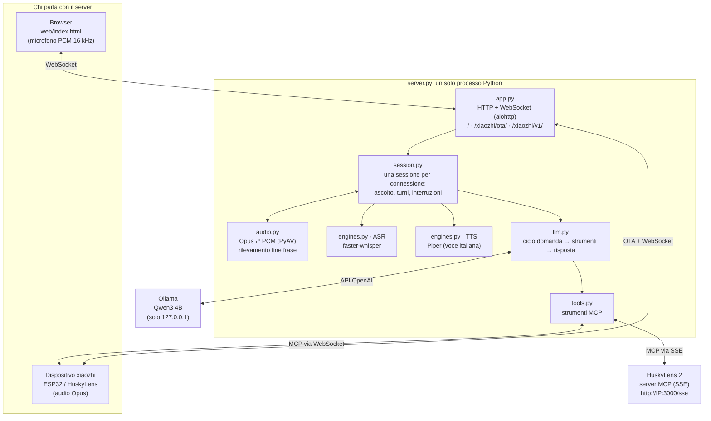
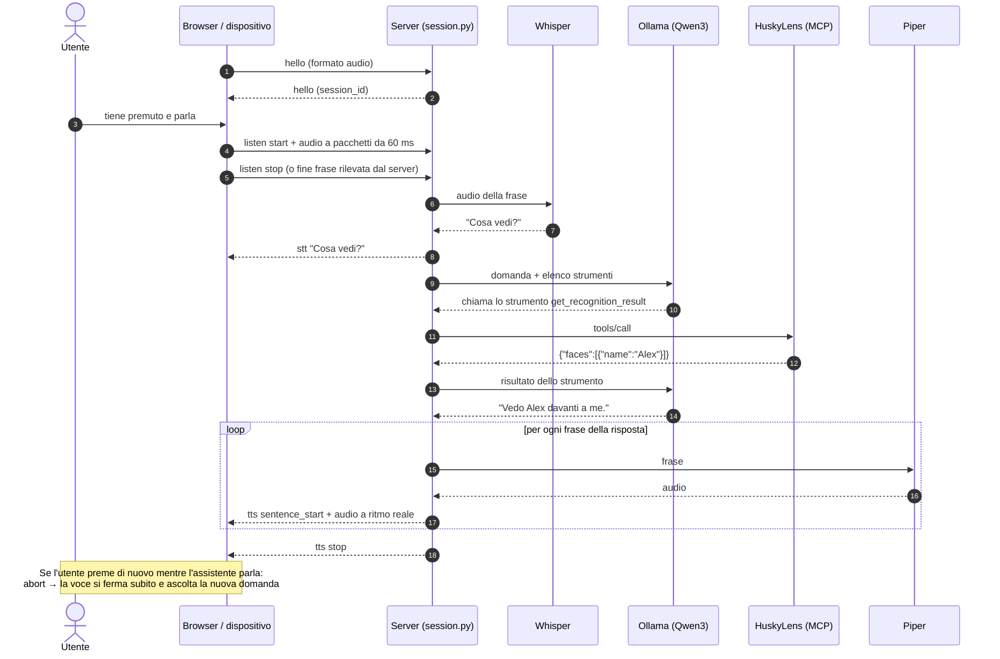
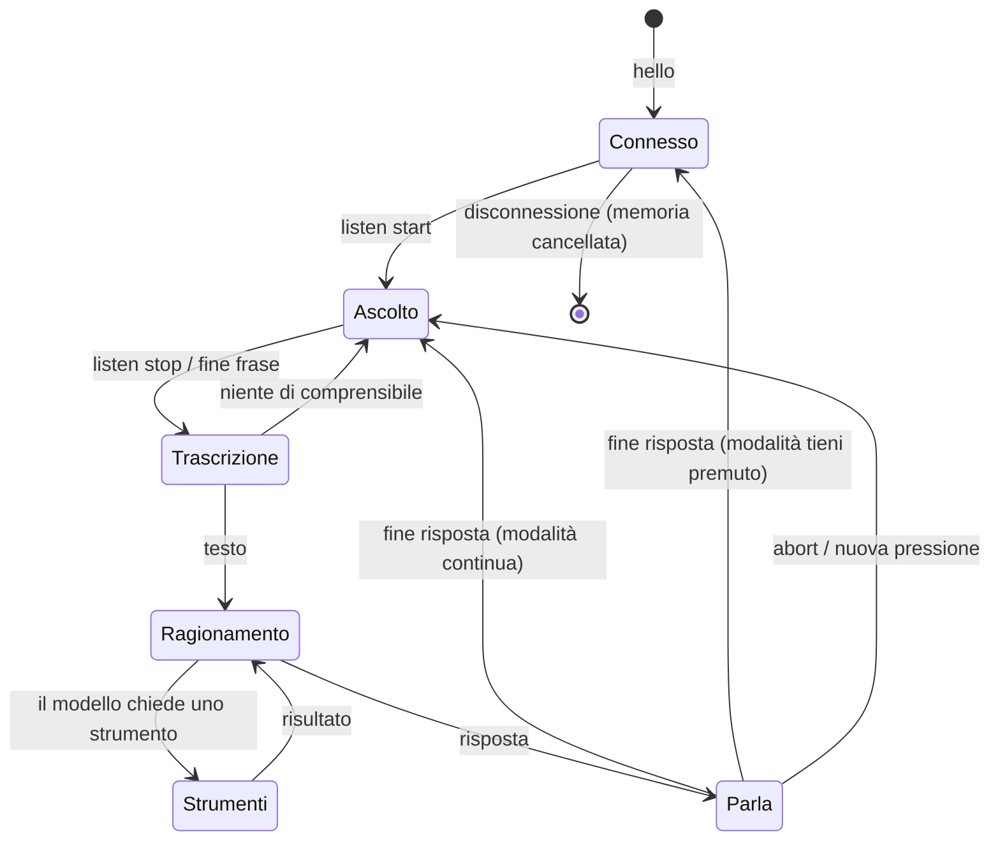
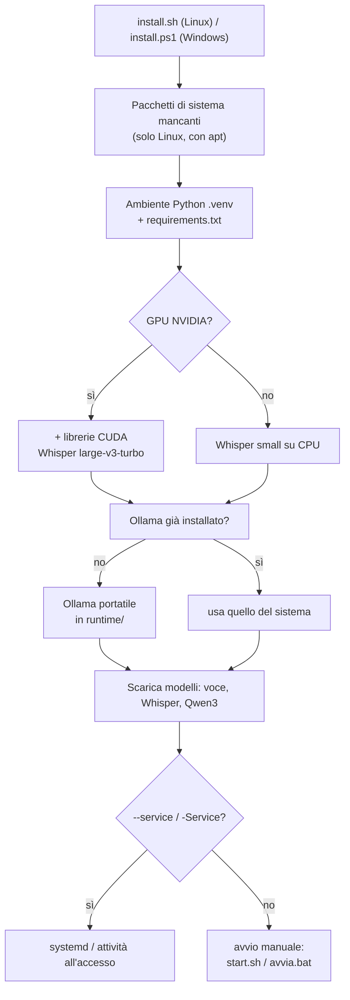

# Come è fatta l'app

Questa pagina spiega com'è costruito Husky locale: i componenti, cosa succede quando parli,
come è organizzato il codice e come è stato verificato.

## 1. Componenti



| Modulo | Cosa fa |
|---|---|
| `app.py` | Avvia il server web: pagina del client, OTA per i dispositivi, WebSocket, endpoint della visione, `/health`. Controlla il token. |
| `session.py` | Implementa il protocollo xiaozhi per una connessione: `hello`, `listen`, `abort`, `mcp`. Raccoglie l'audio, decide quando la frase è finita, esegue il turno e invia la voce. |
| `audio.py` | Decodifica e codifica Opus (frame da 60 ms, 16 kHz in ingresso e 24 kHz in uscita), ricampionamento e rilevamento della fine della frase. |
| `engines.py` | Whisper (sulla GPU se c'è, altrimenti sulla CPU) e Piper. Pulisce il testo da emoji e markdown prima di leggerlo. |
| `llm.py` | Parla con il modello linguistico, esegue gli strumenti che il modello chiede e ripete finché c'è una risposta. Con Ollama scarica e precarica il modello. |
| `tools.py` | Raccoglie gli strumenti MCP: quelli del dispositivo (via WebSocket) e quelli di HuskyLens 2 (via SSE, con riconnessione automatica). |

## 2. Cosa succede quando parli



## 3. Stati di una sessione



## 4. Installazione e avvio



All'avvio (`start.sh` / `start.ps1`) viene acceso Ollama, se non è già attivo, solo su `127.0.0.1`, con il
contesto da 8192 token. Poi parte `server.py`, che lavora offline perché i modelli sono già sul disco.

## 5. Come è stato verificato

```mermaid
flowchart LR
    subgraph unit["Componenti"]
        T1["Opus: codifica / decodifica"]
        T2["Whisper GPU vs CPU"]
        T3["MCP: SDK ufficiale +<br/>server scritto a mano (2024-11-05)"]
    end
    subgraph e2e["tests/test_suite.py: 24 controlli"]
        E1["OTA, token, hello"]
        E2["voce → strumento<br/>protocollo v1 / v2 / v3"]
        E3["tieni premuto, continua,<br/>interruzione, memoria"]
        E4["HuskyLens, visione,<br/>latenza, 3 dispositivi"]
    end
    subgraph browser["tests/browser_mic_test.py"]
        B1["Chrome vero con<br/>microfono simulato"]
    end
    subgraph install["Installazione da zero"]
        I1["Windows 11 + GPU"]
        I2["Ubuntu 24.04 senza GPU"]
    end
    unit --> e2e --> browser --> install
```



Tutti i test si lanciano con un comando: `python tests/run_all.py` (serve Ollama acceso).

## 6. Struttura dei file

```
xiaozhi-local-server/
├── server.py                 avvio (attiva la modalità offline se i modelli ci sono)
├── config.yaml               configurazione
├── install.sh / install.ps1  installazione automatica Linux / Windows
├── start.sh / start.ps1      avvio (Ollama + server); avvia.bat = doppio clic su Windows
├── verifica_privacy.ps1      controllo delle connessioni di rete
├── xiaozhi_locale/           codice del server
├── web/index.html            client web
├── scripts/download_models.py
├── tests/                    test automatici e simulatori (HuskyLens, dispositivo, LLM)
└── docs/ARCHITETTURA.md      questa pagina
```
