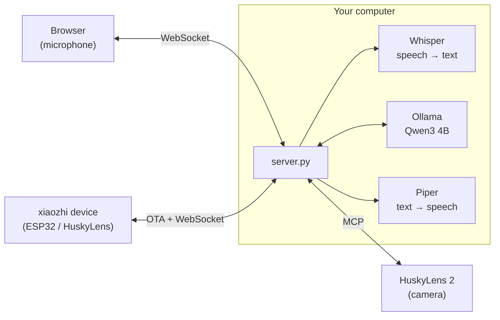
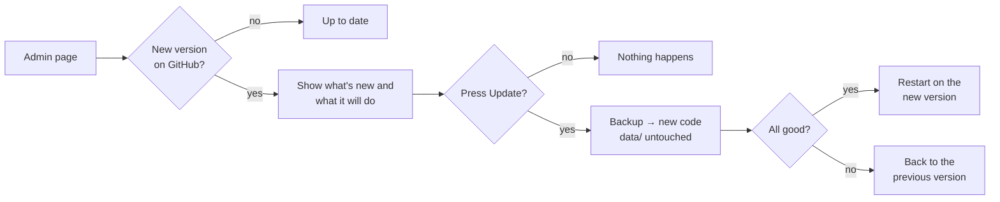

# Husky locale: a privacy-first xiaozhi server

🇮🇹 [Italiano](../README.md) · 🇬🇧 English

A **self-hosted**, open source server compatible with [xiaozhi](https://github.com/78/xiaozhi-esp32), to use instead
of the `xiaozhi.me` cloud, with HuskyLens 2 support via MCP.
Voice, transcripts, answers and camera results **never leave your network**: everything runs on your own
computer, Linux or Windows, with or without a GPU.

| | xiaozhi.me (cloud, China) | Husky locale |
|---|---|---|
| Account | phone number + SMS | none |
| Speech → text | remote servers | **faster-whisper** (large-v3-turbo on GPU, small on CPU) |
| Brain (LLM) | cloud models | **Qwen3 4B** via Ollama, on your computer |
| Text → speech | remote servers | **Piper**, on your computer |
| Where your data ends up | third-party servers in China | **only on your server** (history on your disk, if enabled) |
| Camera commands (MCP) | routed through the cloud | from your server straight to the HuskyLens |
| Internet connections while in use | always | **none** |
| Access | cloud account | **local users with password and 2FA**, anti-bot protection |
| Updates | decided by the cloud | **"Update" button** on the Admin page, your data is kept |

📄 **[Privacy](PRIVACY.en.md)** · 🧩 **[How the app is built](ARCHITECTURE.md)** · 🔄 **[Release notes](../CHANGELOG.md)** · 💬 **[Request a change](#9-requesting-changes-and-updating)** · ✉️ **[giacomo.dev@icloud.com](mailto:giacomo.dev@icloud.com)**

> The assistant speaks Italian by default (Whisper `language: it`, Italian Piper voice, Italian system prompt).
> To use another language, change `asr.language`, `tts.voice` and `assistant.system_prompt` in `data/config.yaml`
> (see [Other languages](#other-languages)).

## Architecture



The server implements the official xiaozhi-esp32 protocol: OTA, WebSocket with binary framing v1/v2/v3,
Opus at 16 kHz in and 24 kHz out with 60 ms frames, and MCP wrapped in `type: "mcp"` messages
(with `nextCursor` pagination). Details in [docs/ARCHITECTURE.md](ARCHITECTURE.md).

## 1. Automatic installation (once)

Works on **Linux** (Ubuntu/Debian and similar, x86_64 or ARM64) and **Windows 10/11**, with or without an NVIDIA card.
The script installs everything **inside the project folder**: Python environment, portable Ollama (unless it is
already installed), Piper voice, Whisper and the language model. You need about 8 GB of free space and an
Internet connection for this step only.

**Linux**

```bash
git clone https://github.com/BitJacker/xiaozhi-local-server.git && cd xiaozhi-local-server
./install.sh              # or: ./install.sh --service   (start automatically with systemd)
```

On Debian/Ubuntu it installs any missing packages by itself (`python3-venv`, `curl`, `zstd`): root or `sudo` required.

**Raspberry Pi and computers without a GPU and little RAM**: `install.sh` automatically picks a **light profile**
(Whisper `base`, model `qwen2.5:3b` with 8 GB of RAM or `qwen2.5:1.5b` with 4 GB) and writes it to `data/config.yaml`.
Force it with `./install.sh --light` (or `--full` for the normal profile). The light profile was tested on Linux without
a GPU; **timings on a real Raspberry Pi have not been measured yet**: expect slower answers than on a PC (tens of seconds
on a Pi 4, less on a Pi 5).

**Windows** (PowerShell, no administrator rights needed)

```powershell
powershell -ExecutionPolicy Bypass -File install.ps1           # add -Service to start automatically at logon
```

Requires [Python 3.10+](https://www.python.org/downloads/) (tick "Add to PATH").

| What | With NVIDIA GPU | Without GPU |
|---|---|---|
| Whisper | `large-v3-turbo` (~1 s per sentence) | `small` on CPU (~2-4 s per sentence) |
| LLM (Ollama) | on the GPU | on the CPU (slower, but works) |

The default language model is `qwen3:4b-instruct-2507-q4_K_M` (2.5 GB): good at Italian and English, supports
tool calling and keeps its safety filters. Change it in `data/config.yaml` → `llm.model` (other tool-capable options:
`llama3.2:3b`, `llama3.1:8b`, `mistral-nemo`); Ollama downloads it automatically on first start.
Avoid "abliterated" / "uncensored" models: their safety filters have been removed.

Prefer **LM Studio**? Set `base_url: http://localhost:1234/v1` and the LM Studio model name in `data/config.yaml`.

## 2. Starting

| System | Command |
|---|---|
| Linux | `./start.sh` (or the service: `sudo systemctl status husky-locale`, logs with `journalctl -u husky-locale -f`) |
| Windows | double-click **`avvia.bat`** (also opens the browser) |

After installation the server works **completely offline**: the models are already on the machine and Ollama
only listens on `127.0.0.1`. To check it on Windows: `powershell -ExecutionPolicy Bypass -File scripts\verifica_privacy.ps1`;
on Linux: `ss -tnp | grep -E 'python|ollama'`.

The server prints its addresses:

```
  Husky locale v1.5.0   (dati in .../data)
  Client web:   http://PC-IP:8000/
  URL OTA:      http://PC-IP:8000/xiaozhi/ota/
  WebSocket:    ws://PC-IP:8000/xiaozhi/v1/

  PRIMO ACCESSO: apri http://localhost:8000/login
  utente: admin   password: Passw0rd!
```

**First sign-in** ("PRIMO ACCESSO"): user **`admin`**, password **`Passw0rd!`**. This password is public (it is written here), so at
the first sign-in the server makes you **change it right away**: until you do, nothing else can be used, neither from
the browser nor from devices. Then you can turn on two-step verification (2FA) on the **Account** page.
If you prefer the administrator to be created only with a code shown in the server terminal, set
`auth.default_admin: false` in `data/config.yaml` before the first start.

**Website in Italian and English, light or dark**: at the top right of every page there are the **IT / EN** and
**A / ☀ / ☾** (automatic, light, dark) buttons; the browser remembers them.

**Your settings** go in `data/config.yaml`, not in `config.yaml`: write only the keys you want to change, with the
same structure. `config.yaml` holds the defaults and is replaced by updates.

## 3. Connecting a HuskyLens 2 (recommended)

1. On the HuskyLens 2 (firmware ≥ 1.1.6, Wi-Fi module fitted, same network as the PC): Settings → **MCP** → enable.
   An address like `http://HUSKYLENS-IP:3000/sse` appears.
2. In `data/config.yaml`:
   ```yaml
   mcp_servers:
     - name: huskylens
       url: http://HUSKYLENS-IP:3000/sse
   ```
3. **Turn off "Xiaozhi AI"** in the HuskyLens menu, so it stops connecting to xiaozhi.me.
4. Start the server: the log shows `MCP 'huskylens' connesso: N tool`. If the HuskyLens is switched off or
   restarted, the server reconnects automatically.
5. Open `http://localhost:8000/` in Chrome on the server PC, then hold **"Tieni premuto per parlare"** (push to talk)
   or enable **"Conversazione continua"** (hands-free). Try "what do you see?", "switch to face recognition",
   "learn this face and call it Marco".

**Permissions**: regular users can only *read* from the camera (results, lists, photos); teaching or forgetting objects,
switching modes or changing parameters is reserved to admins and devices. The full table is on the **Admin** page; change
it with `tool_permissions` in `data/config.yaml`.

If a tool returns an **image** (e.g. a photo), it is described by the local vision model if one is set
(`llm.vision_model`, for example `qwen2.5vl:3b` with Ollama); otherwise the assistant says so clearly.

The PC is the microphone and speaker; the HuskyLens is the "eyes". Camera commands and results travel only between
your server and the HuskyLens on your local network: no cloud in between.

**About the built-in "Xiaozhi AI" on HuskyLens 2**: DFRobot's official guide shows no option to change the server
address, which is fixed to xiaozhi.me. That is why the method above is recommended. If a future firmware allows
setting the OTA address, just use the one from the next section.

## 4. Connecting xiaozhi devices (ESP32)

Any device running the [xiaozhi-esp32](https://github.com/78/xiaozhi-esp32) firmware can use this server instead of
xiaozhi.me:

- **Official firmware**: on the device's Wi-Fi setup page (hotspot `Xiaozhi-xxxx`) → advanced options →
  **OTA address** = `http://PC-IP:8000/xiaozhi/ota/`.
- **Self-built firmware**: `idf.py menuconfig` → `CONFIG_OTA_URL` = the same address.

On first connection the device shows a **6-digit code** on its screen: enter it in **Admin → Dispositivi** (devices) to authorise it (see section 6). The server never forces firmware updates.
The device's MCP tools (volume, brightness, camera...) are discovered automatically. If you set `llm.vision_model`
(a local vision model) in `data/config.yaml`, camera photos are analysed at `/xiaozhi/vision/explain`, locally.

## 5. HTTPS and microphone from other PCs or phones

The server creates its own certificate and also answers on **`https://PC-IP:8443`**: open that address from another PC
or a phone (anyone opening `http://PC-IP:8000` is redirected there). The first time, the browser warns that the
certificate is not from a public authority: that's expected, your server made it. Accept it once: from then on
passwords, cookies and voice travel **encrypted** and the microphone works from other devices too.

- On the server itself you can also use `http://localhost:8000`.
- xiaozhi devices (ESP32) stay on HTTP port 8000, because their firmware does not accept self-signed certificates:
  keep them on a trusted local network.
- Have a real certificate (e.g. for a domain)? Set `server.tls_cert` and `server.tls_key`. Turn HTTPS off with
  `server.https_port: 0`.

Microphone filters, configurable in the URL:

| Parameter | Default | Effect |
|---|---|---|
| `ec` | `1` | echo cancellation |
| `ns` | `0` | Chrome noise suppression (add `?ns=1` in very noisy rooms) |
| `agc` | `1` | automatic gain control |

If end-of-sentence detection triggers too early or too late, tune `vad.energy_threshold` and `vad.silence_ms`
in `data/config.yaml`.

## 6. Accounts, 2FA and anti-bot protection

Every page (assistant, history, account, admin) requires login.

| Feature | How it works |
|---|---|
| **Users** | The admin creates them on the **Admin** page (username and initial password), as *user* or *admin*. |
| **Passwords** | Stored hashed (scrypt with random salt), never in clear text. Minimum length is configurable. |
| **2FA** | Each user enables it from **Account** with an authenticator app (Google Authenticator, Microsoft Authenticator, Aegis, 2FAS…): scan a QR code, then a 6-digit code is required at login. A code cannot be used twice. With `auth.require_2fa: true` it becomes mandatory for everyone. |
| **Lockout** | After 5 wrong passwords the account is locked for 15 minutes (per IP address too, with a wider margin). |
| **Anti-spam** | Limits on requests per IP, questions per minute per user and simultaneous connections per IP. |
| **Sessions** | Protected cookie (HttpOnly, SameSite=Strict) that expires after 7 days. Changing the password ends all sessions. |
| **History** | Each user sees only their own conversations; the admin sees all of them and can delete them. |
| **Web protections** | Content-Security-Policy, CSRF and clickjacking protection. |

Everything is configurable in `data/config.yaml`, sections `auth:` and `limits:`.

**xiaozhi devices (ESP32)**: a new device shows a **6-digit code** on its screen (like xiaozhi.me used to). The admin
enters it on **Admin → Dispositivi** and the device is authorised; until then it cannot use the assistant. Devices can
also be revoked there. Authorisation is bound to the **MAC + Client-Id** pair: the Client-Id is a random code the device
generates and never shows. Knowing the MAC of an approved device (easy to find) is not enough to impersonate it:
whoever tries just gets a new code to approve.

> If the server must be reachable **from the Internet** (not just your local network), put it behind a reverse proxy
> with a real certificate (Caddy, nginx) and keep the ESP32 devices on the local network.

**Firewall (recommended)**: open only the server ports, and only to your local network.

```bash
# Linux (UFW): replace 192.168.1.0/24 with your network
sudo ufw allow from 192.168.1.0/24 to any port 8000,8443 proto tcp
# only if you use MQTT: broker (TCP 1883) and xiaozhi MQTT+UDP voice (UDP 8884)
sudo ufw allow from 192.168.1.0/24 to any port 1883 proto tcp
sudo ufw allow from 192.168.1.0/24 to any port 8884 proto udp
sudo ufw enable
```

```powershell
# Windows (PowerShell as administrator)
New-NetFirewallRule -DisplayName "Husky locale" -Direction Inbound -Protocol TCP -LocalPort 8000,8443 -RemoteAddress LocalSubnet -Action Allow
```

Ollama only listens on `127.0.0.1` and must not be opened. On Linux the service created by `install.sh --service`
runs with systemd protections: it cannot gain privileges or modify the system, and the files it creates are readable
only by its user (install it with a normal user, not root).

**Also**: revoking a user or device closes their open connections immediately; the **Admin** page has a
**security log** (logins, failed attempts, locked accounts, user and device changes, updates, tools that change
something) that never contains conversation content and is encrypted on disk; tool arguments are checked against the
tool's schema before the call, which together with per-role permissions limits what a crafted prompt can make
the model do.

## 7. Privacy, history and security

- **No data is sent to external servers**: not to the xiaozhi.me servers in China, not to anyone else. Voice,
  questions, answers and camera commands (MCP) stay on your server and your network. Details and how to verify
  it in [PRIVACY.en.md](PRIVACY.en.md).
- **History**: conversations are saved on your server's disk (`data/history`) and can be read at `/cronologia`,
  where you can also delete a day. By default they are **deleted after 30 days** (`history.keep_days`, checked every
  hour even if the server never restarts); turn it off with `history.enabled: false`.
- **Encryption**: history and 2FA secrets are stored **encrypted** (AES-256-GCM, `security.encrypt_data`). The key is in
  `data/encryption.key`: to protect against disk theft too, use disk encryption (BitLocker / LUKS) or keep the key
  elsewhere (`security.key_file`).
- **Address check**: if the language model or an MCP server were configured with an Internet address, the server
  **refuses to start** and explains why, unless `privacy.allow_external: true`. The Admin page shows where the server
  connects to.
- The only Internet connections happen during installation and when you check for updates.
- `server.tokens` (optional) adds fixed tokens for scripts or manually configured devices, on top of the accounts.
- **Updates** contact GitHub only from the Admin page (when it opens, to see if a new version exists, or with the
  button): no data is sent. Turn the automatic check off with `update.check_on_admin_open: false`.

## Other languages

Everything runs locally, so switching language only means changing three settings in `data/config.yaml`:

```yaml
assistant:
  system_prompt: |
    You are Husky, a friendly voice assistant. Always answer in English, in short sentences...
asr:
  language: en
tts:
  voice: models/piper/en_US-lessac-medium.onnx
```

Download the voice once with `python -m piper.download_voices --download-dir models/piper en_US-lessac-medium`
(list of voices: [rhasspy/piper-voices](https://huggingface.co/rhasspy/piper-voices)). The web interface labels are in Italian.

## MQTT, sensors, LoRaWAN and ESPHome

From **Admin → MQTT and sensors** you turn on the **built-in MQTT broker** (port 1883, off by default). No need to
install Mosquitto.

| What | How |
|---|---|
| **Sensors and actuators** (ESP8266, ESP32, Wi-Fi Arduino) | Create an **account** (name, password, topics it may write and read) and put it in the device. Then in **Tools** add "Read a sensor" or "Command a device" with the right topic: "what's the temperature in room 1?", "turn on the light". |
| **ESPHome** | Add the `mqtt:` block (below) to the device YAML. Sensors, switches, lights, buttons, numbers and selects **appear on their own** and become Husky tools: reading for everyone, controlling only for administrators and devices (`mqtt.esphome_command_roles`). |
| **LoRaWAN** | LoRaWAN sensors go through a network server: in **External brokers** connect The Things Network or ChirpStack (address, port 8883 with TLS, user and API key, topics `v3/APP-ID@ttn/devices/+/up`), then add the ready-made "LoRaWAN sensor" tool with the field to read (e.g. `uplink_message.decoded_payload.temperature`). |
| **xiaozhi devices over MQTT+UDP** | With the "xiaozhi devices over MQTT+UDP" switch, approved devices get from OTA the details to connect over MQTT: commands over MQTT, **AES-128-encrypted voice over UDP** (port 8884). This way they can receive **voice alerts even when idle**. |

```yaml
# ESPHome: add this to the device YAML
mqtt:
  broker: 192.168.1.50        # address of the Husky server
  username: lab               # account created in Admin → MQTT and sensors
  password: !secret mqtt_password
```

Security: nobody gets into the broker without an account (or without being an approved xiaozhi device); each account
writes and reads only its own topics; limits on connections and messages per second; deleting an account or revoking
a device disconnects it at once. The broker does not use TLS (local network): xiaozhi voice is AES-encrypted, and for
sensors use separate accounts for each group of devices. External brokers on the Internet appear in the Privacy table.

## Alerts to devices

**Admin → Alerts**: a message to all devices or just one ("activity ends in five minutes"), right away or **at a time**
on chosen days (e.g. break at 10:55 Monday to Friday). xiaozhi devices connected over MQTT **hear it even when idle**
(voice notification with subtitle, audio made by the local voice and downloaded from this server); open conversations
and the assistant page get it right away. WebSocket devices that are idle have no open connection: they get the alert
only during a conversation.

## Tools, instant answers and reminders

From the **Admin** page you can let Husky do more. **Everything is off** until you turn it on.

| Feature | What it does |
|---|---|
| **Custom tools** | Three kinds, each switched on separately: **commands** on the server (a program with fixed arguments, never a shell), **websites** (fixed address, the model only chooses the values in marked places) and **MQTT sensors**. For each tool you choose who can use it (admin, users, devices) and can try it with the *Prova* button. |
| **Ready-made tools** | Weather, air quality, regional weather alerts, news headlines, Wikipedia, disk space, CPU temperature, "is the device on?", reading an MQTT sensor and commanding an MQTT device. Added with one click and editable (e.g. your city's coordinates). |
| **Reminders and notes** | "Remind me to bring the book", "what do I need to remember?": stored encrypted on the server, separately per user. Turned off with `assistant.notes: false`. |
| **Instant answers** | Frequent questions with a fixed answer written by the teacher (times, rules, test dates): Husky answers immediately, without the model. Slightly different questions ("ends" instead of "starts") are not confused: the model answers those. |
| **Tool groups** | With more than 12 tools (`assistant.tool_groups_threshold`) the model only sees the groups (camera, device, sensors, web, commands, reminders) and opens the ones it needs: small models make mistakes with many tools at once. The model decides, not the server. |

Tool safety: values chosen by the model must respect type, allowed values and limits (no characters such as
`; | & $` for commands); website API keys are stored encrypted and never sent back to the browser; every change and
every use goes into the security log; enabled websites appear in the Privacy table.

## 8. Updates

**Nothing updates by itself.** When you open the **Admin** page it checks whether a new version was released on GitHub.
If so, a box shows **what's new** and **what the update will do**, with an **"Aggiorna" (Update)** button. Pressing it:

1. saves a backup of the current program (`runtime/backups/`);
2. downloads the new version and replaces **only the code**;
3. **does not touch your data**: users, passwords and 2FA, history, devices, settings (`data/`), models and Ollama;
4. updates Python packages if needed;
5. **tests the new version before restarting** (if it does not load, the previous one is put back immediately);
6. restarts the server (about 1 minute). If after the restart the new version **fails to start twice**, on the third
   start the server **goes back to the previous version by itself** and the Admin page reports it.

From the terminal: `./update.sh` (Linux) or `powershell -ExecutionPolicy Bypass -File update.ps1` (Windows); both show
what's new and ask for confirmation. If the server was not started with `start.sh` / `avvia.bat` / the service,
restart it by hand.



## 9. Requesting changes and updating

1. Whoever uses the program opens a **request** on the project's
   [Issues](https://github.com/BitJacker/xiaozhi-local-server/issues/new/choose) page, choosing *Feature request* or
   *Bug report*, or simply tells the maintainer.
   Ideas, things to add or improve can also be sent by email to **giacomo.dev@icloud.com**.
2. The maintainer implements it, verifies it with the tests and publishes a **new release** on GitHub, with the changes
   described in the [CHANGELOG](../CHANGELOG.md).
3. On the server, just open **Admin** and press **"Aggiorna"** (Update): all data is kept.

## 10. Tests

With Ollama running (`./start.sh` or `avvia.bat`, or Ollama alone), after `pip install -r requirements/dev.txt`:

```bash
.venv\Scripts\python tests\run_all.py
```

Without Ollama: `run_all.py --mock` uses a fake model and skips the tests that check answers and voice.

It starts a simulated HuskyLens and a test server (port 8079, token `test123`), then runs:

**`tests/test_suite.py`** (28 checks, accounts disabled)
- OTA POST/GET, `activate`
- wrong or missing token rejected
- `hello`, MCP connection to the HuskyLens
- voice → device tool with protocol v1, v2 and v3 (tools across 2 pages)
- push-to-talk and hands-free modes
- conversation memory within a session
- history saved to disk, protected by the token and against invalid paths
- visual question → HuskyLens tool
- interruption (`abort`)
- wake word with background noise only → no answer
- PCM web client
- vision endpoint
- latency
- 3 devices in parallel

**`tests/browser_mic_test.py`**
- real Chrome with a microphone simulated from an audio file: push-to-talk, hands-free and text
- reply audio played back
- no JavaScript errors

**Network check**: verifies that the server opened **no connections to the Internet**.

**`tests/test_units.py`** (56 checks, no server)
- history expiring even on a server that never restarts; encrypted history unreadable without the key
- tool permissions: users can read but not teach, forget or change parameters; made-up tool arguments dropped
- images returned by tools described by the vision model
- external addresses detected; with an Internet LLM the server refuses to start

**`tests/test_auth.py`** (64 checks, server with accounts enabled, first start from scratch)
- first admin only with the terminal code, not repeatable
- protected pages and APIs, CSRF, security headers, protected cookies
- user/admin permissions, lockout after 5 wrong passwords (only for that account)
- 2FA: QR, activation, wrong code, **reused code rejected**
- WebSocket without login rejected, per-user history, questions-per-minute limit
- devices: activation code, approval, revocation; **impersonation attempt** (same MAC, other Client-Id, stolen token)
  rejected; vision upload accepted with the device's token
- 2FA and history stored encrypted on disk; HTTPS active and HTTP redirect for other PCs
- password change and logout invalidate sessions

**`tests/test_mqtt.py`** (26 checks, no server): MQTT broker tested with paho-mqtt (accounts, permissions, retained messages), sensor tools, ESPHome discovery with a real device's messages, external broker as for LoRaWAN, revocation.

**`tests/test_xiaozhi_mqtt.py`** (17 checks): a simulated device does what the xiaozhi firmware does: OTA, MQTT connection with its token, AES-encrypted voice over UDP (question understood, answer received and decrypted), voice alert downloaded as Ogg Opus, fake packets ignored, immediate revocation.

**`tests/test_update.py`** (23 checks): a fake v1.0.0 installation with users, devices, settings, 30 days of history,
models and a hand-edited `config.yaml` is updated to a fake v1.2.0. It verifies that **all data is byte-for-byte
identical** and that hand edits are saved. Then it tries the worst cases:
- a broken release is rejected;
- a release that installs but **crashes at startup** is caught before restarting;
- a version that **never manages to start** is replaced with the previous one on the third start.

**`tests/test_upgrade_real.py`** (9 checks): takes the **real published v1.1.0** (Git tag), fills it with data using its
own code (admin with 2FA, approved device, history) and updates it **with its own updater**: verifies that login, 2FA,
device and history work in the new version.

**`tests/soak_test.py`** (reliability, run separately: `python tests/soak_test.py 15`): for N minutes it asks continuous
questions, switches the simulated HuskyLens off and on, drops connections mid-answer and tracks memory.
Result over 15 minutes: 38 of 38 questions answered (average 4.7 s, max 9.7 s); camera switched off and on 9 times, always reconnected on its own in 2-11 s and "what do you see" correct 9/9; 10 connections dropped mid-answer without issues; memory stable around 690 MB after the first minutes of warm-up.

Other tests:
- `tests/raw_sse_mcp.py`: hand-written MCP server (protocol 2024-11-05), to check compatibility with
  implementations other than the SDK.
- `tests/bench_parallel.py`: timings with 1, 3 and 4 devices at once.
- `tests/fake_device.py` + `tests/mock_llm.py`: test without a language model.

### Measured results

**Windows 11, GTX 1060 6 GB** (Whisper large-v3-turbo on GPU, Ollama with Qwen3 4B fully on GPU)

| Measure | Value |
|---|---|
| End of sentence → first reply audio | ~2.5 s |
| Transcribing one sentence | ~0.9 s |
| 1 device, full question | ~5 s |
| 3-4 devices at once | 15-18 s (shared GPU) |
| Video memory used | ~4.1 GB of 6 (LLM context 8192 tokens, q8_0 cache) |

**Ubuntu 24.04 without GPU** (clean install with `install.sh`, Whisper small on CPU): works, with answers in
about 5-10 s. Slower, but usable.

Both installers were tested **from scratch** on clean machines: `install.ps1` on Windows and `install.sh` on
Ubuntu 24.04 (including the automatic download of Ollama and the model, and offline operation).

## Known limitations

- Not yet tested with a physical HuskyLens 2: tests use two simulators (one built on the official MCP SDK, one
  hand-written with protocol 2024-11-05). The server discovers the real tools automatically anyway. Recommended
  acceptance test: conversation, "what do you see?", model switch, learning, camera switched off and on.
- Raspberry Pi performance not measured yet (see the light profile).
- Automatic restart after an update works with `start.sh`, `avvia.bat` and the service; if you start `python server.py` by hand, restart it by hand.
- The `systemd` service (`install.sh --service`) is generated by the script but has not been tested on a server
  with systemd running.
- With more than 3-4 simultaneous devices, answers slow down (single GPU).
- In hands-free mode you cannot interrupt by voice while it is speaking (the microphone is ignored meanwhile, so
  it does not hear itself): use the button.
- The synthetic test voice (Piper) is sometimes mis-transcribed: this does not affect real voices.

## Files

```
xiaozhi-local-server/
├── install.sh / install.ps1   automatic installation (Linux / Windows)
├── start.sh / start.ps1       start (Ollama + server); avvia.bat = double click on Windows
├── update.sh / update.ps1     update from the terminal
├── server.py                  the server
├── config.yaml                default settings (yours go in data/config.yaml)
├── requirements.txt           Python packages (requirements/: GPU and tests)
├── VERSION, CHANGELOG.md      version and release notes
├── xiaozhi_locale/            server code
├── web/                       pages: assistant, history, login, account, admin
├── scripts/                   model download, network connection check
├── docs/                      privacy, security, architecture (with diagrams)
├── tests/                     automated tests and simulators
└── data/                      YOUR DATA: created on first start, never touched by updates
```

| Where | What |
|---|---|
| `xiaozhi_locale/app.py` | HTTP routes: OTA, WebSocket, vision, account and admin APIs, security |
| `xiaozhi_locale/session.py` | xiaozhi protocol for each connection (voice, text, tools) |
| `xiaozhi_locale/audio.py`, `engines.py` | Opus, end of speech, Whisper (speech → text), Piper (text → speech) |
| `xiaozhi_locale/llm.py`, `tools.py` | local language model and MCP tools (device, HuskyLens) |
| `xiaozhi_locale/auth.py` | users, passwords, 2FA, sessions, devices, anti-spam limits |
| `xiaozhi_locale/history.py`, `cryptobox.py`, `events.py` | encrypted history and security log on disk |
| `xiaozhi_locale/tls.py`, `privacy.py` | automatic HTTPS, external address check |
| `xiaozhi_locale/custom_tools.py`, `notes.py`, `faq.py` | custom tools, reminders, instant answers |
| `xiaozhi_locale/mqtt_*.py`, `xiaozhi_mqtt.py` | MQTT broker, client for external brokers, sensors and ESPHome, xiaozhi MQTT+UDP protocol |
| `xiaozhi_locale/alerts.py` | alerts to devices, also scheduled |
| `scripts/tools/` | programs for the ready-made tools (disk, temperature, ping) |
| `xiaozhi_locale/updater.py`, `config.py` | updates that keep your data, settings |
| `scripts/download_models.py` | voice model download |
| `scripts/verifica_privacy.ps1` | checks that the server has no Internet connections (Windows) |
| `docs/PRIVACY.md` / `docs/PRIVACY.en.md` | where data goes and how to verify it |
| `docs/SECURITY.md` | how to report a security issue |
| `docs/ARCHITETTURA.md` / `docs/ARCHITECTURE.md` | diagrams: components, request flow, installation, tests |

## License

[GPL-3.0](../LICENSE): the project uses Piper (GPL-3.0) for speech synthesis. Models downloaded during installation
have their own licenses (Qwen3: Apache-2.0, Whisper: MIT, Piper voices: see each voice's model card).

Independent project, not affiliated with xiaozhi, DFRobot (HuskyLens) or Ollama.
