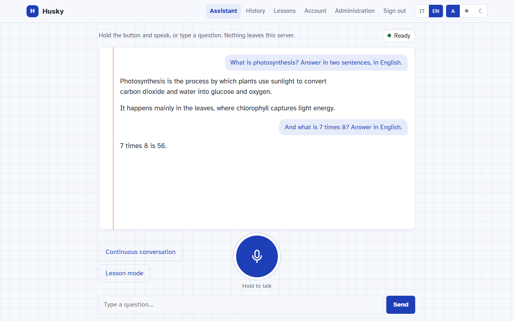
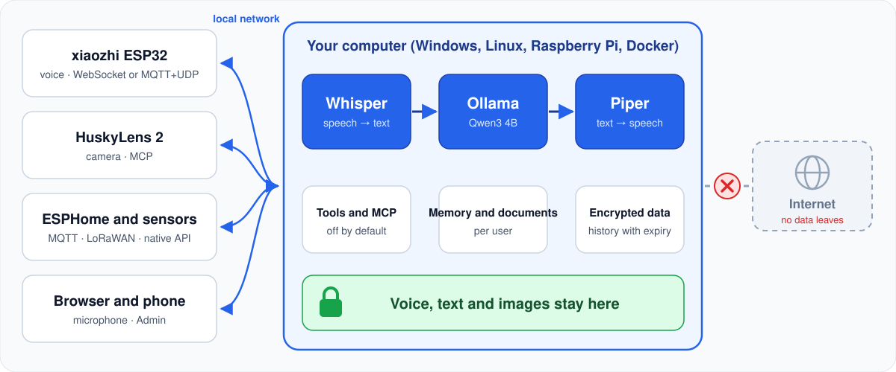
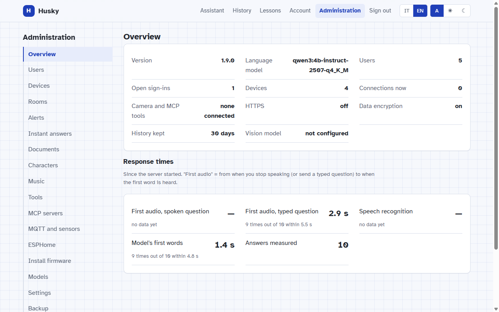
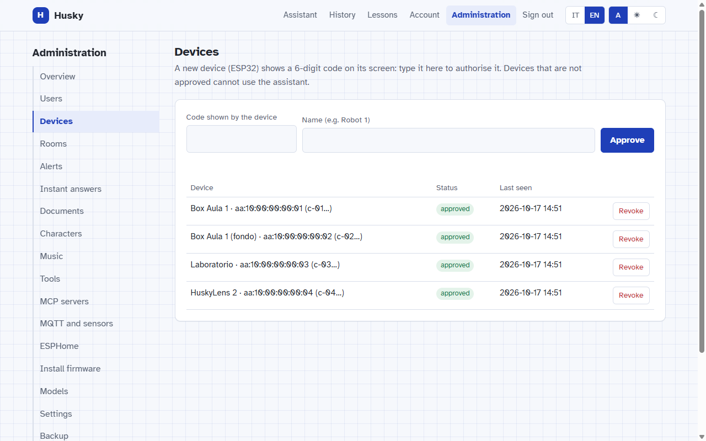
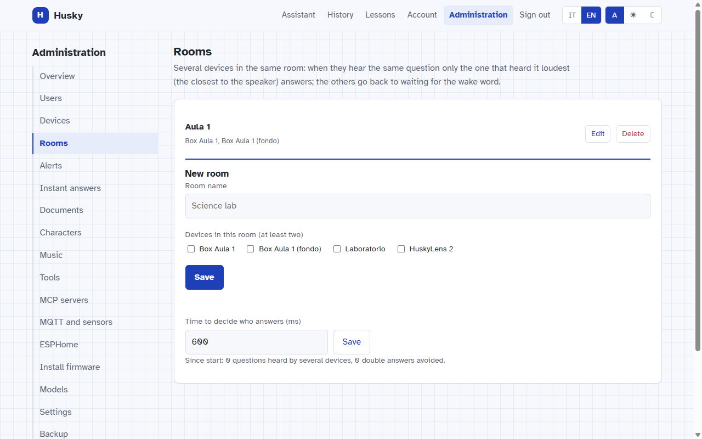
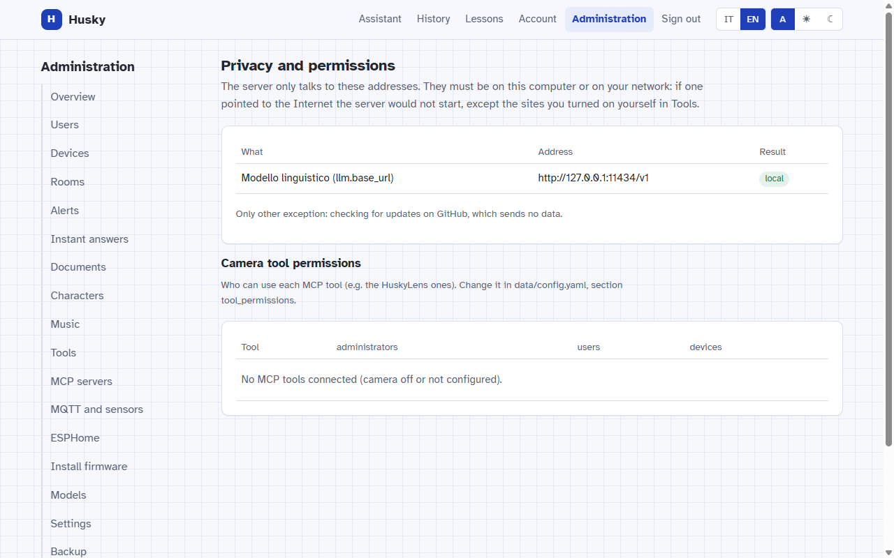
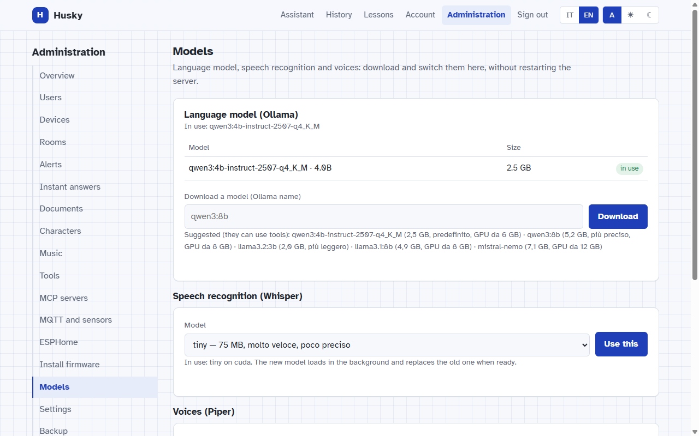

<p align="center">
  
</p>

<p align="center">
  <a href="https://github.com/BitJacker/xiaozhi-local-server/releases/latest"></a>
  <a href="https://github.com/BitJacker/xiaozhi-local-server/actions/workflows/verifica.yml"></a>
  <a href="../LICENSE"></a>
  
  
</p>

<p align="center">
  🇮🇹 <a href="../README.md">Italiano</a> · 🇬🇧 English
  &nbsp;|&nbsp; 📖 <a href="GUIDE.en.md">Full guide</a>
  &nbsp;|&nbsp; 🔒 <a href="PRIVACY.en.md">Privacy</a>
  &nbsp;|&nbsp; 🧩 <a href="ARCHITECTURE.md">Architecture</a>
  &nbsp;|&nbsp; 🔄 <a href="../CHANGELOG.md">Changelog</a>
</p>

**Husky local** replaces the `xiaozhi.me` cloud for [xiaozhi (ESP32)](https://github.com/78/xiaozhi-esp32) voice devices
and the **HuskyLens 2** camera. It understands speech, answers, uses tools and sensors: **all on your own computer**.

<p align="center">
  
</p>

## How it works

<p align="center">
  
</p>

## What it does

| | | |
|:---:|:---:|:---:|
| 🎙️ **Local voice**<br><sub>Whisper, Ollama, Piper: speech starts with the first sentence</sub> | 📷 **HuskyLens 2**<br><sub>"what do you see?", learns faces and objects (MCP)</sub> | 🔌 **ESP32, ESPHome, MQTT, LoRaWAN**<br><sub>sensors and lights by voice</sub> |
| 🧰 **Tools and MCP servers**<br><sub>created from Admin, off by default</sub> | 📚 **For the classroom**<br><sub>teacher documents, lesson transcripts, memory, characters</sub> | 🏫 **Several devices per room**<br><sub>only the closest one answers</sub> |
| 🗣️ **Voiceprint**<br><sub>knows who is speaking, only with consent</sub> | 🎵 **Music and audio**<br><sub>from a folder on the server</sub> | 🔐 **Accounts, 2FA, encrypted data**<br><sub>history kept 30/60/90 days or forever</sub> |
| 📊 **Prometheus and Grafana**<br><sub>timings and load, numbers only</sub> | 💾 **Encrypted backup**<br><sub>daily, restore with one command</sub> | ⬆️ **One-click updates**<br><sub>rolls back by itself if something fails</sub> |

## The Admin page

<table>
  <tr>
    <td width="50%"><br><sub><b>Overview</b>: server status and response times</sub></td>
    <td width="50%"><br><sub><b>Devices</b>: approved with a 6-digit code</sub></td>
  </tr>
  <tr>
    <td><br><sub><b>Rooms</b>: only one device answers per room</sub></td>
    <td><br><sub><b>Privacy</b>: every address the server contacts</sub></td>
  </tr>
  <tr>
    <td><br><sub><b>Models</b>: download and switch without restarting</sub></td>
    <td><br><sub><b>Light and dark theme</b>, Italian and English</sub></td>
  </tr>
</table>

## Get started in 3 steps

**1. Install** (once; downloads the models, about 8 GB)

```bash
git clone https://github.com/BitJacker/xiaozhi-local-server.git && cd xiaozhi-local-server
./install.sh                                         # Linux and Raspberry Pi
```

```powershell
powershell -ExecutionPolicy Bypass -File install.ps1   # Windows
```

<details>
<summary>🐳 With Docker or Kubernetes</summary>

```bash
docker compose up -d                                   # NVIDIA GPU: add -f docker-compose.gpu.yml
kubectl apply -k k8s/
```

Details in the [guide](GUIDE.en.md#management-settings-metrics-backup-docker-and-kubernetes).
</details>

**2. Start**: `./start.sh` or `avvia.bat`, then open **http://localhost:8000**
(first sign-in `admin` / `Passw0rd!`: you must change the password straight away).

**3. Connect the devices**: on the ESP32 set the OTA address `http://PC-IP:8000/xiaozhi/ota/` and approve the code it
shows in **Admin → Devices**.

## Why local

| | ☁️ xiaozhi.me | 🏠 Husky local |
|---|:---:|:---:|
| Where your voice goes | third-party servers | **your computer** |
| Account needed | phone + SMS | **none** (local users) |
| Works without Internet | ❌ | ✅ |
| You choose the models | ❌ | ✅ |
| Open, auditable code | ❌ | ✅ GPL-3.0 |

<details>
<summary>📈 How many devices it handles</summary>

Measured with the real model (Qwen3 4B, GTX 1060 6 GB), students asking **all at the same moment**:

| People at once | 1 | 5 | 10 | 20 | 30 |
|---|:---:|:---:|:---:|:---:|:---:|
| Answer (median) | 1.8 s | 6.1 s | 11.5 s | 21 s | 27 s |
| Everyone answered | ✅ | ✅ | ✅ | ✅ | ✅ |

Try it yourself with `tests/load_test.py`. Details in the [guide](GUIDE.en.md#measured-results).
</details>

## Documentation

📖 [Full guide](GUIDE.en.md): installation, devices, HTTPS, accounts, MQTT, ESPHome, tools, tests

🔒 [Privacy](PRIVACY.en.md) · 🛡️ [Security](SECURITY.md) · 🧩 [Architecture](ARCHITECTURE.md) · 🔄 [Changelog](../CHANGELOG.md)

💬 Ideas, problems, requests: [open an issue](https://github.com/BitJacker/xiaozhi-local-server/issues) or
✉️ [giacomo.dev@icloud.com](mailto:giacomo.dev@icloud.com)

<sub>[GPL-3.0](../LICENSE) license. Not affiliated with xiaozhi.me or DFRobot.</sub>
